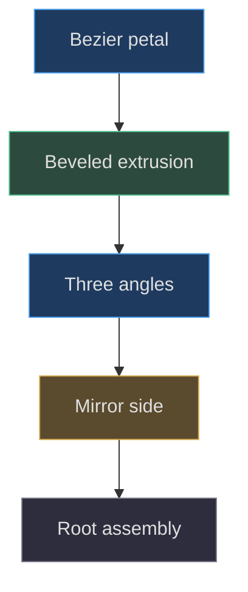
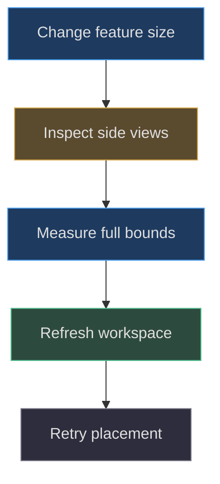

# Gills, tail and cute features

## Detail as silhouette, not unverified anatomy

**Implemented behavior.** The axolotl factory adds six pink gill petals,
four feet, twelve toes, two eyes, two cheeks, one smile tube, and layered
tail geometry around the head/body assembly. These are procedural
shapes, not scanned anatomy or imported reference-image meshes. Their names
describe a stylized lamp. Biological realism is outside the demonstrated
contract.
[Feature construction](https://github.com/Zanark/BowserBoy/blob/1e4ef518d6943ab1af39cef3b4d558f209a17891/src/axolotl-lamp.js#L33-L87)
(src/axolotl-lamp.js:33) makes the inventory auditable.

**Design interpretation.** Large side petals, short feet, small bead eyes,
and an upturned tail can make the silhouette readable at desk scale. Calling
that arrangement cute is interpretation, not a test result. The engineering
question is whether each detail survives projection, lighting, mirroring, and
collision-envelope measurement without becoming visually or numerically unstable.

## Author one gill petal, then mirror instances

The petal starts at `(0,0)` and uses two cubic Bézier curves. The first
reaches `(1.02,.19)` through `(.28,.34)` and `(.86,.53)`;
the second returns to origin through `(1.14,-.19)` and `(.45,-.34)`.
The geometry is extruded `.12`, with bevel size and thickness `.09`,
three bevel segments, and one depth step.

The factory shares that geometry among all gills. For each side, three meshes
are placed at `(side*1.43,1.48,.24)` and rotated around Z using angles
`side*[-.8,0,.8]`. Their X scale is `side`, so the negative side reflects the
local petal. Negative scale is not a request to reverse the authored control
points manually; doing both would double-reflect the shape.

The attachment point is the petal's local origin. Rotation therefore fans
the tip around its base, not around the center of the whole extruded shape.
This pivot ownership is what allows one shared shape to form three distinct
silhouette directions. Centering the geometry automatically would change the
fan even if all rotations remained identical.

Figure MD24.1. Shared petal topology becomes a bilateral fan through base-pivot rotations and one X reflection per side.

## Derive a petal's transformed reach

For a local planar point `(u,v)`, X reflection produces `(s*u,v)`,
where `s` is the side sign. A Z rotation by `s*a` then mixes the horizontal
and vertical coordinates. Add the mesh translation only after applying those
local operations. This derivation explains why a petal's maximum world X is
not simply `1.43+1.14`: its rotation changes which point is extremal, and
bevel geometry adds reach beyond the original planar outline.

The actual Three.js object matrix also includes the scene root's `.3`-radian
yaw. A desk-facing screenshot cannot by itself recover the unrotated gill
dimensions. For reproduction, inspect local geometry and mesh transforms
separately, then compute the assembled world box. Avoid reporting a single
hand-estimated width as a verified final envelope.

**Researched guidance.** Current
[BufferGeometry documentation](https://threejs.org/docs/pages/BufferGeometry.html)
explains that geometry bounds must reflect changed positions. Here geometry
is fixed after construction, but a proposed deforming petal would need both
normal and bounds maintenance. Merely changing the object's rotation uses
a different transform responsibility.

## Bead eyes and cheeks follow a curved normal

Eyes use the shared unit sphere at `x=±.79`, `y=1.55` with scale
`(.115,.145,.07)`. Cheeks use `x=±1.05`, `y=1.24` and scale
`(.19,.085,.045)`. Their centers come from the positive-Z ellipsoid function,
and their quaternions align local positive Z to a normalized ellipsoid-gradient
vector. See
[facial feature attachment](https://github.com/Zanark/BowserBoy/blob/1e4ef518d6943ab1af39cef3b4d558f209a17891/src/axolotl-lamp.js#L46-L55)
(src/axolotl-lamp.js:46).

The interpretation is a thin colored oval riding the head, not an eye embedded
in a flat plane. Near the side, orientation matters as much as depth: an
unrotated flat cheek would increasingly cut across the head curvature.
The code's formula uses the offset center when computing its gradient-like
direction; reproduce that detail before proposing a more exact normal-offset
construction.

Pear offers a contrasting strategy: broad expression patches are subdivided
and projected vertex by vertex, whereas these axolotl features remain transformed
solids (src/pear-boy.js:90). The distinction matters when adapting a large
flat marking to this smaller head. Enlarging an oval without revisiting
curvature can reveal intersections absent at the original scale.

## Feet and toes communicate support

For each side, feet are placed at Z `-.65` and `-2.45`, giving four feet.
Their centers are `(side*1.08,.3,z)` with scale `(.34,.3,.46)`, and
their Y rotation is `side*-.2`. Each foot receives three separate toe
meshes at X offsets `-.17`, `0`, `.17`, center Y `.12`, and forward
offset Z `.37`. Each toe scale is `(.105,.12,.17)`.

The foot's Y minimum is zero, and so is the toe's, from center minus vertical
radius. Those authored support heights help explain why a root Y of zero
places the lamp on the tabletop. They do not prove all extruded tail and gill
vertices remain above it; inspect the complete assembled bounds for that.

Toes are direct root children, not foot children. Rotating a foot therefore
does not rotate its toes. This is an important ownership fact for a proposed
walking animation: the pinned model is static, and anatomical-looking naming
does not create a joint hierarchy automatically.

## MD24-W01 Construct the raised tail in the correct plane

Begin with the cream fin outline. It starts at the origin, curves toward
`(1.55,1.65)`, and returns through a second contour to close. Extrude it
`.12`, with `.09` bevel size and thickness and three bevel segments.
Place the mesh at `(0,.55,-2.72)` and rotate around Y by `pi/2`.
The original XY outline now reads as a vertical tail extending along the
body's depth direction rather than as a side-facing sign.

Next build the separate pink tip outline using its own Bézier coordinates.
Its extrusion depth is `.4`, bevel size and thickness `.035`, again with
three bevel segments. Apply the same position and Y rotation, then call
`translateZ(-.14)`. That last operation is local-axis translation after
rotation, not a subtraction from world Z. It aligns the thicker pink layer
across the cream fin's thickness direction.

For an observable reproduction, compare the two tail meshes' world matrices,
not only their `.position.z` values. Transform the local unit Z direction
through each quaternion to see where the offset acts. The exact sequence is
visible in
[tail construction](https://github.com/Zanark/BowserBoy/blob/1e4ef518d6943ab1af39cef3b4d558f209a17891/src/axolotl-lamp.js#L69-L87)
(src/axolotl-lamp.js:69).

## The smile is a sampled tube

The smile uses six XY control points, projected to the head with offset `.045`.
Their heights undulate from `1.31` through `1.2`, `1.23`, `1.2`,
`1.23`, and `1.34`. A Catmull–Rom curve connects them, and
`TubeGeometry` uses 32 longitudinal divisions, radius `.024`, six radial
divisions, and an open path. It is neither a filled mouth patch nor a texture.

The small radius keeps the line modest relative to the head, but it creates
a sampling tradeoff at distant camera scales: a physically present line can
project to less than a pixel. Increasing emission will not necessarily restore
black-line readability. A proposed thicker smile should be evaluated for both
projected size and shell clearance, not just assigned a larger radius.
Current
[Raycaster documentation](https://threejs.org/docs/pages/Raycaster.html)
helps distinguish a geometrically hittable tube from perceptually legible
pixels; neither property automatically proves the other.

## MD24-R01 Retry with longer gills and a closer camera

**Proposed extension.** Scale each gill's local X magnitude by `1.2` while
preserving side sign and base pivot. The changed condition increases silhouette
reach and may crowd nearby consoles. Recompute the full rotated model envelope;
do not retain motion bounds measured before the edit.

Then move to a closer, three-quarter diagnostic camera. Inspect both front
and back faces, because the extruded thickness and mirrored transforms can
look acceptable from the front while exposing an awkward seam behind.
The parent-produced atlas views are appropriate for this diagnostic comparison,
but they are neutral-studio views, not proof of room light or animation.
No new screenshots are implied by this recipe.

If enlarged gills collide with another desk model during drag, compare the
scene's stored `axolotlMotion.bounds` with the newly measured assembly.
The controller integrates one rigid upright root
(src/pear-motion.js:5); it does not fold the gills away. The placement helper
uses the provided envelope and cannot discover omitted geometry by itself
(src/desk-clearance.js:3).

Figure MD24.2. A decorative silhouette edit becomes a movement-envelope edit once the feature extends beyond the old assembly.

## Integration, history, and material tradeoffs

The scene tags and picks the actual companion meshes, applies yaw before
measuring bounds, and keeps the emitter under the same root
(src/scene.js:130). Thus details are not merely display ornaments: their
geometry contributes to the measured footprint. The cream and pink materials
share roughness but not emission color or strength. Current
[MeshStandardMaterial guidance](https://threejs.org/docs/pages/MeshStandardMaterial.html)
describes that distinction; the chosen values remain pinned source facts.

**Documented history.** The axolotl task record describes a contact-sheet
review that found overly dark wine-colored gills and a correction to pink
material/emission. That is evidence of a recorded visual iteration, not
permission to claim all future lighting conditions look correct. The same
record explicitly separates local technical qualification from owner acceptance.
The later movable-lamp record supersedes fixed placement without adding
gill animation or a facial state machine.
See the recorded color correction
(TODO/110_SMALL_AXOLOTL_LAMP.todo:54) and movement supersession
(TODO/111_MOVABLE_AXOLOTL.todo:40).

## Count details without confusing count and quality

The browser geometry fixture checks six gill petals, four feet, and an
axolotl-to-Pear height ratio below `.4`, alongside initial nonoverlap and a
real mesh pick. These are useful assembly assertions: a missing mirrored
loop or an accidentally doubled root scale becomes detectable without relying
on subjective description. They do not prove twelve toes have ideal spacing
or that the smile remains readable at every camera distance
(tests/browser/dock.spec.mjs:662).

For a proposed feature revision, retain those inventory checks and add a
specific observation for the changed condition. Lengthening gills calls for
an envelope check; thickening a smile calls for surface clearance and visible
line-width comparison; reparenting toes calls for transform tests. A generic
“model exists” assertion is too weak to distinguish these failure modes.

The contrast with Pear is instructive. Pear's six freckles are checked as
foremost ray hits across expression and gaze states, because animated facial
neighbors can occlude them. Axolotl has no corresponding expression state
machine, so copying that entire test grid would not automatically add value.
Instead, choose observations that match its actual static geometry and
shared-root movement. This avoids documenting imaginary animation simply
to make two companions appear symmetrical in the handbook.

## MD24-Q01 Find a misleading pivot assumption

A developer rotates the front foot and expects its three toes to rotate with
it. Nothing happens to the toes, although the foot mesh visibly turns.
Should the repair change toe geometry, the light intensity, or transform
ownership?

## MD24-A01 Build the hierarchy the animation actually needs

Change ownership if articulation is the goal. The implemented toes are root
children, so foot rotation cannot affect them. A proposed animated foot would
need a group with an explicit pivot, reparented foot and toe meshes, and
coordinates converted to that group's local space without changing the
neutral appearance.

The failure boundary is not only the joint transform. Reparenting changes
how bounds and picking traverse the assembly, and animated toes can change
the silhouette without root motion. Add envelope invalidation and tests for
the new hierarchy. Until that work exists, document the pinned model honestly
as a static stylized assembly moved as one companion.
