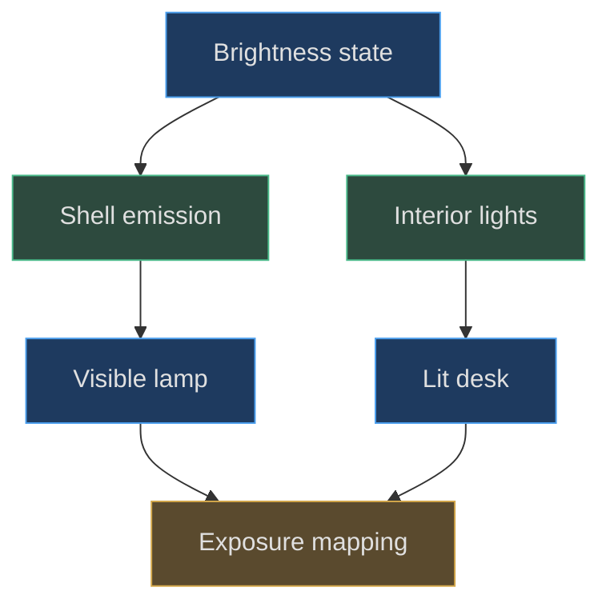
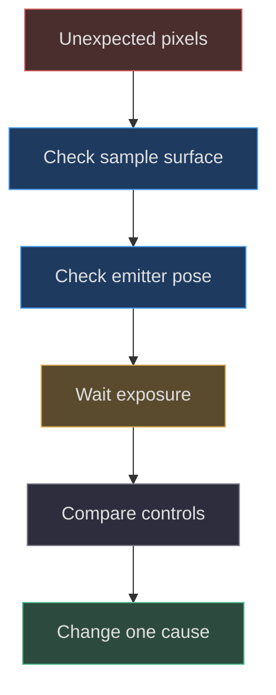

# Companion light emission and material tuning

## Two different meanings of luminous

**Implemented behavior.** Both companions combine emissive mesh materials with
point lights. Emission makes their surfaces appear luminous; point emitters
illuminate surrounding geometry. The factories do not configure a physically
transmitting silicone volume. Treating the emissive material as if it alone
casts the warm desk pool would misdescribe the actual rendering architecture.
Pear's setup appears in
[material creation](https://github.com/Zanark/BowserBoy/blob/1e4ef518d6943ab1af39cef3b4d558f209a17891/src/pear-boy.js#L8-L26)
(src/pear-boy.js:8), and axolotl's in
[two material families](https://github.com/Zanark/BowserBoy/blob/1e4ef518d6943ab1af39cef3b4d558f209a17891/src/axolotl-lamp.js#L6-L13)
(src/axolotl-lamp.js:6).

**Researched guidance.** Current
[MeshStandardMaterial documentation](https://threejs.org/docs/pages/MeshStandardMaterial.html),
consulted on 2026-11-07, describes emissive color, intensity, and maps as
separate factors. It also distinguishes roughness from emission. These general
definitions help reason about the model, but pinned source remains the
authority for its actual values and controls.

## Reconstruct Pear's surface emission

Pear's diffusion map is a `16×256` procedural canvas. A vertical gradient
uses `#b8b8b8` at zero, white at `.65`, and `#d6d6d6` at one.
The standard material uses cream `#fff3d4`, roughness `.65`, emissive
`#ffe4a0`, the gradient map, and factory intensity `77`.
That gradient modulates a generated lathe surface; it is not a photographed
silicone texture.

The shared `canvasTexture` helper creates the canvas, throws if no 2D context
exists, paints it, sets `SRGBColorSpace`, and assigns anisotropy four.
[Texture helper](https://github.com/Zanark/BowserBoy/blob/1e4ef518d6943ab1af39cef3b4d558f209a17891/src/handheld.js#L68-L79)
(src/handheld.js:68) therefore belongs to the material evidence chain.
An offscreen numerical factory recreation that bypasses this helper may
reconstruct shape but not the same color pipeline.

Four point lights form a rectangular distribution at X `±1.1`, Y `4.4`,
and Z `±1`. Each factory light has warm color `#ffd9a8`, intensity `560`,
distance `70`, and decay `2`. The shell does not cast shadows, explicitly
avoiding self-blocking by the opaque shell representation
(src/pear-boy.js:325). This is an appearance approximation, not simulated
light transport through silicone.

Figure MD25.1. Surface glow and received illumination are independently generated, then jointly affected by scene exposure.

## Factory values versus scene-controlled values

The scene starts Pear on at brightness `.7`. `updatePearLight` assigns each
emitter `800*b` and shell emission `110*b` when on. At `.7` these reproduce
the factory values `560` and `77`. Power off hides the point lights and
sets shell emission to zero. Brightness accepts finite values from `.1`
through one and does not inherently enable power.

Axolotl starts on at `.5`. The scene assigns point intensity `260*b`,
cream emission `90*b`, and pink emission `48*b`. At `.5` these become
`130`, `45`, and `24`, again matching factory defaults. Its brightness
setter accepts only `.5` or one, not an arbitrary continuous slider.
Power off sets all three intensities to zero; its light need not be hidden
to stop contributing.
[Control mapping](https://github.com/Zanark/BowserBoy/blob/1e4ef518d6943ab1af39cef3b4d558f209a17891/src/scene.js#L563-L603)
(src/scene.js:563) is more precise than saying both lamps share identical
brightness behavior.

## Axolotl's internal emitter and readable face

The axolotl emitter is at `(0,.65,-.5)` beneath the head region inside
the assembled body, with color `#ffd29e`, factory intensity `130`,
distance `24`, and decay `2`. Its cream and pink materials have roughness
`.72` but different base and emissive colors. Black eyes and smile remain
basic-material markings rather than luminous parts.
[Emitter placement](https://github.com/Zanark/BowserBoy/blob/1e4ef518d6943ab1af39cef3b4d558f209a17891/src/axolotl-lamp.js#L86-L90)
is a critical geometric parameter, not merely a lighting metadata detail.

**Documented history.** `TODO/110_SMALL_AXOLOTL_LAMP.todo` records that an
initial exposed emitter near the face saturated both brightness levels.
Moving it inside the body allowed the unchanged stronger rendered-pixel
assertion to distinguish them. The record also describes correcting overly
dark gill colors. Those are reported iteration outcomes, not recovered
internal reasoning or evidence of fresh aesthetic approval.
The source record preserves both the failed probe and the stronger unchanged
pixel assertion (TODO/110_SMALL_AXOLOTL_LAMP.todo:50).

The lesson is not to memorize one magical intensity. A point light very
close to a visible surface can dominate the local result. Moving it can
improve readability while retaining an actual desk pool. Merely lowering
emission would change a different contribution.

## MD25-W01 Derive the two axolotl brightness states

At Sleep `.5`, compute emitter `260*.5=130`, cream `90*.5=45`,
and pink `48*.5=24`. At Bright one, these become `260`, `90`, and `48`.
All three double, but the final displayed RGB values need not double:
lighting, material response, exposure, and tone mapping intervene.
This distinction explains why a property-value assertion is insufficient
for visible brightness.

For an observable reproduction, follow the browser fixture: turn off tripod,
room, and Pear; select each axolotl level through controls; wait for its
state, settled exposure near `.018`, and completed pending paint work.
Sample the same `12×12` patch around the projected head target and compare
mean RGB. The existing assertion requires Bright to exceed Sleep by more
than five mean channel units. See
[actual shell photometry](https://github.com/Zanark/BowserBoy/blob/1e4ef518d6943ab1af39cef3b4d558f209a17891/tests/browser/dock.spec.mjs#L708-L742).

Keep the sample camera and location fixed. A changed sample that lands on
a black eye or background is not a valid brightness comparison. Read the
bitmap into the canvas before closing it, and normalize by retained canvas
dimensions. The historical record notes that premature dimension handling
first produced an invalid probe before the real saturation problem was found.

## Exposure makes all-off a separate condition

The scene targets exposure `.018` if any tripod, room, Pear, or axolotl
light is on; otherwise it targets `.45`. Damping uses rate four and current
delta, with an explicit convergence threshold. See
[exposure adaptation](https://github.com/Zanark/BowserBoy/blob/1e4ef518d6943ab1af39cef3b4d558f209a17891/src/scene.js#L1222-L1226)
(src/scene.js:1222).

Consequently toggling the last companion off changes more than its own
emission. A before/after image taken during exposure adaptation can make
the dark state unexpectedly bright elsewhere. Tests must wait for the intended
condition rather than treating an immediate screenshot as a settled optical
measurement.

Pear's light test samples near and farther desk locations, requires a red
increase greater than blue increase, and checks meaningful illumination
beyond the lamp's feet. That is evidence for warm received light, distinct
from the axolotl shell-brightness test
(tests/browser/pear-boy.spec.mjs:65). Neither test establishes a calibrated
lux value or physical bulb efficiency.

## MD25-R01 Retry after moving the lamp

Change conditions by relocating Pear while keeping its brightness constant.
The lights are children of its root, so their world positions change with
it. A desk sample that was bright can become dim even though all intensity
properties are unchanged. First record emitter world positions and confirm
the sample still hits the intended desk surface.

Then isolate two questions. To test production movement, let body and lights
move together. To reproduce a historical fixed-light material comparison,
explicitly hold the historical emitter positions while keeping legal body
clearance. Label the latter as a controlled diagnostic, not native behavior.
The verification ledger records exactly this distinction when clearance moved
Pear and altered a DS deck color measurement
(docs/VERIFICATION.md:462).

Do not “fix” that comparison by weakening RGB thresholds or pretending the
lamp's local coordinates determine received light independently of layout.
Root motion comes from the motion controller
(src/pear-motion.js:36), and layout can also move it before painting
(src/desk-clearance.js:3). These geometric sources belong in a lighting
diagnosis because they change emitter-to-surface relationships.

Figure MD25.2. Diagnose geometry, exposure, and state before modifying materials; a lighting mismatch can originate in layout rather than color.

## Material and performance tradeoffs

**Proposed extension.** A transmissive material might produce a different
silicone impression, but it would introduce thickness, environment, sorting,
and performance questions not answered by the present setup. It must not be
documented as an already implemented quality upgrade. Similarly, replacing
four Pear point lights with one would alter the spatial distribution even
if total nominal intensity stayed similar.

Current
[MeshStandardMaterial documentation](https://threejs.org/docs/pages/MeshStandardMaterial.html)
clarifies that a displacement map or edited vertices affect shape differently
from normal or roughness adjustments. Here no displacement-driven silicone
surface is authored. The useful diagnostic sequence is silhouette first,
material response second, actual received light third, and exposure last
as an explicitly controlled presentation variable.

**Design interpretation.** High roughness and broad warm output may suggest
soft diffusion. That remains an appearance interpretation. It does not justify
using “physically accurate silicone” as a factual claim, especially when
self-shadow suppression and multiple interior emitters are deliberate
approximations.

## Design a bounded optical comparison

Use paired measurements rather than a single impressive image. For Pear,
hold camera, desk sample, exposure condition, and root pose fixed while
switching its power. Compare the red-channel change with the blue-channel
change to test warm contribution, and retain a farther sample to avoid
qualifying only a tiny bright hotspot. The existing near/far test explicitly
requires both effects rather than reading a light's color property
(tests/browser/pear-boy.spec.mjs:65).

For axolotl, compare the same head patch at Sleep and Bright with other
lights disabled. Then switch power off and check all three numeric
contributions become zero. Selecting Sleep while off must leave power off.
Finally wait for all-off exposure to approach `.45`. These observations
test different layers: control semantics, surface response, and adaptation.
Combining them into one broad screenshot assertion would make a failure
harder to diagnose.

The scene marks reflections dirty when companion lighting changes. That
does not mean a reflection capture happens immediately during every held
movement. The render path waits for suitable settled conditions before
updating DS reflections (src/scene.js:1375). A stale reflection during a
drag is therefore a different question from whether the moved lamp's direct
light follows its root. Keep those claims separate in both tests and captions.

## Avoid misleading brightness units

The point-light constructor includes intensity, distance, and decay parameters,
but this chapter does not infer a real bulb wattage from them. The displayed
result includes exposure values far from a generic default and intentionally
strong mesh emission. Without a calibrated scene, physical camera model, and
measurement convention, reporting a consumer-lamp lumen equivalence would be
invented precision.

A proposed tuning session should record model pose, camera pose, enabled
lights, brightness state, exposure convergence, and the sampled surface.
Those are reproducibility inputs, not private conversation memory. Another
agent can repeat the comparison from those conditions even if it does not
share the original author's aesthetic judgment. The interpretation “soft
warm silicone” should remain clearly labeled as a visual aim, while exact
colors, offsets, roughness, and intensity mappings remain source-backed facts.

When an edit improves the face but weakens the desk pool, do not report
unqualified improvement. State which observation improved and which changed
adversely. Emission, internal emitter location, and brightness mapping are
independent controls with coupled appearance; a responsible tradeoff preserves
that causal structure instead of collapsing it into one saturation slider.

## MD25-Q01 Explain indistinguishable brightness screenshots

Both brightness buttons correctly double the three axolotl intensities, yet
the sampled face is nearly identical. What should be checked before declaring
the control broken? Why is a metadata-only test inadequate?

## MD25-A01 Test the displayed response and its causes

Check saturation, emitter proximity to the face, sample location, other enabled
lights, and exposure convergence. If the face is already clipped, doubling
linear contributions can leave displayed pixels almost unchanged. Metadata
proves that a setter executed, not that the intended appearance survived the
render pipeline.

The existing stronger boundary is an actual shell-pixel difference with
other lights isolated and settled exposure. Preserve that assertion while
changing one causal parameter at a time. Conversely, if only a neutral-studio
atlas is available, report its geometry diagnostic value and leave native-room
photometry unverified. No atlas caption should imply the movement or
brightness sequence was captured.
