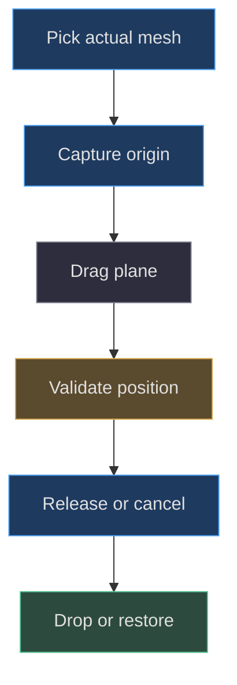
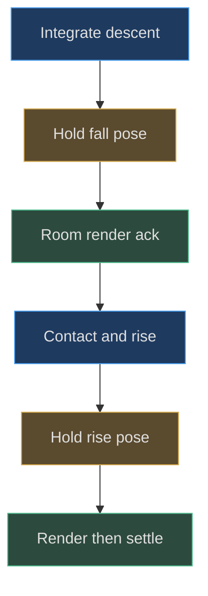

# Dragging, gravity and dropping

## One root controller, two companion assemblies

**Implemented behavior.** Pear uses `PearMotion`, a configured subclass of
`DeskMotion`; axolotl uses `DeskMotion` with bounds measured from its rotated
assembly. Both share companion gesture handling in the scene. The controller
stores a reference to the root position, velocity, previous position, fixed-step
accumulator, held/sleep state, and optional presentation state. It does not
simulate angular momentum or soft-body deformation.
[Controller state](https://github.com/Zanark/BowserBoy/blob/1e4ef518d6943ab1af39cef3b4d558f209a17891/src/pear-motion.js#L5-L33)
(src/pear-motion.js:5) is the authoritative model.

This separation is reusable: model factories build geometry and local parts;
the scene interprets input; the controller advances upright translation.
Pear's rope and face systems respond to body movement afterward. Axolotl's
static feet, gills, and emitter simply follow its root
(src/axolotl-lamp.js:3). Similar interaction does not imply identical anatomy
or animation.

## Construct a camera-plane drag

`beginCompanionMove` switches toward table mode, saves the pickup origin,
and creates a plane whose normal is the camera's world direction. The plane
passes through the actual hit point, or a bounds-center fallback. Intersecting
the pointer ray with that plane gives a 3D drag point. The saved offset from
that point to the root prevents the object center from snapping under the
pointer.

Pointer movement must exceed four screen pixels before the gesture counts
as moved. A short click can therefore remain a power toggle; a drag releases
into physics without toggling. Pointer capture keeps ownership when the
pointer leaves the canvas. Cancellation, lost capture, blur, and related reset
paths restore the saved pickup origin rather than inventing a new home.
[Gesture setup](https://github.com/Zanark/BowserBoy/blob/1e4ef518d6943ab1af39cef3b4d558f209a17891/src/scene.js#L611-L632)
(src/scene.js:611) and
[completion](https://github.com/Zanark/BowserBoy/blob/1e4ef518d6943ab1af39cef3b4d558f209a17891/src/scene.js#L741-L766)
show these responsibilities.

Wheel input adds camera-direction depth using clamped `deltaY*.015`,
bounded to `[-2,2]` model units per event. The drag plane is translated by
the accepted root displacement, preserving subsequent pointer continuity.
Keyboard arrows and Page Up/Down use `.65`-unit world-axis steps, and clear
velocity after each deliberate placement.

Figure MD26.1. Input owns a bounded translation transaction; release and cancellation intentionally take different state paths.

## Derive release velocity without unbounded throws

`moveTo` estimates seconds from the previous movement timestamp, clamped
between `.008` and `.1`. After the first sample, velocity is displacement
divided by that duration, then clamped to total length 22. The clamp limits
three-dimensional speed, not each component independently. The first movement
has no previous finite timestamp and does not create an arbitrary throw.

`drop` clears held state, impact report, and accumulator. If more than
100 milliseconds passed since the last movement, velocity becomes zero.
This makes holding still before release produce a fall rather than preserve
a stale throw. `pickUp` and `reset` also remove old velocity and pending
presentation. These details explain why keyboard placement explicitly zeroes
velocity rather than depending on the user's key-repeat timing.
[Move and drop](https://github.com/Zanark/BowserBoy/blob/1e4ef518d6943ab1af39cef3b4d558f209a17891/src/pear-motion.js#L35-L53)
are the reproducible rules.

## Fixed-step gravity and contact response

Each physics step is `1/120` second. Velocity Y decreases by `45*h`;
horizontal velocities multiply by `.998`; position advances by `velocity*h`.
The method accepts at most five seconds from one callback and processes at
most 600 steps in one update. It does not integrate an arbitrarily large
unbounded suspension.

At the workspace floor, root Y clamps to its minimum. Incoming downward speed
is reported as impact speed. If its magnitude exceeds `1.2`, vertical velocity
rebounds at `.23` of that magnitude; otherwise it becomes zero. Supported
horizontal motion is additionally damped by `.85`. Total speed squared below
`.0025` allows sleep and clears accumulated time.

Obstacle collision expands each box horizontally by the moving model's
offset bounds. Previous vertical position distinguishes landing from hitting
an underside. If neither applies, the controller chooses the nearest horizontal
side. These are box-based contacts, not continuous triangle collision or a
general guarantee against tunneling at arbitrary speeds and obstacle thicknesses.
The implemented bounded speed and step size define the useful regime.

## MD26-W01 Derive the first drop and rebound

Start Pear at height ten with zero release velocity and no obstacles.
After one step, `vy=-45/120=-.375`, and the height decreases by
`.375/120=.003125`. This immediate change is small but physical; a snap
straight to zero would violate the implementation.

Ignoring discrete-step error and damping of horizontal components, the
continuous reference gives impact speed `sqrt(2*45*10)=30`.
The `.23` rebound suggests initial upward speed near `6.9` and a free
rebound height near `6.9²/(2*45)=.529`. These are explanatory estimates,
not exact expected floating-point values: collision is detected at fixed
steps and the controller may clamp to supports.

For observable reproduction, use the unit test's raised position, call
`pickUp`, move to height ten, and drop after the stale-velocity threshold.
Assert that an early update remains between nine and ten, later updates
contain positive vertical velocity, height never goes negative, and the final
velocity is zero. See
[fall and contact tests](https://github.com/Zanark/BowserBoy/blob/1e4ef518d6943ab1af39cef3b4d558f209a17891/tests/unit/pear-motion.test.mjs#L24-L63).
This establishes trajectory, not yet visible presentation.

## Physical integration is not a painted fall

**Documented history.** Commit
`120d9bd5a3e785d24a9bdc5e96d6e9b332613510` added paint-aware presentation.
The verification ledger records an earlier failure where 48 physics steps
covered fall and rebound without a main-room render. Correct final position
and animation-callback samples did not prove the user saw the fall
(docs/VERIFICATION.md:443).

With `requirePaint=true`, the controller first holds an actual descending
pose at or below halfway between release height and relevant support.
It preserves the remaining accumulator and refuses further integration while
presentation is pending. Main-room rendering acknowledges that pose, allowing
the controller to continue toward contact and a first upward pose.

During rebound, it chooses a rising threshold
`contactHeight+vy²/(4*45)`, halfway toward the ideal ballistic apex height.
The next pending pose is still an integrated rising state, not a fabricated
animation key. A second acknowledgment releases the remaining catch-up.
[Presentation logic](https://github.com/Zanark/BowserBoy/blob/1e4ef518d6943ab1af39cef3b4d558f209a17891/src/pear-motion.js#L116-L140)
explains why queued time and visible state must be managed together.

Figure MD26.2. Sparse updates retain actual descending and ascending poses until main-room submission acknowledges them.

## MD26-R01 Retry with a three-second callback

Change the callback interval from `1/120` to three seconds. First run without
paint requirements: the unit trajectory test expects equivalent integrated
contacts over the same bounded elapsed time. Then enable `requirePaint`.
The first long update should stop mid-fall; a further update should leave
position unchanged while adding queued time. Acknowledge paint, update with
zero new time, and observe a rising pose. Acknowledge again and allow sleep.

If the body remains frozen, inspect whether the main room render actually
occurred. Scene code acknowledges Pear, axolotl, and console motion only after
`renderer.render(scene,camera)`
(src/scene.js:1378). A reflection capture or dirty flag is not an equivalent
acknowledgment. If it snaps directly to rest, inspect whether release requested
paint-aware behavior or bypassed the normal finish path.

**Researched guidance.** MDN's
[requestAnimationFrame reference](https://developer.mozilla.org/en-US/docs/Web/API/Window/requestAnimationFrame)
documents variable refresh rates and paused background callbacks. It supports
the need for elapsed-time handling, but an animation callback is not evidence
of a completed GPU frame. Keep physics, render submission, and observed pixels
as separate evidence layers.

## Couple reactions and ropes without mixing authorities

Pear receives `frightened=true` while held or not sleeping. Downward support
impact speed can trigger anger at ten or above, followed by pout recovery.
Rope updates then follow the changed root. The shell's root remains upright;
there is no impact-driven body pitch. The actual hierarchy and face state
are in `createPearBoy` (src/pear-boy.js:235), and rope origin changes are
handled independently (src/pear-rope.js:48).

Scene clearance can still adjust horizontal placement before a paint. That
is why a sleeping controller is not enough to assert final saved console
coordinates. The browser console test explicitly waits for a settled table
paint before recording the moved position
(tests/browser/console-movement.spec.mjs:159). Geometry reconciliation belongs
to the placement solver (src/desk-clearance.js:3), not to a hidden movement
animation.

Actual axolotl drop assertions wrap the room renderer, requiring descending
and rising positive-height samples and no negative heights
(tests/browser/dock.spec.mjs:791). Pear's corresponding fixture additionally
checks the painted expression sequence. These are test definitions read for
this chapter, not fresh execution claims.

## Raised supports and offset origins

A root's floor is not necessarily the mesh's visible bottom. The generic
controller uses local bounds offsets to land on an obstacle: support root
height is `obstacle.max.y-bounds.min.y`. The unit fixture with local minimum
Y `-.5` lands at `8.5` on an eight-unit support, not at eight. The workspace
minimum is separately configured to `.5` for the table in that fixture.
This is why reusing a controller with a new model requires measuring origin
offsets rather than copying Pear's zero floor
(tests/unit/pear-motion.test.mjs:102).

For an underside hit, the correction uses obstacle minimum minus the moving
model's maximum bound. Side contact uses horizontally expanded intervals and
reflects the affected velocity component. A proposed nonupright companion
would need current-orientation or conservative rotational bounds; the existing
translational controller does not update a spinning collision shape for you
(src/pear-motion.js:91).

The paint-aware fall threshold also considers raised supports below release
height. Otherwise a halfway-to-table hold could lie inside a tall obstacle.
The raised-support unit case checks that the held descending pose remains
above the support, then verifies catching clears presentation and ordinary
integration can settle correctly. This is a concrete changed-condition test,
not a blanket claim that all stacked furniture is supported.

## Select instrumentation that cannot miss the event

Arm a release observer before dispatching pointerup. Starting a recorder only
after a later automation evaluation can miss a genuine short fall and falsely
blame physics. Conversely, sampling every animation callback can record
positions that were never submitted to the main room renderer. The Pear
fixture therefore records both progression and actual room-render samples,
and the axolotl fixture wraps the renderer for its descending/rising assertions
(tests/browser/pear-boy.spec.mjs:448; tests/browser/dock.spec.mjs:791).

These are complementary controls. An event-time recorder avoids an observation
race, while the render wrapper proves presentation was attempted. Neither
alone establishes physical monitor scanout, and neither authorizes relaxing
the existing no-penetration or expression-order assertions. If a test fails
under sparse software rendering, retain the failure evidence and inspect
whether time was discarded, presentation was bypassed, or the observer
started late.

The historical paint-aware correction changed the controller's presentation
contract while preserving gravity and rebound values. That is a more precise
lesson than “slow down the animation.” Another agent can reconstruct the
mechanism from fixed steps, pending poses, acknowledgments, and tests, without
claiming literal continuity with any prior agent's memory.

## MD26-Q01 Distinguish cancellation from resetting home

A companion is moved from a nondefault table location, lifted, then canceled.
Should it return to the original factory home, the last accepted held point,
or the position captured at pickup? What would reveal stale momentum?

## MD26-A01 Restore the transaction's origin

Cancellation restores the pickup origin. Factory reset is a separate operation
with occupancy checks; normal release drops from the last accepted point.
After cancellation, velocity and pending presentation must be cleared.
A subsequent update moving the canceled lamp would expose stale controller
state rather than a valid continuing throw.

The failure boundary is occupied or externally changed scene geometry.
Restoring an origin is not permission to hide overlapping objects; normal
pre-paint clearance still applies. Tests should separate cancellation identity,
collision reconciliation, and actual painted result instead of conflating
all three with a single “position changed” assertion.
