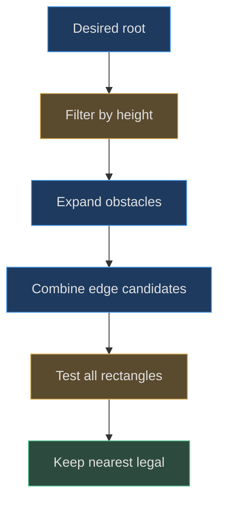
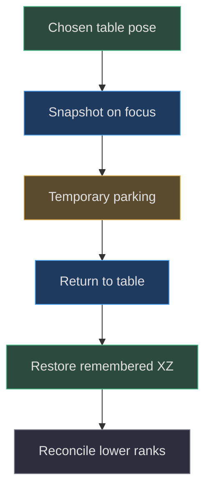

# Clearance, collision envelopes and home poses

## Why sleeping physics cannot resolve every overlap

**Implemented behavior.** `resolveDeskClearance` runs in the main paint path
after motion and geometry updates. It reconciles objects according to current
interaction mode before rendering. A stationary Pear can otherwise be intersected
by an incoming rotated console even though Pear's own physics is asleep.
Moving the objects apart is the actual repair; visibility tricks, render-order
changes, and disabled depth tests are not substitutes.
[Pre-paint integration](https://github.com/Zanark/BowserBoy/blob/1e4ef518d6943ab1af39cef3b4d558f209a17891/src/scene.js#L1367-L1383)
(src/scene.js:1367) establishes this sequencing.

The system has several kinds of remembered position: authored seed coordinates,
current root positions, saved console table poses, first legal console homes,
temporary focus parking, and companion table snapshots. Their names are not
interchangeable. This chapter treats layout as an explicit transaction with
geometric evidence rather than a collection of convenient coordinate constants.

## Choose envelopes for their actual responsibility

Pear's motion controller uses a simplified body box from `(-3,0,-3)` to
`(3,8.1,3)`. The factory also computes broader bounds and expands horizontal
reach to at least `±4.5`. For clearance, the scene starts with that broader
envelope and unions current child bounds, excluding the contact shadow.
The envelope therefore covers more than the instantaneous shell while still
accounting for current limbs.

The contact shadow is a `6.6×6.6` plane with transparent material and a
clipping plane. It is not a solid support object. Including it in an envelope
would make a presentation aid displace real models. The source explicitly
excludes it during Pear envelope assembly
[here](https://github.com/Zanark/BowserBoy/blob/1e4ef518d6943ab1af39cef3b4d558f209a17891/src/scene.js#L806-L811)
(src/scene.js:806).

Axolotl bounds are measured after its scene Y rotation `.3`, so the offset
AABB reflects the actual assembled orientation. Focused consoles can rotate
and hinge; current world bounds are therefore needed instead of a historical
unrotated width. A current AABB is still not an all-future rotational envelope.
Re-evaluation and invalidation make it useful at each eligible paint.

## Derive forbidden root rectangles

`nearestDeskPosition` receives local offset bounds, desired root position,
root workspace, obstacle boxes, and a default gap `.25`. It first rejects
desired heights outside workspace limits. Only obstacles with strict vertical
overlap contribute forbidden horizontal rectangles.

For obstacle X interval `[oMin,oMax]` and local moving bounds `[bMin,bMax]`,
the forbidden root interval is
`(oMin-bMax-gap,oMax-bMin+gap)`.
The same expansion applies in Z. This is a Minkowski-style reduction:
instead of translating an entire box through every candidate, test one root
point against expanded rectangles. The actual implementation is
[the complete solver](https://github.com/Zanark/BowserBoy/blob/1e4ef518d6943ab1af39cef3b4d558f209a17891/src/desk-clearance.js#L3-L34)
(src/desk-clearance.js:3).

Candidate X values are the clamped desired X and every clamped rectangle
edge; candidate Z values follow the same rule. Their Cartesian product includes
mixed corners formed by different obstacles. Testing only “left, right,
front, back” of one obstacle would miss the nearest legal corner in a crowded
layout.

Figure MD27.1. Expanded forbidden rectangles reduce box placement to a finite search over desired coordinates and obstacle edges.

## MD27-W01 Derive a two-obstacle corner

Use local bounds `[-.5,0,-.5]` to `[.5,1,.5]`, desired root
`(0,7,0)`, and workspace X/Z `[-2,2]`. The first obstacle extends
X `-2.25` to `.25` and Z `-4.25` to `4.25`; its right expanded
edge is `.25-(-.5)+.25=1`.
The second obstacle extends X `-4.25` to `4.25` and Z `-2.25`
to `.75`; its forward expanded edge is `.75-(-.5)+.25=1.5`.

The nearest legal combination is therefore `(1,7,1.5)`, with horizontal
distance `sqrt(1²+1.5²)=sqrt(3.25)`. Neither isolated single-axis correction
is sufficient because the other obstacle still blocks it. The unit test
also reverses obstacle order for this fixture and expects the same answer.
See
[corner regression](https://github.com/Zanark/BowserBoy/blob/1e4ef518d6943ab1af39cef3b4d558f209a17891/tests/unit/desk-clearance.test.mjs#L10-L22).

For reproduction, clone inputs before calling the solver and compare them
afterward. The result is a new vector; desired position, workspace, bounds,
and obstacle boxes must remain unchanged. Mutation would make later retry
results depend on whether a previous diagnostic had already run.

## Stable ranking and two different tolerances

Distance ranking uses squared horizontal distance. A candidate is rejected
when `squared>=bestDistance-1e-9`; thus numerically equivalent candidates
retain the earlier accepted choice. This `1e-9` is a ranking tolerance,
not a collision gap and not the vertical overlap tolerance.

Obstacle-interior classification uses
`8*Number.EPSILON*max(1,coordinate magnitudes)`. It accepts legal edges that
move a few representable values during world/local bounds reconstruction.
It does not replace the `.25` geometric gap with a broad collision allowance.
The negative test verifies that genuine `.01` penetration still moves clear.

**Documented history.** Commit
`6b5d2c552e6b3206bfb3ae36d845896773147a1c` added the scale-relative
interior allowance. The ledger records an inactive DS return changing X by
one ULP, from `11.314174109565958` to `11.31417410956596`
(docs/VERIFICATION.md:410). A strict edge classifier rejected the formerly
legal point after reconstruction. That evidence supports the bounded numerical
fix, not loosening exact-pose tests or claiming all software latency was solved.

## Mode priority and transactional placement

In focus, the active console is inserted as an immovable obstacle. The inactive
console is placed next, then Pear, then axolotl, then loose props. The active
camera-facing pose and hinge are not moved to accommodate lower-priority
objects. On the table, companion positions become obstacles first, loose
props attempt their anchors, and consoles yield afterward.

The resolver collects placements without immediately mutating roots. A failed
placement reports the blocked model and returns false. For equal-priority
table consoles, it first tries GBA then DS; if that ordering fails, it restores
the candidate arrays and tries DS then GBA. This is a bounded order retry,
not a global optimization over every permutation of every object.
[Priority and retry](https://github.com/Zanark/BowserBoy/blob/1e4ef518d6943ab1af39cef3b4d558f209a17891/src/scene.js#L820-L867)
(src/scene.js:820) provides the exact ordering.

On commit, moved roots update motion's previous position and clear horizontal
velocity. Elevated unheld objects can wake to fall. Pear limbs are reset
against the new origin. This prevents a layout correction from leaving stale
inertial state or detached rope geometry.

## Capture legal homes, not overlapping seeds

The scene initially copies console seed positions into home slots, but after
the first successful nonfocused clearance it replaces those homes with the
collision-free console table poses. This is guarded by
`initialDeskLayoutStored`. Resetting consoles later therefore targets a legal
initial layout rather than the old seeds that predated companion clearance.
[Home capture](https://github.com/Zanark/BowserBoy/blob/1e4ef518d6943ab1af39cef3b4d558f209a17891/src/scene.js#L868-L890)
(src/scene.js:868) is the important implementation point.

The wording “settled home” needs care: the guard records first successful
table reconciliation; it does not explicitly wait for a new independent
all-physics-sleep predicate. Preserve the exact contract instead of implying
a stronger settling algorithm. Companion reset homes remain authored constants,
with occupancy checks and explicit errors if another lamp blocks them.
They are not automatically replaced by this console-home mechanism.

## MD27-R01 Retry after focus parking and explicit movement

First choose a nondefault Pear table position and resolve table clearance.
Enter Play or Inspect so consoles take priority. Save the original table
snapshot once on entering focus; temporary parking must not overwrite it.
Return to table and verify the remembered XZ values are restored while
lower-priority models yield.

Now change conditions: reset Pear or explicitly move it while a table
snapshot exists. Those operations update the remembered table position so an
older focus snapshot cannot undo the user's newer choice. Canceling a move
restores its pickup origin and updates the remembered snapshot accordingly.
The browser focus fixture exercises both reset and explicit movement overrides
(tests/browser/desk-clearance.spec.mjs:163).

If the lamp jumps back after a valid move, inspect snapshot ownership before
changing geometry. If it oscillates between sides on successive paints, inspect
tie ranking and reconstructed bounds before rounding all positions. Rounding
would destroy exact pose identity and can introduce genuine overlap.

Figure MD27.2. Focus parking is temporary geometry reconciliation, not a new authored table pose.

## Invalidate a layout when its evidence changes

The clearance signature includes focus state, DS lid rotation, cartridge
motion presence, and relevant roots' positions and quaternions. Moving limbs
or insertion activity explicitly clears the signature, because geometry can
change without root movement. A future animated axolotl tail would require
similar invalidation; its current static construction does not supply that
automatically.

Rope simulation updates world points and tube bounds
(src/pear-rope.js:48; src/pear-boy.js:330). Axolotl geometry contributes its
actual extruded feature reach (src/axolotl-lamp.js:33). Body physics separately
uses support and side contact boxes (src/pear-motion.js:91). These supporting
sources explain why neither a current AABB alone nor a broad static envelope
alone is a complete future-motion guarantee.

**Researched guidance.** Current
[BufferGeometry documentation](https://threejs.org/docs/pages/BufferGeometry.html)
notes that edited vertices may need recomputed bounding boxes and spheres.
The repository does this for moving ropes. That general advice supports
invalidation discipline, but does not prove a new model's envelope is sufficient
without measured geometry and tests.

## Order dependence has a bounded meaning

The two-obstacle worked example is insensitive to reversing its obstacle
array because its nearest corner is unique. Do not generalize that result
into universal permutation invariance. Candidate coordinates are stored in
sets with insertion order, and equal-distance ranking deliberately retains
the first accepted candidate within tolerance. A truly symmetric arrangement
can therefore expose deterministic ordering choices. The source's guarantee
is stable evaluation under its ordered inputs, not an abstract canonical
answer independent of every permutation.

The console-order retry addresses a different problem. Two equal-priority
models have different widths, so placing the narrower one first can leave
no legal region for the wider one. Retrying the reverse order is a bounded
search improvement. It does not remove all layout path dependence, and it
does not promote a lower-priority model above the active focus console.
Keep rank policy, candidate tie policy, and retry order as separate concepts
when extending the solver.

## Verify geometry at the paint boundary

The browser clearance fixture deliberately creates overlap without calling
the resolver, then requests an actual paint. It records nonintersection
and unchanged active pose from the renderer wrapper. This checks integration,
not merely the helper in isolation. It additionally verifies that sleeping
Pear yields in focus, returning to table restores remembered placement,
and console rotations and tripod pose remain unchanged
(tests/browser/desk-clearance.spec.mjs:75).

That test does not prove arbitrary triangle-level separation for every future
model. It demonstrates the current envelope-based contract at the point
the room is submitted. A proposed articulated companion must supply both
an adequate envelope and invalidation when articulation changes. Without
those responsibilities, a cached signature can certify stale geometry even
though the helper's rectangle math remains perfectly correct.

## MD27-Q01 Distinguish no solution from unstable choice

One crowded scene returns null; another alternates equally distant sides
after bounds reconstruction. Should both be repaired by reducing the gap?
What evidence distinguishes them?

## MD27-A01 Preserve geometry and diagnose the actual failure

No. Null can mean no legal root candidate exists in the fixed-height workspace.
The correct response is an explicit blocked result or a changed layout, not
quiet penetration. Alternating sides can instead indicate unstable tie
ranking or edge classification. Compare exact desired coordinates, candidate
distances, and before/after reconstructed bounds.

The solver's failure boundary is fixed-height horizontal placement with
provided envelopes and priorities. It does not search arbitrary heights,
rotate models, prove mesh-level clearance, or guarantee a globally optimal
layout. The existing occupied-workspace, exact-edge, negative-overlap, and
paint-path tests establish useful bounded contracts. Retain their assertions
when extending the scene; a visually plausible screenshot cannot replace
those geometric and state-identity checks.
