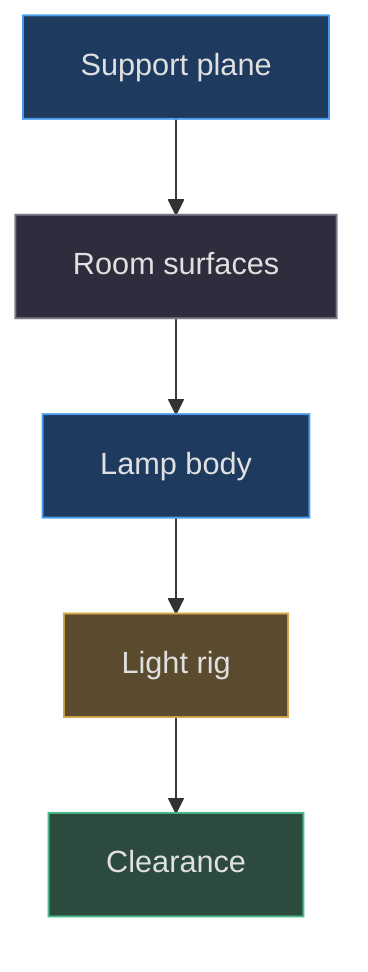
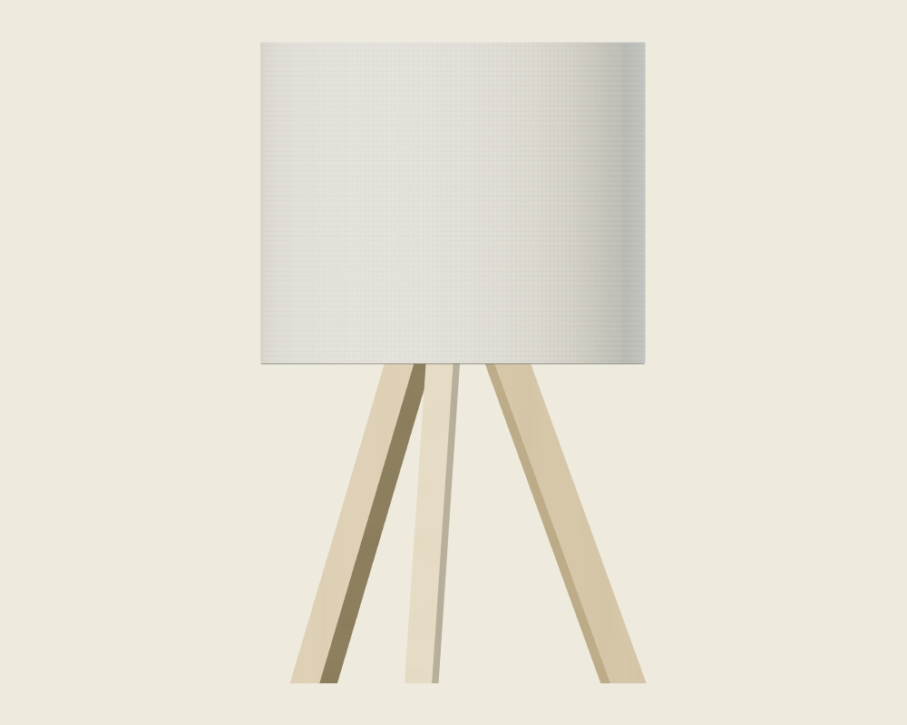
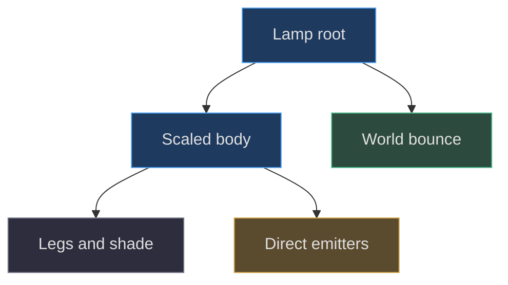
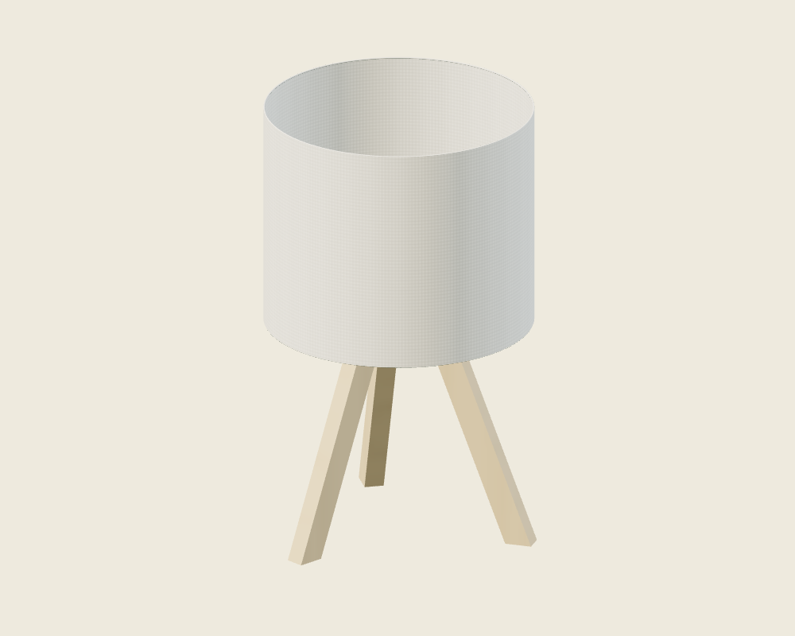

# The desk, room and tripod lamp

## A room is a coordinate contract

The shared desk is not an imported interior. It is a small, deliberately
constructed Three.js world whose furniture establishes where other models can
rest, move and receive light. Begin reconstruction with its support surfaces,
not with decorative detail. Otherwise every later contact, camera and lighting
decision inherits an uncertain origin. The application uses Three.js
**0.186.1**, exactly, rather than a Blender scene, CAD assembly, model importer
or general physics engine ([package.json:7–9](https://github.com/Zanark/BowserBoy/blob/1e4ef518d6943ab1af39cef3b4d558f209a17891/package.json#L7-L9)).

In the constructor of `HandheldScene`, the tabletop is a box measuring
1000 by 2.4 by 26 world units. Its center is `(0,-1.2,-3)`, so its upper face
is exactly world Y zero, its front edge is Z ten, and its rear edge is Z
minus sixteen. Its enormous width is a framing expedient: it prevents a side
edge from entering ordinary views. It is not evidence that the depicted
physical desk is seventeen meters wide. Keep authored scene dimensions
separate from claims about real furniture
([src/scene.js:73–97](https://github.com/Zanark/BowserBoy/blob/1e4ef518d6943ab1af39cef3b4d558f209a17891/src/scene.js#L73-L97)).



Figure MD28.1. Construct support and illumination before arranging movable objects; clearance is a consequence of real geometry, not a cosmetic final pass.

## Constructing the support surfaces

Create two independently repeated wood textures. The tabletop repeats
`1000/16` horizontally and `26/11.5` along the other texture coordinate;
the fascia repeats `1000/16` and `2.4/11.5`. Separate repetition prevents
the narrow edge from inheriting the top's stretched grain. The material array
assigns the lighter, roughness `.83` material to the positive-Y box face;
the remaining faces use the darker `.88` edge material. Do not assign a
single UV scale to the whole box merely because it has one geometry.

The shared `createWood` helper makes a 1024-square canvas with a
deterministic integer generator seeded at 41. It paints eight
128-pixel planks, each with a slight wash, 110 sinusoidally
meandering grain strokes and paired seam lines. Repeat wrapping
is enabled before the scene overrides its default repetition.
Consequently, rebuilding the texture does not randomly change
the grain on every reload. This determinism is useful for visual
comparison: a material adjustment should not also move every
grain line. The lamp has its own smaller ash-grain generator;
do not replace both with one texture just because both are wood
([src/handheld.js:657–685](https://github.com/Zanark/BowserBoy/blob/1e4ef518d6943ab1af39cef3b4d558f209a17891/src/handheld.js#L657-L685)).

The wall is a 1000-square plane at `(0,464.5,-16)`, with warm plaster color
and roughness one. Its lower edge is Y minus 35.5, close to the floor at
minus 35. The floor is a 180-square plane rotated minus ninety degrees about
X. Both receive shadows. These broad planes provide a continuous room
background without introducing a window, ceiling mesh, chair, skirting board
or extra prop that does not exist in this construction. The scene background
itself starts black and changes separately with the room-light switch.

Build the physical world and the interaction workspace as different objects.
The floor is not the drop destination for tabletop movement. `DeskMotion`
uses a root-coordinate workspace whose minimum Y determines support.
The visible table is much wider than that workspace. This intentional
restriction keeps interactions near the camera and other models rather than
turning the whole oversized support mesh into a draggable territory
([src/pear-motion.js:59–89](https://github.com/Zanark/BowserBoy/blob/1e4ef518d6943ab1af39cef3b4d558f209a17891/src/pear-motion.js#L59-L89)).

## Building the tripod in metric-local space

`createDeskLamp` creates a root and a body group. The body is positioned at
`(-13.5,0,2)` in world units and scaled by `1/.017`. Its children are
authored in meter-like local dimensions. This is the essential ownership
rule: parent translation remains a world-space placement, while child lengths
are converted by parent scale. Do not divide the parent position by `.017`
a second time
([src/lighting.js:5–49](https://github.com/Zanark/BowserBoy/blob/1e4ef518d6943ab1af39cef3b4d558f209a17891/src/lighting.js#L5-L49)).

Draw one leg as a closed four-point shape, beginning at `(.076,0)`,
then `(.094,0)`, `(.027,.174)` and `(.009,.174)`. Extrude `.013`
without bevels, then translate the extrusion by minus `.0065` along Z.
Centering its thickness before rotating avoids a small systematic twist in
the footprint. Reuse this geometry three times. Each leg rotates around Y
by `.35 + index * 2π/3`. Thus the tripod is a radial construction of flat
sloping members, not three cylinders leaning toward a guessed center.

The wood material uses a 128-by-512 generated grain canvas and roughness
`.72`. Its strokes vary mildly with X and meander with Y. A short cylinder
at Y `.162`, radius `.022`, height `.018`, supplies the shade support.
There is no separately authored tall central pole in this factory: record
the short support cylinder as the pole/support component rather than
inventing a hidden stem. The cream trim is a standard material with
roughness `.8`.

The shade is an open cylinder, radius `.09`, height `.15`, with 96 radial
segments, centered at Y `.225`. Its open ends are important: a closed
cylinder would introduce opaque caps absent from the model. The double-sided
fabric material shows the interior and exterior of this thin surface.
Two torus rims sit at Y `.15` and `.30`, each rotated around X to lie
horizontally. A sphere at Y `.215`, radius `.018`, acts as a warm diffuser.
The source explicitly disables shadow casting on shade, rims and bulb;
copying the mesh helper's default casting flag without those overrides
would change the result
([src/lighting.js:51–81](https://github.com/Zanark/BowserBoy/blob/1e4ef518d6943ab1af39cef3b4d558f209a17891/src/lighting.js#L51-L81)).



Figure MD28.2. The supplied neutral-studio front render is for checking leg silhouette, open shade and support proportions, not proof of actual room illumination.

## Constructing a lamp that also illuminates

The visible glowing fabric does not replace scene lights. The factory adds
a downward spotlight, transmitted-shade area light, open-bottom area light
and separate tabletop-bounce area light. The first three belong to the
scaled body; bounce belongs directly to the root. This hierarchy makes
the finite bounce patch a world-sized approximation rather than a
meter-local rectangle accidentally enlarged fifty-nine times
([src/lighting.js:82–110](https://github.com/Zanark/BowserBoy/blob/1e4ef518d6943ab1af39cef3b4d558f209a17891/src/lighting.js#L82-L110)).

There is no modeled toggle lever or cord switch. The mesh helper marks
the lamp surfaces with `userData.lampToggle`, and scene picking invokes
the lamp callback. This is an interaction model, not an omitted anatomical
detail to fabricate. Switching sets light intensities to zero or restores
their remembered values and changes shade/bulb emission. It keeps the light
objects present to avoid changing shader light counts
([src/scene.js:1053–1075](https://github.com/Zanark/BowserBoy/blob/1e4ef518d6943ab1af39cef3b4d558f209a17891/src/scene.js#L1053-L1075)).



Figure MD28.3. The bounce patch has a different space owner from the lamp's metric-local parts; preserving that distinction prevents silent size errors.

### Reconstructing the weave rather than painting a flat white drum

The fabric canvas is 1024 by 256. At each pixel, the factory combines
two period-four cosine signals for warp and weft, their product, and
a smaller sinusoidal fiber variation. The base value is 237; both
main signals contribute six levels and their product contributes two.
The same generated texture feeds ordinary color and emission, which
keeps the weave visible when the shade glows. This is actual procedural
texture synthesis, not a downloaded fabric photograph or a normal map
([src/lighting.js:53–72](https://github.com/Zanark/BowserBoy/blob/1e4ef518d6943ab1af39cef3b4d558f209a17891/src/lighting.js#L53-L72)).

For a material diagnostic, retain geometry, light and exposure while
temporarily comparing the generated map with a constant near-white
map in an isolated harness. The comparison asks whether texture
contrast survives emission, not whether the whole room looks brighter.
Restore the original map afterward and dispose only resources the
harness created.

## MD28-W01 Convert the shade and tabletop by hand

Work through three dimensions before writing geometry. With one world unit
representing `.017` meters for this factory, shade diameter is
`.18/.017 = 10.5882` world units; shade height is
`.15/.017 = 8.8235`; top height is `.30/.017 = 17.6471`.
The shade center becomes world `(-13.5,13.2353,2)`. The support cylinder
center becomes Y `9.5294`. These are derived construction values, not
measurements taken from a rendered frame.

The tabletop's upper face is `-1.2 + 2.4/2 = 0`, which matches the legs'
local starting Y. That is why the factory can sit directly on the shared
support plane without a compensating root lift. Check this equation before
adjusting any contact shadow.

This original browser-module recipe assumes the project's import map,
decoded brand assets and served source are already available. It constructs
only the lamp; it does not start a renderer or modify the application.
Expected output is three leg names and the derived top height.

```js
import { createDeskLamp } from './src/lighting.js';
const lamp = createDeskLamp();
const body = lamp.root.children[0];
const legs = body.children.filter(
  item => item.name.startsWith('Ash tripod leg')
);
console.assert(legs.length === 3);
console.log(legs.map(item => item.name));
console.log(.30 * body.scale.y); // 17.647...
```

## MD28-R01 Retry after changing the shade diameter

Suppose a proposed extension changes radius from `.09` to `.11` while
retaining height. This is not a request to scale the whole body. Rebuild
the shade and both rims with corresponding radii, preserve the support
height, and reconsider whether the transmitted area emitter still lies
outside the fabric. The current `.11` emitter X offset was chosen to avoid
an intersecting plane and a hard lighting seam. A wider shade can invalidate
that relationship even though every mesh remains legal.

Next recompute the lamp's actual world bounds and rerun desk clearance.
The lamp is a fixed obstacle, not a lower-priority object the resolver may
quietly move aside. A radius increase expands the occupied territory and
can displace companions, cartridges and consoles. A visual improvement
therefore has an interaction cost. The clearance browser test explicitly
checks that the lamp's pose remains unchanged
([tests/browser/desk-clearance.spec.mjs:59–72](https://github.com/Zanark/BowserBoy/blob/1e4ef518d6943ab1af39cef3b4d558f209a17891/tests/browser/desk-clearance.spec.mjs#L59-L72)).



Figure MD28.4. The supplied diagnostic three-quarter view helps distinguish the three radial legs; it cannot establish the spotlight target or bounce strength.

## MD28-Q01 Exercise: add a floor without moving the desk

A reconstruction sets the floor at Y zero because that is the usual
ground convention in its previous project. Explain which contract breaks,
how to diagnose the apparent intersection, and why moving every handheld
upward is the wrong repair. Also explain why the wall's huge height is not
a furniture dimension to copy into a product specification.

## MD28-A01 Explained answer

Here Y zero already belongs to the tabletop. A second horizontal room
surface at the same height overlaps the support and can alter depth,
lighting and visible grain. Restore the authored floor at minus 35 and
leave table and object homes unchanged. Raising every model would require
changing workspace floors, saved poses, light targets and camera fits to
compensate for one mistaken surface. The wall is oversized scenery with
its lower edge near the floor; its dimensions ensure coverage, not
architectural fidelity.

Finally separate geometry from acceptance. A leg count assertion verifies
factory structure; a clearance assertion verifies placement; a neutral
studio image helps judge silhouette. None says the owner likes the lamp
in the integrated room. That distinction is explicit project practice
([docs/VERIFICATION.md:1–8](https://github.com/Zanark/BowserBoy/blob/1e4ef518d6943ab1af39cef3b4d558f209a17891/docs/VERIFICATION.md#L1-L8)).
