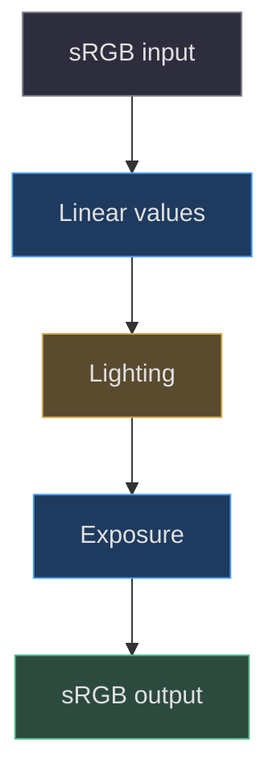
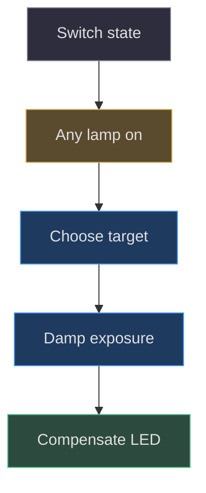

# Light units, exposure and color

## Begin with the source of each brightness

Three distinct mechanisms make this room appear bright: surface emission,
actual light objects and renderer exposure. They are not interchangeable.
A bright shade material makes the shade visible; a spotlight illuminates
surfaces; exposure maps scene radiance into display values. Replacing a
misplaced light with global brightness can make a screenshot legible while
destroying the all-lights-off behavior. The renderer explicitly uses sRGB
output, ACES filmic tone mapping and initial exposure `.018`
([src/scene.js:39–47](https://github.com/Zanark/BowserBoy/blob/1e4ef518d6943ab1af39cef3b4d558f209a17891/src/scene.js#L39-L47)).

The checked current Three.js
[color-management guidance](https://threejs.org/manual/pages/color-management.html)
explains why lighting should be computed in Linear-sRGB and output converted
for an sRGB display. This is contemporary guidance consulted on
2026-11-07, not proof of which library revision the application runs.
That proof is the exact dependency in
[package.json:7–9](https://github.com/Zanark/BowserBoy/blob/1e4ef518d6943ab1af39cef3b4d558f209a17891/package.json#L7-L9).
Never substitute a current documentation default for an explicit source
assignment.



Figure MD29.1. Input encoding, physical-light arithmetic and display encoding are separate stages; changing light intensity cannot repair a missing conversion.

## The authored hierarchy and its units

The tripod factory uses `.017` meters per world unit. Its spotlight
intensity is `12/.017²`, approximately `41522.49`. This scaling preserves
an inverse-square relationship when meter-authored geometry becomes
world-sized geometry: at corresponding distances, intensity and squared
distance acquire the same factor. It does not certify the modeled lamp
against a photometer or establish a real bulb wattage.

The spotlight has decay two, unlimited distance, cone angle `π/3` and
penumbra `.65`. Its local target includes the inverse placement needed
to aim toward the desk. The transmitted-shade rectangle has intensity
300 and explicit dimensions `.18/.017` by `.15/.017`; the open-bottom
rectangle uses 90 and `.16/.017` square. Dimensions are explicit because
the source warns that rectangle-light dimensions do not inherit parent
scale. Its bounce rectangle is six by six with intensity 50, rooted
outside the metric-scaled body
([src/lighting.js:82–110](https://github.com/Zanark/BowserBoy/blob/1e4ef518d6943ab1af39cef3b4d558f209a17891/src/lighting.js#L82-L110)).

Room lighting is a separate switchable group: a 14-by-12 ceiling area
light at `(0,10,5)`, intensity 132, looks toward the origin; a hemisphere
light with intensity 22 represents warm reflected room illumination.
The ceiling is a light, not a visible ceiling mesh. The hemisphere and
tabletop patch are authored approximations, not a traced global-
illumination solution
([src/lighting.js:113–123](https://github.com/Zanark/BowserBoy/blob/1e4ef518d6943ab1af39cef3b4d558f209a17891/src/lighting.js#L113-L123)).

Companion lamps are part of the same exposure problem. At defaults,
Pear brightness `.7` produces intensity `800*.7 = 560` on each of its
lights and body emission `110*.7 = 77`. Axolotl brightness `.5` produces
point-light intensity 130, silicone emission 45 and pink emission 24.
These numbers describe source coefficients, not equivalent radiometric
units across material and light properties. Turning off only the tripod
and room therefore does not establish an LCD-only room
([src/scene.js:563–603](https://github.com/Zanark/BowserBoy/blob/1e4ef518d6943ab1af39cef3b4d558f209a17891/src/scene.js#L563-L603)).

## Sampling screen light in linear space

`ScreenIllumination` samples a 24-by-16 canvas, so each sample visits
384 pixels. A 256-entry floating-point lookup table converts byte
channels from sRGB to linear values. The code sums converted values,
divides by 384, and interpolates its current color toward that target.
Averaging encoded bytes first would not conserve average light energy:
half black plus half white averages to linear `.5`, not the linear
equivalent of encoded middle gray
([src/lighting.js:5–7](https://github.com/Zanark/BowserBoy/blob/1e4ef518d6943ab1af39cef3b4d558f209a17891/src/lighting.js#L5-L7),
[src/lighting.js:163–187](https://github.com/Zanark/BowserBoy/blob/1e4ef518d6943ab1af39cef3b4d558f209a17891/src/lighting.js#L163-L187)).

Sampling a live source happens at most once per 125 milliseconds unless
the source changes. Interpolation can still advance on eligible room
paints. Its coefficient is `1-exp(-18*delta)`, making the response depend
on elapsed seconds instead of a fixed fraction per callback. A maximum
channel error below `.00001` snaps to the target, allowing eventual
idle rendering rather than an asymptote that stays dirty forever.

The maximum current channel, called peak, determines area-light intensity
as `peak*12`. Normalizing color by peak separates hue from overall
strength. Experimental control spill uses `peak^.25*.1`; it makes dim
content contribute a small amount near coplanar controls without
inventing global ambient light. At peak zero, intensity is zero. The
code avoids dividing by zero, and `clear()` explicitly zeros both
emitters when a source goes away.

## Exposure is stateful, not a one-off correction

During rendering, exposure targets `.018` if any tripod, room, Pear or
axolotl lamp is on, and `.45` only when all are off. It damps toward
the target with rate four. That is a factor of 25 between endpoints,
not a sudden multiplication applied to LCD pixels. The GBA indicator's
emission compensates by multiplying `80*.018/currentExposure`, preventing
dark adaptation from bleaching its green appearance
([src/scene.js:1222–1236](https://github.com/Zanark/BowserBoy/blob/1e4ef518d6943ab1af39cef3b4d558f209a17891/src/scene.js#L1222-L1236)).

The DS accent fill also follows this branch. Its emission is copied
from material color only in the brighter-room target state and cleared
for the dark-room target. It is an explicit stylization, not evidence
that metallic paint generates light. Document this approximation rather
than hiding it behind the word realistic. Active LCD materials avoid
tone mapping entirely, so their picture and the room's adaptation have
different ownership.



Figure MD29.2. All four switch families participate in adaptation; forgetting one changes both illumination and exposure.

### Diagnose color by changing one stage

Use an ordered diagnostic rather than tuning several coefficients.
First establish which object a sample actually hits. A ray landing
on the glossy screen instead of blue paint invalidates a shell-color
conclusion. Next identify material state: active basic LCD, inactive
physical glass, ordinary painted shell or emissive accent. Then
record every lamp switch and exposure target. Only after those
conditions are explicit should a light coefficient be changed.

A color texture and a data texture also have different meanings.
The checked current color-management guide recommends sRGB annotation
for color imagery, while roughness, normal and other noncolor data
must not receive a display-color conversion. The lamp's generated
fabric is color imagery; calling every generated canvas “data” would
therefore be an incorrect shortcut. Conversely, a proposed numeric
roughness texture should not inherit the color helper's annotation
without review. This is researched extension guidance, not a claim
that a new roughness canvas exists in the lamp.

Finally compare settled states. A frame taken during exposure damping
mixes old and new adaptation even if the light switch changed
instantly. Record current exposure or deliberately wait for convergence.
Do not demand an arbitrary fixed wait universally: eligible GPU
paints and interpolation time determine progress. For exact LCD
invariance, material type plus unchanged samples is stronger than
a loosely described screenshot. For shell appearance, acknowledge
that chosen probes cover only their local surfaces and views. A
passing blue-channel threshold does not establish calibrated color
across all monitors, camera angles or tone-mapping alternatives.

## MD29-W01 Work a half-white screen through the sampler

Assume the downsampled canvas contains 192 white pixels and 192 black
pixels, with equal channels and no resampling ambiguity. Converted
linear white is one and black zero, so target RGB is `(.5,.5,.5)`.
Starting from black, after `.1` seconds the interpolation coefficient
is `1-exp(-1.8)`, approximately `.83470`. Current RGB becomes
approximately `(.41735,.41735,.41735)`. Peak is `.41735`, the primary
area intensity becomes about `5.0082`, and normalized light color is
white. Control spill is approximately `.0804`. These are calculated
expectations under stated assumptions, not recorded browser samples.

The following standalone Node recipe uses no browser or model assets.
It reproduces that arithmetic and should log a primary intensity close
to five. It intentionally does not approximate the renderer's ACES
curve, which would add a different stage to the experiment.

```js
const target = .5;
const delta = .1;
const current = target * (1 - Math.exp(-18 * delta));
const primary = current * 12;
const spill = current ** .25 * .1;
console.assert(primary > 5 && primary < 5.02);
console.log({ current, primary, spill });
```

For comparison, taking an encoded average `.5` and then linearizing
it yields about `.214`, less than half the desired average energy.
This explains why a lookup table is a correctness mechanism rather
than merely a micro-optimization.

## MD29-R01 Retry a dark upright DS without global ambient

Change the condition from a console lying on the table to the straight,
camera-facing DS play pose. The historical repair moved its target
from `(5,5.1,8)` to `(-2,5.1,-8)`. It did not raise exposure, recolor
paint or add a camera light. The causal diff explains that the face
must remain behind the existing emitter instead of being backlit
([commit 9be851e](https://github.com/Zanark/BowserBoy/commit/9be851e96098e0dfd4beedffd911185cf33a11a6)).

Reproduce the diagnosis with the checked desktop and phone fixture:
disable both companions, use real static status LCDs, verify the root
is straight, ray-check eight shell probes, and compare tripod-only,
all-off and room-only pixels. The test requires blue above 75 under
the tripod and maximum channel below three in darkness; it also
requires the LCD RGB values to remain identical across states.
These are assertions read in source, not a new successful run
([tests/browser/ds.spec.mjs:1412–1486](https://github.com/Zanark/BowserBoy/blob/1e4ef518d6943ab1af39cef3b4d558f209a17891/tests/browser/ds.spec.mjs#L1412-L1486)).

## MD29-Q01 Exercise: why is “all off” still bright?

An agent switches off the tripod and ceiling controls, sees bright
table pixels, and reduces LCD spill until they darken. Identify two
uncontrolled inputs and explain why the apparent repair would
damage a valid dark-room experiment.

## MD29-A01 Explained answer

Pear and axolotl remain independent illumination sources and also
keep the low-exposure target selected. Disable both using their
scene methods, then wait for adaptation and a real eligible paint.
Otherwise the experiment mixes changed light energy with changed
exposure. Reducing LCD spill would compensate for an incorrect
fixture and remove legitimate screen-driven lighting from the
actual all-lamps-off state.

The public verification record explicitly separates fixture isolation
from production changes and reports parked lighting coverage as
debt, not fixed behavior
([docs/VERIFICATION.md:21–37](https://github.com/Zanark/BowserBoy/blob/1e4ef518d6943ab1af39cef3b4d558f209a17891/docs/VERIFICATION.md#L21-L37)).
Use that same discipline when deciding whether a color mismatch
belongs to encoding, material, geometry, exposure or evidence.
