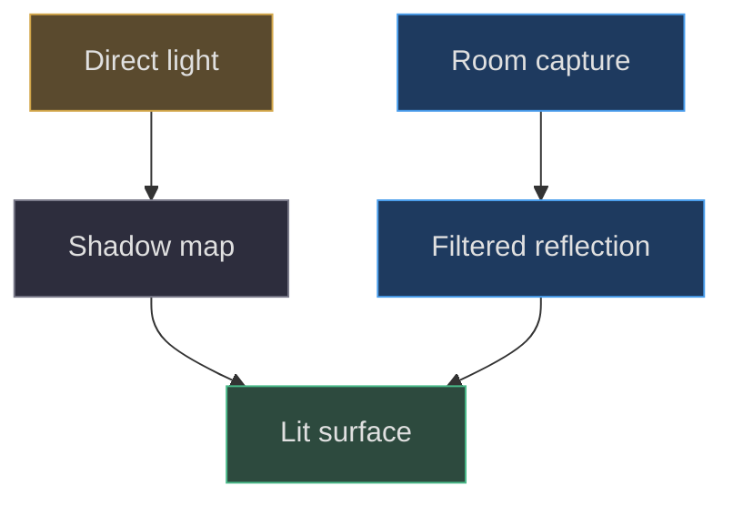
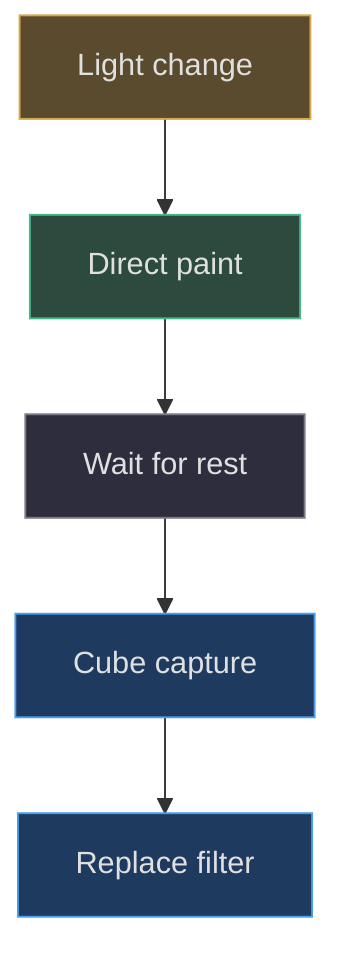

# Shadows, reflections and shaders

## Three effects that must not share a diagnosis

A dark patch beneath an object, a bright moving patch on lacquer and
a discolored LCD may all look like lighting defects, yet they arise
from different pipelines. Shadows estimate blocked direct light.
Environment reflection samples surrounding radiance. Screen shaders
or canvas effects transform image content. Start by naming the
pipeline before changing a parameter. This scene does not contain
a universal reflection or global-illumination engine: it combines
a spotlight shadow map, authored fill, selected physical materials
and a cached room cubemap
([src/scene.js:39–47](https://github.com/Zanark/BowserBoy/blob/1e4ef518d6943ab1af39cef3b4d558f209a17891/src/scene.js#L39-L47),
[src/lighting.js:82–110](https://github.com/Zanark/BowserBoy/blob/1e4ef518d6943ab1af39cef3b4d558f209a17891/src/lighting.js#L82-L110)).

The current official
[shadow guide](https://threejs.org/manual/pages/shadows.html), checked
2026-11-07, explains the basic cost: shadow-casting lights render
casters from their own viewpoint before the main view. Its examples
are recommendations, not measurements of this application. In
particular, adding shadow-casting point lights to every glowing
companion would introduce extra scene views rather than simply
making their existing glow more accurate.



Figure MD30.1. A surface combines different evidence paths; a cubemap highlight is not a shadow and neither is a screen filter.

## Constructing the shadow path

The renderer enables shadows, selects `PCFShadowMap` and disables
automatic shadow updates. The tripod spotlight casts the mapped
shadow. Its map is 1024 square, near plane `.7`, far plane 120,
bias `-.00012`, normal bias `.008` and radius 16. These are authored
settings, not guarantees of a particular penumbra width on every
GPU. Preserve them as a baseline before testing an alternative
shadow technique
([src/lighting.js:82–92](https://github.com/Zanark/BowserBoy/blob/1e4ef518d6943ab1af39cef3b4d558f209a17891/src/lighting.js#L82-L92)).

The lamp mesh helper initially makes objects both casters and
receivers, but shade, rims and diffuser override casting to false.
The tabletop casts and receives; wall and floor receive. This
asymmetry is purposeful. An opaque shadow-casting thin drum could
block the very light used to suggest transmitted fabric. It would
also make an illumination approximation look like a modeling hole.
Shadow flags therefore belong to the material-and-light contract,
not merely to a mesh-construction convenience.

The main render path marks shadows dirty when scene change, active
pose change or button motion requires it. Reflection capture also
requests shadow updates before and after its temporary renderer
state change. Disabling automatic updates is safe only while these
invalidation paths remain complete. A new animated prop that never
sets `changed` can leave a stale shadow even if its own transform
is correct
([src/scene.js:1367–1386](https://github.com/Zanark/BowserBoy/blob/1e4ef518d6943ab1af39cef3b4d558f209a17891/src/scene.js#L1367-L1386)).

Pear additionally has a stylized contact plane. The scene keeps it
at world Y `.012` by subtracting body height from its local Y,
fades opacity no lower than `.12`, and enlarges its scale with
height. Picking explicitly ignores it. Treat this as a visual
attachment, not a physical obstacle or an accurate soft-shadow
solution. The room's mapped shadow and the character's contact
cue serve different jobs
([src/scene.js:547–553](https://github.com/Zanark/BowserBoy/blob/1e4ef518d6943ab1af39cef3b4d558f209a17891/src/scene.js#L547-L553),
[src/scene.js:894–899](https://github.com/Zanark/BowserBoy/blob/1e4ef518d6943ab1af39cef3b4d558f209a17891/src/scene.js#L894-L899)).

## Building the reflected environment

The constructor allocates a 128-square half-float cube render target,
a cube camera with near `.1` and far 1500, and a `PMREMGenerator`.
It traverses the DS and stores its physical materials in a Set.
That Set avoids duplicate assignment when meshes share a material;
it does not mean every glossy object in the room receives this
environment map
([src/scene.js:161–167](https://github.com/Zanark/BowserBoy/blob/1e4ef518d6943ab1af39cef3b4d558f209a17891/src/scene.js#L161-L167)).

`updateDsReflections` records console visibility and renderer tone
mapping, hides both consoles, moves the capture camera to the DS
root, and captures with `NoToneMapping`. It then filters the cube
texture, assigns the filtered texture to collected physical
materials, disposes the previous filtered target, and clears the
dirty flag. A `finally` block restores visibility and tone mapping
even if capture or filtering throws
([src/scene.js:1077–1100](https://github.com/Zanark/BowserBoy/blob/1e4ef518d6943ab1af39cef3b4d558f209a17891/src/scene.js#L1077-L1100)).

Hiding both consoles prevents self-capture and the other console
from appearing in this approximation. It also limits fidelity:
this is not a full mutually reflective scene. A single capture
point cannot reproduce parallax-correct nearby reflections across
the whole clamshell. Describe the result as an actual-room sampled
environment with explicit omissions, not as perfect mirror
physics. Physical material roughness can blur that environment
but cannot supply missing spatial information.

The current official
[MeshPhysicalMaterial reference](https://threejs.org/docs/pages/MeshPhysicalMaterial.html)
supports understanding clearcoat and roughness as distinct surface
layers and parameters. It now contains properties and deprecations
newer than the pinned runtime. Consult it for concepts only; do not
silently add a current property to a reconstruction of revision
`1e4ef518`.

## Cache policy is part of appearance

Room capture waits until there is no transition, inspection drag,
pinch, companion move or console move, both companions are
sleeping, and consoles are not moving. Light switching paints
direct illumination first, then permits reflection refresh on a
later settled paint. This is a latency tradeoff: a temporarily
stale reflection is preferable to making every direct-light
switch wait for six extra views and filtering.

Switching tripod lights changes intensity instead of removing
light objects. Keeping shader light counts stable reduces
compilation churn. This is a concrete implementation choice, not
a blanket promise that material changes never compile shaders.
The browser fixture compares program counts and requires a
direct-light paint while reflections are still pending; it is
explicitly CI-parked in the pinned source
([tests/browser/scene.spec.mjs:150–199](https://github.com/Zanark/BowserBoy/blob/1e4ef518d6943ab1af39cef3b4d558f209a17891/tests/browser/scene.spec.mjs#L150-L199)).



Figure MD30.2. Reflection quality is scheduled behind responsiveness; the first switched frame intentionally uses the previous environment.

### Shader selection is not the canvas CRT pipeline

The word shader is particularly easy to overextend here. Renderer
materials compile GPU programs; preferences expose validated native
CRT choices; generated status pictures receive a canvas overlay.
`drawLcdCrt` uses ordinary 2D composite operations and a cached pattern.
It is not a custom imported GLSL file secretly responsible for the
DS clearcoat or room shadow map
([src/lcd-crt.js:1–39](https://github.com/Zanark/BowserBoy/blob/1e4ef518d6943ab1af39cef3b4d558f209a17891/src/lcd-crt.js#L1-L39)).

When diagnosing a dark edge, first reproduce it with a static
status image and fixed camera. If it remains painted into that
image independent of room state, inspect the vignette and picture
generation path. If it moves with viewing direction on inactive
glass, inspect physical material and environment. If another
object changes it by blocking the lamp, inspect the shadow path.
These experiments isolate causes without rewriting three pipelines
at once.

For a proposed higher-quality reflection mode, state the budget
before implementation. Doubling cube-face side length quadruples
texel count per face, and there are six faces before filtering.
A 128-square cube contains 98,304 base face texels; 256-square
contains 393,216. Those counts exclude mip levels, attachment
formats, filtering intermediates and implementation overhead.
They are arithmetic, not measured VRAM consumption. Any claim
of actual memory use or timing needs profiling on the target
renderer. Preserve current responsiveness and settled-refresh
behavior while evaluating the new quality mode, and make any
changed resolution contract explicit rather than silently
altering the baseline.

## MD30-W01 Trace a light switch through two eligible paints

Assume the scene has settled with no outstanding fence and the
tripod is on. The user switches it off. First, `setLamp(false)`
stores/restores known intensities, sets all four to zero, disables
shade and bulb emission, and sets `changed`, `lightingChanged`
and `dsReflectionsDirty`.

On the next eligible render, `lightingChanged` allows recovery
bypass but not outstanding-fence bypass. Reflection capture is
excluded because `lightingChanged` is true. The main view paints
the switched direct lighting, resets that flag and inserts a
GPU fence. Once the fence and any severe-load recovery permit
another frame, a settled scene may capture and filter the new
room environment. No numeric duration follows from these steps:
eligibility depends on actual GPU completion.

This explicit pseudocode is a teaching reduction, not replacement
application code. It assumes capture succeeds and retains the
ordering needed for a responsive switch.

```text
on switch:
  directDirty = true
  environmentDirty = true
on eligible paint:
  if environmentDirty and not directDirty and settled:
    capture and replace environment
  render main view
  directDirty = false
  insert completion fence
```

Expected outcome is a direct-light frame before environment
replacement. Record frame order, flags and actual sampled pixels;
a checkbox changing alone does not demonstrate the effect.

## MD30-R01 Retry after a moving companion changes reflections

Change the condition: the axolotl is dragged while its light is on.
Do not capture a fresh environment on every pointer event. Let
movement dirty the main view and retain deferred reflection
refresh until the object sleeps. If the DS seems to reflect the
old position during movement, that can be the intentional cache
policy rather than failed light propagation.

After landing, verify that dirty state eventually clears and that
the previous filtered target is disposed. If it never clears,
inspect held/moving flags and pending presentation acknowledgments
before increasing capture frequency. If memory grows across
repeated replacements, inspect target ownership rather than
deleting arbitrary scene textures. The checked official
[cleanup guide](https://threejs.org/manual/pages/cleanup.html)
reinforces that render resources require explicit release;
material disappearance from a scene is not disposal.

## MD30-Q01 Exercise: can clearcoat fix missing shadows?

A proposed change increases clearcoat until the DS has a brighter
edge, claiming it restored lamp shadow detail. Explain the category
error and propose independent observations for reflection, direct
occlusion and cached-state correctness.

## MD30-A01 Explained answer

Clearcoat changes the reflective response of a material; it cannot
create a missing caster or update an old shadow map. Check caster,
receiver, light and renderer flags for the shadow path. Then move
a known light or object and inspect whether shadow invalidation
occurs. For reflection, inspect the assigned environment texture,
capture origin and settled refresh conditions separately. For
cached state, compare dirty flags before and after an eligible
paint, not after an arbitrary animation callback.

Keep the evidence limitation visible. CI parking retains the
original switch assertions but does not prove they currently
pass; the verification record calls such exclusions coverage debt
([docs/VERIFICATION.md:93–107](https://github.com/Zanark/BowserBoy/blob/1e4ef518d6943ab1af39cef3b4d558f209a17891/docs/VERIFICATION.md#L93-L107)).
An appealing reflection and a passed structural assertion still
require separate human aesthetic review.
