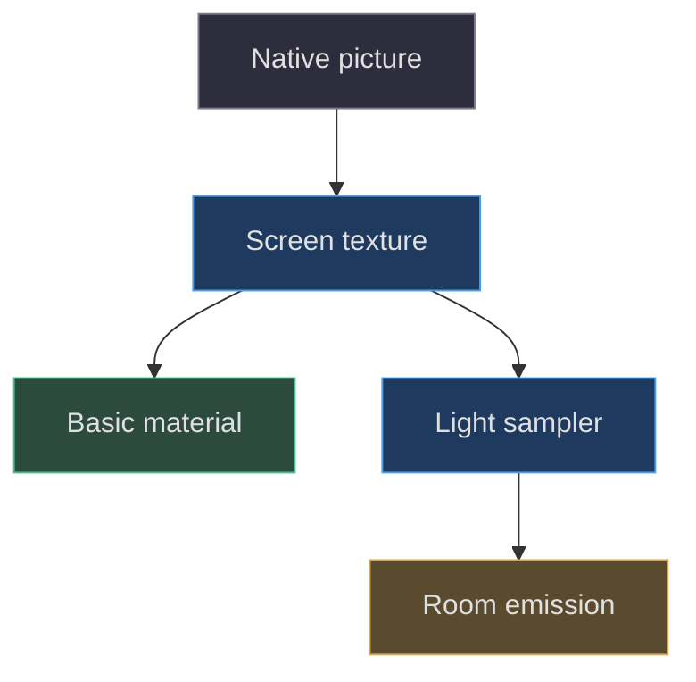
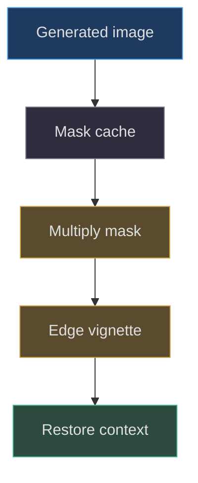

# Screen materials and pixel preservation

## A screen has several independent representations

The physical LCD is geometry, its picture is a texture, its powered-off
appearance is a reflective material, and its contribution to room light
is a separate emitter. Combining those into one vaguely emissive glass
material would make room exposure alter game colors and would confuse
touch mapping with a decorative overlay. Reconstruction begins by
preserving these responsibilities rather than choosing a shader that
looks screen-like
([src/scene.js:1106–1142](https://github.com/Zanark/BowserBoy/blob/1e4ef518d6943ab1af39cef3b4d558f209a17891/src/scene.js#L1106-L1142)).

The library is exactly Three.js 0.186.1
([package.json:7–9](https://github.com/Zanark/BowserBoy/blob/1e4ef518d6943ab1af39cef3b4d558f209a17891/package.json#L7-L9)).
The checked current
[color-management manual](https://threejs.org/manual/pages/color-management.html)
supports the distinction between color textures, linear lighting and
sRGB output, but does not establish historical runtime defaults.
Keep the source's explicit color-space annotations even if a newer
example appears to work without them.



Figure MD31.1. Picture display and room illumination share an image source but not a material or exposure path.

## Active display versus inactive glass

When the GBA powers off, the scene clears its source and screen
illumination, then installs `MeshPhysicalMaterial` with color
`#101713`, roughness `.24`, clearcoat one and clearcoat roughness
`.22`. That is deliberately reflective dark glass. When a live
canvas is attached, `setScreen` creates an sRGB `CanvasTexture`,
sets both filters to `LinearFilter`, disables mipmaps and uses
`MeshBasicMaterial` with `toneMapped:false`. These assignments
mean the active picture does not acquire the room's tone mapping
or direct-light response.

The DS follows the same active/inactive distinction but not the
same live-texture filtering. Its powered-off path uses reflective
physical material. Status screens use basic non-tone-mapped
materials. When the retained native framebuffer starts, the
controller creates two 256-by-192 canvas textures with both
filters set to **NearestFilter**, no mipmaps, and non-tone-mapped
basic materials
([src/ds-controller.js:266–294](https://github.com/Zanark/BowserBoy/blob/1e4ef518d6943ab1af39cef3b4d558f209a17891/src/ds-controller.js#L266-L294),
[src/ds-controller.js:415–435](https://github.com/Zanark/BowserBoy/blob/1e4ef518d6943ab1af39cef3b4d558f209a17891/src/ds-controller.js#L415-L435)).

This difference matters. “All active LCDs use nearest” would be
false for the pinned GBA path. Nearest is the exact DS native
pixel-preservation contract; linear filtering is an explicit GBA
choice for a supplied canvas that can already contain filtered
content. Neither implies a one-to-one mapping between source
pixels and final device pixels at every camera angle.
Perspective projection, canvas density and screen footprint
remain involved.

The controller verifies the native canvas layout and requires a
retained drawing buffer before accepting it. `paintScreens`
copies each region into its output canvas with
`imageSmoothingEnabled=false`, then marks the corresponding
texture dirty. These copies occur even when the room-render
budget defers another 3D paint
([src/ds-controller.js:662–675](https://github.com/Zanark/BowserBoy/blob/1e4ef518d6943ab1af39cef3b4d558f209a17891/src/ds-controller.js#L662-L675)).
Do not describe texture dirtiness as proof that the main view
has already presented the new picture.

## Curved outlines without a second framebuffer warp

`createLcdGeometries` gives the GBA viewport width 4.05 and
height `width*2/3 = 2.7`. The curved option builds a shape
outline; the flat option builds a plane. For curved geometry,
UVs are explicitly set from XY position divided by viewport
dimensions plus one half. This preserves a direct image mapping
inside a curved boundary instead of warping an already-filtered
framebuffer again
([src/handheld.js:49–65](https://github.com/Zanark/BowserBoy/blob/1e4ef518d6943ab1af39cef3b4d558f209a17891/src/handheld.js#L49-L65)).

The recess is regenerated with the screen, and old geometries
are disposed during a curve change. Geometry owns silhouette;
the emulator or built-in drawing path owns the picture. Moving
the outline vertices and then adding another barrel distortion
to UVs would create two unrelated distortions. That might be a
proposed artistic experiment, but it is not the implemented
reconstruction.

Pixel preservation also requires preserving the original source.
Changing world exposure to rescue dark shell paint should leave
active LCD RGB unchanged. A fixture that samples powered-off
glass cannot assert that rule because the powered-off material
is intentionally light-responsive. The upright DS lighting test
therefore installs real status LCDs before comparing light
states, and checks material type as well as RGB
([tests/browser/ds.spec.mjs:1421–1484](https://github.com/Zanark/BowserBoy/blob/1e4ef518d6943ab1af39cef3b4d558f209a17891/tests/browser/ds.spec.mjs#L1421-L1484)).

## Built-in CRT is a canvas effect, not an imported model

`drawLcdCrt` uses a WeakMap keyed by the destination canvas. It
caches a three-column mask tile, a repeated pattern and a radial
vignette. Cache identity includes canvas width, height and row
count. It saves context state, resets the transform, multiplies
the mask over the picture, overlays the vignette and restores
state. The effect belongs to generated startup/status pictures,
not to a new modeled CRT tube or a universal postprocessor
([src/lcd-crt.js:1–39](https://github.com/Zanark/BowserBoy/blob/1e4ef518d6943ab1af39cef3b4d558f209a17891/src/lcd-crt.js#L1-L39)).

Each tile column has a slightly different near-white tint.
The last row gets a translucent black scanline. The radial
gradient stays transparent until its outer region and darkens
the edge. These are restrained overlays; no random noise or
frame-time-dependent mask is generated. A WeakMap avoids
keeping an otherwise unreachable canvas alive solely because
its cached pattern exists, although GPU textures still require
their separate disposal.

Preferences list supported native CRT presets and allow
`disabled`; validation rejects unrecognized values. That list
does not mean all presets run through `drawLcdCrt`. Distinguish
native preset selection from the built-in canvas treatment
([src/preferences.js:1–13](https://github.com/Zanark/BowserBoy/blob/1e4ef518d6943ab1af39cef3b4d558f209a17891/src/preferences.js#L1-L13),
[src/preferences.js:67–90](https://github.com/Zanark/BowserBoy/blob/1e4ef518d6943ab1af39cef3b4d558f209a17891/src/preferences.js#L67-L90)).



Figure MD31.2. The built-in treatment overlays a generated canvas and returns its drawing state to the caller.

### A practical pixel-preservation audit

Follow the image through its boundaries. At the native boundary,
record canvas dimensions, retained-buffer eligibility and region
layout. At the 2D boundary, record source rectangle, destination
rectangle and smoothing state. At the texture boundary, inspect
color space, filters and mipmap generation. At the material
boundary, inspect basic versus physical and tone-mapping state.
At the final view boundary, record camera, projected viewport
size and renderer pixel ratio. Each stage can be correct while
another introduces blur or color change.

Use a chart with alternating single-source-pixel columns to expose
resampling. At exact integer enlargement, nearest should retain
hard repeated blocks; linear should interpolate transitions.
At arbitrary perspective tilt, the chart may alias under nearest
or blur under linear. That is a sampling tradeoff, not evidence
that the native framebuffer was corrupted. Keep a direct native
or canvas sample beside the projected-view observation when
isolating the cause.

Do not assume disabling mipmaps is universally best for every
scene texture. It is the explicit LCD choice here. The wood
and fabric maps have different visual frequencies, screen
footprints and lifecycle. Copying an LCD texture policy to
all room materials could worsen distant texture aliasing.
Likewise, anisotropy on the general canvas helper does not
supersede the explicitly assigned DS nearest filters.

For memory ownership, each newly attached screen map replaces
an older one through `setDisplay`, which disposes the prior
map and material. A debugging chart that is injected outside
that path needs its own cleanup. Removing its DOM canvas
does not release a corresponding GPU texture automatically.
Keep that distinction in a reconstruction checklist rather
than treating debug-only resources as cost-free.

A useful negative control is a solid black active picture.
Its basic material should remain black rather than acquiring
a reflected lamp highlight, while the separate sampler should
converge toward zero emission. Powered-off glass can still
show the room. Comparing these two superficially similar dark
screens exposes accidental material reuse. A second control,
a constant white chart, separates exposure invariance from
source animation. Neither requires private gameplay content.
Use public generated charts first, then qualify native behavior
separately where execution is authorized. This keeps a failed
picture pipeline from being misdiagnosed through a moving,
uncontrolled emulator scene.

## MD31-W01 Work out the cached scanline tile

Use the GBA status size 720 by 480 and default 160 rows.
`round(480/160)` is three, so the mask tile is three by three.
At DS status size 512 by 384 with 192 rows, the tile height is
two. Its three columns repeat across width regardless of whether
the width divides evenly by three; the pattern is clipped by
the destination fill rectangle.

The following original browser-console recipe assumes same-origin
served modules. It draws a generated chart, not emulator content,
and deliberately applies the effect only once. Expected outcome
is a chart with a fine repeating mask and darker outer corners.
The assertion checks caller state, not aesthetic quality.

```js
const { drawLcdCrt } = await import('./src/lcd-crt.js');
const canvas = document.createElement('canvas');
canvas.width = 720;
canvas.height = 480;
const ctx = canvas.getContext('2d');
ctx.fillStyle = '#808080';
ctx.fillRect(0, 0, 720, 480);
ctx.globalAlpha = .7;
drawLcdCrt(ctx, 160);
console.assert(ctx.globalAlpha === .7);
document.body.append(canvas);
```

Do not call this repeatedly on the same unchanged image without
redrawing its base. Multiplication accumulates darkness. The
cache saves pattern construction; it does not make the overlay
idempotent. That is an important distinction between caching an
effect's resources and caching an effect's final output.

## MD31-R01 Retry after doubling the destination height

Change the chart height to 960 while keeping 160 rows. The
cached tile must be rebuilt because its height becomes six and
the vignette radius changes. If an extension caches only by
canvas identity, it will retain the old scale and produce
denser-looking lines after resize. Preserve the width/height/rows
key, not just the WeakMap container.

If DS native pixels look softened, inspect both stages before
raising texture resolution: the 2D copy must disable smoothing,
and texture minification/magnification must remain nearest.
Then inspect actual projected footprint. A subpixel-wide source
feature cannot be universally preserved after arbitrary
perspective minification. No renderer flag establishes that
impossible guarantee.

## MD31-Q01 Exercise: fix a false LCD-light regression

A test powers off the DS, toggles room light, and fails because
LCD center RGB changes. It proposes disabling tone mapping on
every material in the scene. Explain the wrong premise and
design two narrower tests.

## MD31-A01 Explained answer

Powered-off glass is physical and reflective, so its appearance
should respond to surroundings. Test that state for reflective
material properties and sensible room dependence. Separately
install an active status or native display and require a basic
non-tone-mapped material plus unchanged picture samples across
lighting states. Disable both companions when claiming LCD-only
illumination; otherwise their light and exposure branch remain
uncontrolled.

Keep any native-input test independent from this static color
fixture. A generated status chart can prove material isolation
but cannot prove that the emulator advanced or received touch.
The public verification document explicitly distinguishes
technical evidence from human acceptance and from deployment
([docs/VERIFICATION.md:1–8](https://github.com/Zanark/BowserBoy/blob/1e4ef518d6943ab1af39cef3b4d558f209a17891/docs/VERIFICATION.md#L1-L8)).
