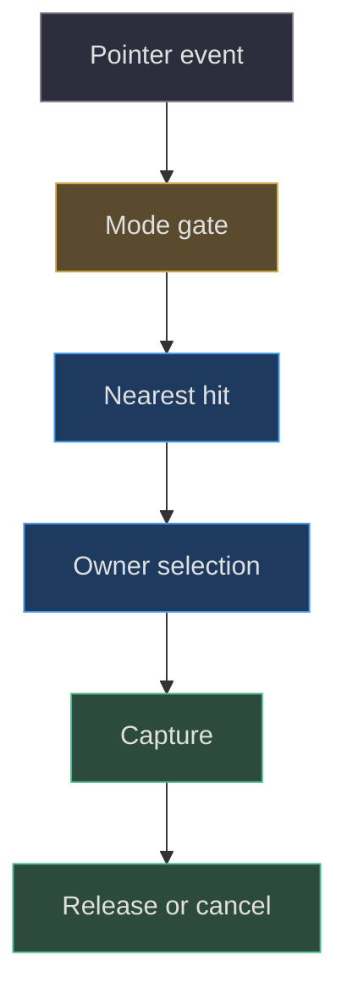
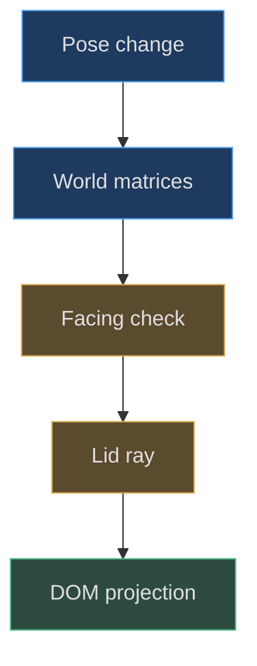

# Picking, occlusion and input ownership

## Visibility does not automatically grant input

An interactive procedural model needs more than triangles under the
cursor. It needs a rule for which surface owns a gesture, when that
ownership ends, and how an action reaches its intended subsystem.
The same canvas supports table movement, inspection, lamp switching
and DS stylus interactions. Those actions cannot all respond to the
same pointerdown. `HandheldScene` therefore dispatches by mode,
transition state, hit metadata and current movement ownership
([src/scene.js:180–231](https://github.com/Zanark/BowserBoy/blob/1e4ef518d6943ab1af39cef3b4d558f209a17891/src/scene.js#L180-L231)).

Begin with a state table rather than adding event handlers until
the desired click works. In table mode a console click can become
movement or play selection; in inspection it rotates the active
body or edits a hinge; in DS play a lower-screen touch can become
native touch. A modal dialog, transition or held stylus changes
what is available. These are behavioral ownership boundaries,
not incidental UI details.



Figure MD32.1. A successful pick is only the middle of an interaction; gates and cleanup make ownership reliable.

## Converting browser coordinates into a world ray

`pick` gets the scene canvas's CSS bounding rectangle. It converts
client coordinates into normalized device coordinates by subtracting
the rectangle origin, dividing by its CSS size, mapping X into
minus one through one, and flipping Y. `Raycaster.setFromCamera`
then produces the world ray. It intersects GBA, DS, tripod, Pear
and axolotl roots recursively and uses the first permitted hit
([src/scene.js:547–561](https://github.com/Zanark/BowserBoy/blob/1e4ef518d6943ab1af39cef3b4d558f209a17891/src/scene.js#L547-L561)).

Do not divide client coordinates by the drawing buffer dimensions.
A device-pixel ratio of two doubles the buffer but does not double
CSS pointer coordinates. Conversely, framebuffer reads need buffer
coordinates. Many apparently small picking offsets come from
mixing these spaces, especially after moving a canvas away from
the viewport origin.

Two exceptions refine nearest-hit selection. Pear's contact plane
is ignored because it is a visual cue rather than a selectable
object. A docked stylus marked `dsStylus` is ignored while the
stylus is held, preventing its inactive original geometry from
stealing input. These exclusions should remain specific. A
general rule that ignores all transparent meshes could break
legitimate screen or decorative-surface interactions.

DS native touch has a stricter ray test. It intersects the complete
DS model and accepts only when the first permitted hit is the
lower screen itself. It does not raycast directly against the
LCD and accept a point through an intervening lid. The resulting
UV is converted by `dsTouchFromUv`, then sent with a pressed or
cancelled state to the retained iframe
([src/ds-controller.js:490–508](https://github.com/Zanark/BowserBoy/blob/1e4ef518d6943ab1af39cef3b4d558f209a17891/src/ds-controller.js#L490-L508)).

## Dragging owns a plane, offset and pointer identity

A console movement record stores system, original position,
pointer ID, initial CSS coordinates, a camera-facing plane and
grab offset. The plane passes through the picked point, so
dragging follows a constant-depth surface initially. Subtracting
the ray-plane point from root position preserves where the user
grabbed the object; without it, picking a corner snaps the root
under the cursor
([src/scene.js:635–654](https://github.com/Zanark/BowserBoy/blob/1e4ef518d6943ab1af39cef3b4d558f209a17891/src/scene.js#L635-L654)).

Movement becomes a drag only after more than four CSS pixels
of pointer travel. Wheel depth is separately treated as movement.
Its displacement follows camera forward, clamped to two world
units per event. When a move is accepted, the interaction plane
is translated by the actual accepted displacement, not the
requested displacement. This matters at workspace edges:
using the unclamped request would leave the next pointer event
intersecting a plane the object never reached
([src/scene.js:233–246](https://github.com/Zanark/BowserBoy/blob/1e4ef518d6943ab1af39cef3b4d558f209a17891/src/scene.js#L233-L246),
[src/scene.js:295–323](https://github.com/Zanark/BowserBoy/blob/1e4ef518d6943ab1af39cef3b4d558f209a17891/src/scene.js#L295-L323)).

Pointer capture keeps the original owner receiving subsequent
events outside the element. Release, cancellation and lost
capture have different meanings. A normal release after motion
drops with bounded inertia; cancellation restores the original
position; a stationary console release activates play. Blur,
resize, view change and console selection also cancel owned
movements. A robust extension must cover these exits before
claiming a new drag interaction is complete.

Keyboard movement uses `.65`-unit steps along X, Y and Z.
It clears velocity after each accepted step because deliberate
keyboard placement should not imitate a fast pointer throw.
Enter drops and Escape cancels. Inspection has different
arrow-key semantics, so movement ownership is checked first.
The project architecture documents that positions are session
state, not reload-persisted placements
([docs/ARCHITECTURE.md:43–68](https://github.com/Zanark/BowserBoy/blob/1e4ef518d6943ab1af39cef3b4d558f209a17891/docs/ARCHITECTURE.md#L43-L68)).

## Projected controls need their own occlusion contract

DS control DOM elements project from physical anchors. The
controller first rejects wrong mode, transitions, back-facing
normals and offscreen positions. It then raycasts the lid and
hides a control if the lid is nearer than the anchor distance
minus `.08`. Only visible targets receive projected CSS
position and scaled size, with a minimum 44-pixel power target
and 14-pixel ordinary target
([src/ds-controller.js:677–700](https://github.com/Zanark/BowserBoy/blob/1e4ef518d6943ab1af39cef3b4d558f209a17891/src/ds-controller.js#L677-L700)).

The stylus button uses a separate obstruction check and margin
`.16`. Do not copy one tolerance blindly into the other:
their anchors and target geometry differ. Likewise, these
DOM checks are not a universal scene-wide occlusion solver.
They implement the specific DS lid and stylus ownership
requirements of the current application.

Projection cannot wait for the next eligible GPU paint.
`updateViewMatrices` updates camera and active-model matrices
and projects controls immediately after pose/camera changes.
Otherwise a deferred room frame could leave current DOM
targets paired with stale touch rays
([src/scene.js:484–500](https://github.com/Zanark/BowserBoy/blob/1e4ef518d6943ab1af39cef3b4d558f209a17891/src/scene.js#L484-L500)).



Figure MD32.2. Input geometry becomes current before GPU scheduling decides whether another room image can be submitted.

### Native messaging has session ownership too

`touch` requires both a frame and a running controller.
Its message includes the touch payload and current session
and is posted to `location.origin`. A visually correct
stylus therefore does not prove a native touch was accepted:
the controller must still have a valid retained target.
Keep session identity in any diagnostic log, without
publishing unrelated private user data
([src/ds-controller.js:498–508](https://github.com/Zanark/BowserBoy/blob/1e4ef518d6943ab1af39cef3b4d558f209a17891/src/ds-controller.js#L498-L508)).

A complete regression observes at least three stages. First,
the ray produces a legal lower-LCD UV under current geometry.
Second, the controller sends press and release for the
current session. Third, a native response demonstrates
effect where the fixture supports it. A moving physical
button cap proves neither the second nor the third stage.
Conversely, an iframe accepting input does not establish
that its hit target matches the visible handheld.

For accessibility, preserve the distinction between target
size and physical size. The power control's minimum 44 CSS
pixels is an input affordance; it does not enlarge the
modeled button cap or change native geometry. A projected
target can be larger than its visible cap while still
belonging to the same anchor and occlusion rule. Test
pointer hit area and physical travel independently. If
the target remains active through a closed lid, a generous
size is not an excuse: visibility gating must hide it
before sizing. This is a practical reason to keep
projection checks in their current order.

This distinction also guides cancellation tests. Hold a
pointer, change view or open tools, and inspect whether
all owned sources release. Repeat with keyboard and touch
ownership separately; one synthetic release cannot stand
in for every source. Then resume the retained session and
confirm no old hold remains. These are proposed diagnostic
steps derived from the controller's cleanup contract,
not claims of newly executed browser results. They make
the boundary reusable for a future model without assuming
that another console shares the DS's exact message schema
or stylus availability rules.

## MD32-W01 Convert a pointer and preserve its grab

Assume the canvas CSS rectangle is left 100, top 50, width
800, height 600. A pointer at `(500,200)` produces X
`(400/800)*2-1 = 0` and Y `-(150/600)*2+1 = .5`.
Those coordinates stay the same at pixel ratio one or two.
If the ray intersects the movement plane at world `(3,4,2)`
while the object's root is `(5,4,1)`, the stored offset is
`(2,0,-1)`. A later intersection `(4,5,2)` requests root
`(6,5,1)`, preserving the original grab.

This runnable Node recipe checks the coordinate arithmetic
only; ray generation still requires camera matrices and Three.js.
It is intentionally small enough to print beside a diagram.

```js
const rect = { left: 100, top: 50, width: 800, height: 600 };
const event = { clientX: 500, clientY: 200 };
const x = (event.clientX - rect.left) / rect.width * 2 - 1;
const y = -(event.clientY - rect.top) / rect.height * 2 + 1;
console.assert(x === 0 && y === .5);
const offset = [2, 0, -1];
const nextHit = [4, 5, 2];
console.log(nextHit.map((v, i) => v + offset[i]));
// [6, 5, 1]
```

Expected behavior after a rejected placement is different:
the model stays in its accepted position, and no fabricated
successful displacement is recorded. Keep intent, acceptance
and presentation as separate observations.

## MD32-R01 Retry with a closed lid and deferred room paint

Change the condition from a flat, unobstructed DS to a lid
covering the lower LCD while GPU recovery is active. Update
pose matrices immediately. The lower-screen-only raycast
shortcut would still return UVs, but the complete-model
nearest-hit rule should reject touch through the lid. DOM
controls obscured by the lid should likewise disappear.

If the visible image is one frame old, that does not justify
sending input through current occluding geometry. Test current
projection and ray ownership independently, then verify the
next eligible painted pose. Do not remove recovery or fake
future timestamps simply to make the test click its old target.
The DS browser coverage explicitly includes inaccessible
controls and lower-screen rejection in an occluded pose
([tests/browser/ds.spec.mjs:250–268](https://github.com/Zanark/BowserBoy/blob/1e4ef518d6943ab1af39cef3b4d558f209a17891/tests/browser/ds.spec.mjs#L250-L268)).

## MD32-Q01 Exercise: explain a stuck native press

A new tool dialog opens during a held DS pointer action.
The dialog looks correct, but gameplay continues receiving
the old hold. Why is visual correctness insufficient, and
which ownership cleanup should the tool reuse?

## MD32-A01 Explained answer

Opening a dialog changes who can receive the eventual release.
The existing controller's `openTools` first calls
`releaseInputs`: keyboard release, cancelled touch, stylus
return, release of recorded pointer sources, and map clearing.
A tool that only changes visibility bypasses that contract
([src/ds-controller.js:265–266](https://github.com/Zanark/BowserBoy/blob/1e4ef518d6943ab1af39cef3b4d558f209a17891/src/ds-controller.js#L265-L266),
[src/ds-controller.js:509–514](https://github.com/Zanark/BowserBoy/blob/1e4ef518d6943ab1af39cef3b4d558f209a17891/src/ds-controller.js#L509-L514)).

Reuse the owner-level cleanup rather than synthesizing one
arbitrary keyup. Preferences separately validate unique
bindings and reserve browser-sensitive keys; valid bindings
do not remove the need for release semantics
([src/preferences.js:63–90](https://github.com/Zanark/BowserBoy/blob/1e4ef518d6943ab1af39cef3b4d558f209a17891/src/preferences.js#L63-L90)).
A complete interaction test checks press, ownership transfer,
release/cancellation and absence of stale state, not just
whether a dialog appeared.
