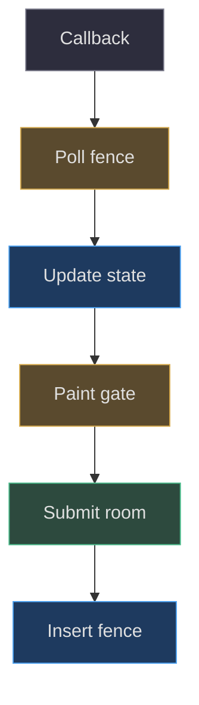
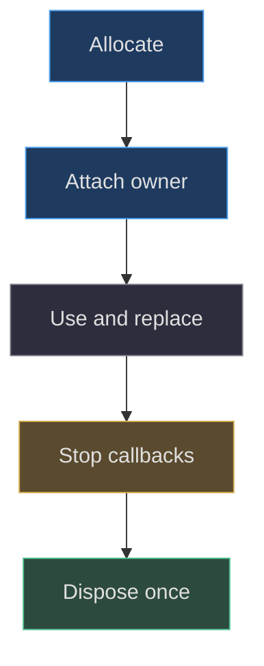

# Render loops, GPU budgets and lifecycle

## A callback is not a completed picture

The browser can call JavaScript again before previously submitted
graphics work finishes. A modeling application that treats every
animation callback as a completed picture can queue expensive
room renders faster than the GPU drains them. It can also
integrate an entire fall between visible frames. This project
separates callback time, render submission, completion fences
and presentation-aware motion
([src/scene.js:1167–1217](https://github.com/Zanark/BowserBoy/blob/1e4ef518d6943ab1af39cef3b4d558f209a17891/src/scene.js#L1167-L1217)).

The main renderer uses antialiasing and caps device-pixel ratio
at two. It does not dynamically lower sharpness after a slow
frame. Root dependencies pin Three.js 0.186.1
([package.json:7–9](https://github.com/Zanark/BowserBoy/blob/1e4ef518d6943ab1af39cef3b4d558f209a17891/package.json#L7-L9)).
Budgeting here primarily changes when another room image may
be submitted, not how many source pixels are discarded.

The checked MDN
[WebGL best-practices page](https://developer.mozilla.org/en-US/docs/Web/API/WebGL_API/WebGL_best_practices)
recommends avoiding blocking calls in production, flushing when
awaiting fence results, and budgeting memory conservatively.
Those are current recommendations consulted 2026-11-07. They
explain the design, but do not constitute a benchmark of this
room or proof of universal browser behavior.



Figure MD33.1. The render loop updates more often than it necessarily submits room work; a fence protects the queue rather than creating another animation clock.

## Constructing the scheduling state

The constructor checks whether `fenceSync`, `clientWaitSync`,
`deleteSync` and `flush` are available. Following a main room
render, `fenceRoomPaint` inserts a completion fence and flushes.
Later callbacks poll it with zero timeout. A timeout retains
the outstanding fence and withholds another room submission;
failure reports an explicit synchronization error. A signaled
fence allows deletion and scheduling of the next eligible paint.

This proves completion of submitted GPU commands before the
fence, not that a human saw a frame at a particular display
scanout. It is nevertheless stronger evidence than “one rAF
elapsed.” Startup uses this distinction: `waitForFirstPaint`
waits for scene changes and reflections to settle, then fences
the completed first frame when supported
([src/scene.js:413–449](https://github.com/Zanark/BowserBoy/blob/1e4ef518d6943ab1af39cef3b4d558f209a17891/src/scene.js#L413-L449)).

Recovery depends on observed completion delay. For a fence
observed no later than 100 milliseconds after submission, no
extra idle interval is added. Beyond that threshold, delay
is twice observed elapsed time, capped at 1000 milliseconds
for settled playing and 200 otherwise. “Otherwise” includes
transitions and cartridge insertion. The no-fence fallback
has its own earlier-callback heuristic and is not identical
to the fence path.

`paintDue` also requires no failed synchronization, no native
busy operation and no open dialog. A lighting change bypasses
the recovery timestamp, but not an outstanding fence or
those other gates. This precise exception lets direct
switching feel responsive without submitting work on top of
an unfinished room frame.

## Different loops have different owners

The scene still updates body motion, gaze, limbs and control
state before returning at the room gate. DS `paintStylus`
and `paintScreens` also run before that return. The latter
copies retained native framebuffer regions into output
canvases; it is not the expensive full 3D room render.
Moving the copy behind the gate would couple native LCD
freshness to room recovery again
([src/scene.js:1303–1342](https://github.com/Zanark/BowserBoy/blob/1e4ef518d6943ab1af39cef3b4d558f209a17891/src/scene.js#L1303-L1342),
[src/ds-controller.js:662–675](https://github.com/Zanark/BowserBoy/blob/1e4ef518d6943ab1af39cef3b4d558f209a17891/src/ds-controller.js#L662-L675)).

At an eligible paint, screen illumination samples use elapsed
time since the last paint. Clearance resolves before actual
rendering. An idle guard then checks sources, dirty flags,
active pose, button movement, adaptation and illumination
settling. If nothing requires a new picture, it returns
without waking a settled room. A new component must dirty
the scene when its appearance changes and eventually stop
dirtying it when settled.

After rendering, body motion acknowledges its required
presentation pose; transition and cartridge elapsed values
are committed to that painted step. GPU completion remains
tracked by the fence. This is a pipeline with separate
submission and completion contracts, not a claim that every
physics acknowledgment waited for monitor presentation
([src/scene.js:1372–1412](https://github.com/Zanark/BowserBoy/blob/1e4ef518d6943ab1af39cef3b4d558f209a17891/src/scene.js#L1372-L1412)).

Fullscreen screen focus suspends the room animation loop.
On return it resets `lastRender`, recovery, rendered-frame
state and dirtiness before restarting
([src/scene.js:537–545](https://github.com/Zanark/BowserBoy/blob/1e4ef518d6943ab1af39cef3b4d558f209a17891/src/scene.js#L537-L545)).
Context loss reports
an error without claiming saves were deleted; restoration
clears synchronization failure and requests a fresh paint.
Failure of LCD light sampling similarly clears and parks
that sampler, reports the error, and retains the game
instead of retrying it every frame.

## Resource lifecycle is a model contract

`setDisplay` releases the old screen map and material.
`setScreenCurve` releases replaced geometries. Reflection
replacement disposes the previous filtered target.
Final scene disposal stops animation, removes registered
global handlers, disconnects resize observation, deletes
the pending fence, releases reflection resources, traverses
geometry/material resources, and disposes the renderer
([src/scene.js:1114–1130](https://github.com/Zanark/BowserBoy/blob/1e4ef518d6943ab1af39cef3b4d558f209a17891/src/scene.js#L1114-L1130),
[src/scene.js:1430–1450](https://github.com/Zanark/BowserBoy/blob/1e4ef518d6943ab1af39cef3b4d558f209a17891/src/scene.js#L1430-L1450)).

Do not exaggerate this into a universal resource manager.
The traversal handles current material maps and explicitly
handled DS bump maps; it does not enumerate every possible
texture property a future material might acquire. Shared
leg geometry and materials can also be encountered more
than once. A proposed extension should track unique owned
resources with a Set and define external ownership rather
than blindly disposing every referenced texture.

The current official
[cleanup guide](https://threejs.org/manual/pages/cleanup.html)
explains explicit geometry, texture and material disposal,
including resource tracking. Apply that principle when
extending this implementation, but label a new tracker as
a proposal until it is actually installed and tested.



Figure MD33.2. Releasing GPU resources starts with ownership and callback shutdown; removing a mesh alone is not cleanup.

### Quantify a budget without inventing performance results

Pixel count is a useful first estimate, not a benchmark.
For a CSS canvas 800 by 600, pixel ratio one gives
480,000 drawing-buffer pixels; ratio two gives 1,920,000.
That fourfold count helps explain why density matters
without asserting that total GPU time must also quadruple.
Geometry, shaders, shadows, captures, copies and driver
behavior contribute different fixed and variable costs.

Similarly, the screen sampler visits 384 pixels per
sample regardless of the native picture's source size.
Its readback remains a synchronization-sensitive operation,
so reducing sample dimensions does not prove zero stall.
The source catches readback failures and quarantines the
failed emitter. A proposed optimization should measure
actual sample cost and retain error visibility rather
than merely removing the catch because the canvas is small.

For a trustworthy experiment, record CSS size, buffer size,
device ratio, browser/GPU environment, active lights,
moving objects and whether an environment capture occurred.
Separate CPU callback duration from observed fence delay.
The latter includes queued completion observed by a later
callback; it is not automatically an isolated GPU timer
query for one mesh. Also distinguish initial shader
compilation from settled switching, since their costs
and remedies differ.

The checked current MDN guidance suggests batching,
smaller buffers when appropriate and avoiding needless
synchronous queries. Here, smaller buffers would alter
an explicit product constraint. Investigate redundant
submission, repeated environment refresh or perpetual
dirty state first. If a new quality mode later changes
density, name it as a new authorized feature with its
own visual acceptance and regression criteria, not as
a transparent repair of the existing full-resolution path.

For lifecycle testing, repeat an owned operation rather
than reading one final memory number. Replace status
screens several times, toggle curve geometry, refresh
reflections and dispose the scene. Track which resources
should be created and released at each step. A stable
memory reading alone can hide a retained object if
driver allocation is pooled; a rising reading alone
can include intentional caches. Pair ownership counts
with renderer diagnostics and actual disposal paths.
This is a recommended future harness, not a claim
that a repeated-resource profile was run here. Keep
the current cleanup limitations visible until such
coverage exists.

## MD33-W01 Work through three fence observations

Assume settled play, no transition, no insertion and a room
frame submitted at time 1000 milliseconds. If its fence
is observed complete at 1100, elapsed is exactly 100:
the strict `>100` check is false, so `nextPaint=1100`.
If observed at 1101, elapsed 101 gives recovery 202 and
`nextPaint=1303`. If observed at 2000, twice elapsed
would be 2000, but the settled-play cap gives 1000,
so `nextPaint=3000`.

Now change only mode to a moving transition. At observation
2000, recovery caps at 200 and next paint is 2200.
These are source-derived scheduling examples, not measured
frame rates. The following runnable Node calculation
reproduces the threshold and cap.

```js
function nextPaint(submitted, observed, moving) {
  const elapsed = Math.max(0, observed - submitted);
  const limit = moving ? 200 : 1000;
  const idle = elapsed > 100
    ? Math.min(limit, elapsed * 2) : 0;
  return observed + idle;
}
console.assert(nextPaint(1000, 1100, false) === 1100);
console.assert(nextPaint(1000, 1101, false) === 1303);
console.assert(nextPaint(1000, 2000, true) === 2200);
```

## MD33-R01 Retry after a long real GPU wait

Change the test condition: callbacks have been manually
paused while real time advances during GPU recovery.
Starting the next rest sample from stale `lastRender`
can submit a synthetic timestamp earlier than the real
operation's creation time. The sparse-paint regression
therefore retires the prior fence, waits recovery, resets
the old render baseline and starts from
`performance.now()`, not from a guessed old timestamp
([tests/browser/scene.spec.mjs:338–363](https://github.com/Zanark/BowserBoy/blob/1e4ef518d6943ab1af39cef3b4d558f209a17891/tests/browser/scene.spec.mjs#L338-L363)).

The reusable fixture waits real recovery separately and
rejects a caller timestamp earlier than `nextPaint`.
It does not fabricate later time merely because waiting
took longer. Preserve both clocks in a retry; otherwise
a passing fixture can conceal a scheduling defect
([tests/browser/pixel-lab.mjs:8–41](https://github.com/Zanark/BowserBoy/blob/1e4ef518d6943ab1af39cef3b4d558f209a17891/tests/browser/pixel-lab.mjs#L8-L41)).

## MD33-Q01 Exercise: make a slow scene faster responsibly

An extension proposes lowering pixel ratio after every
100-millisecond frame and calling `gl.finish()` before
each readback. Explain why neither matches the existing
budget contract, and identify a safer first experiment.

## MD33-A01 Explained answer

Automatic ratio reduction violates the retained full-
resolution sharpness contract. A blocking completion call
can stall the main thread and native work rather than
solve queue pressure. First measure which work is being
submitted, whether reflections are recaptured unnecessarily,
whether idle invalidation ever settles and whether real
fences are respected. Change one scheduling cause while
retaining resolution and assertion bounds.

The original GPU recovery browser scenario is explicitly
CI-parked, so its retained assertions are a specification,
not a fresh success claim
([tests/browser/scene.spec.mjs:437–445](https://github.com/Zanark/BowserBoy/blob/1e4ef518d6943ab1af39cef3b4d558f209a17891/tests/browser/scene.spec.mjs#L437-L445)).
Record both performance observations and missing coverage
when handing off the experiment.
