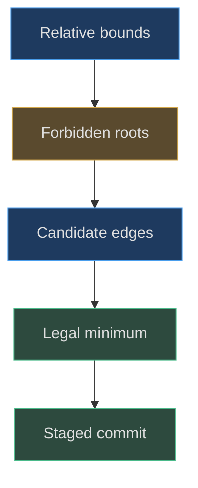
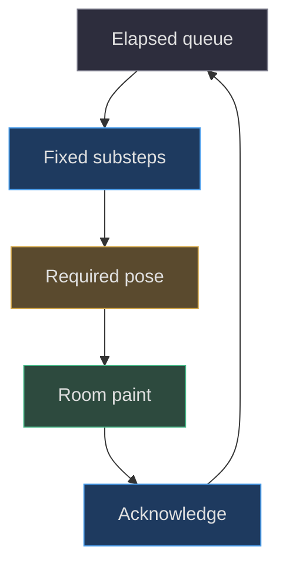

# Algorithms and data structures

## Simplification is useful only when its domain is explicit

This desk uses custom clearance and motion algorithms, not a
general collision engine. Their strength comes from a limited
problem: upright or orientation-locked objects, axis-aligned
bounds, a bounded workspace and a small set of obstacles.
Understanding those assumptions is more reusable than copying
a function name. A nearest legal translation is not the same
problem as continuous collision detection during arbitrary
rotation
([src/desk-clearance.js:3–35](https://github.com/Zanark/BowserBoy/blob/1e4ef518d6943ab1af39cef3b4d558f209a17891/src/desk-clearance.js#L3-L35),
[docs/ARCHITECTURE.md:43–101](https://github.com/Zanark/BowserBoy/blob/1e4ef518d6943ab1af39cef3b4d558f209a17891/docs/ARCHITECTURE.md#L43-L101)).

The important data structures are modest. Relative `Box3`
bounds describe an object around its root. A `Vector3`
stores a proposed root position. Arrays hold obstacles and
staged placements. Sets deduplicate candidate coordinates
and reflection materials. Small state objects preserve
pointer ownership, motion velocity and pending presentation.
There is no spatial tree to imply a large-world scalability
claim.



Figure MD34.1. Clearance converts geometry bounds into a finite root-position search before mutating any scene object.

## Deriving forbidden root rectangles

Let a moving object's local X bounds be `bmin` and `bmax`.
At root X `p`, its interval is `[p+bmin,p+bmax]`.
For obstacle interval `[omin,omax]` and gap `g`, horizontal
overlap occurs when `p > omin-bmax-g` and
`p < omax-bmin+g`. These two limits form the forbidden
root interval. Repeat for Z, after filtering out obstacles
that do not overlap at the proposed fixed Y.

The asymmetric formula is essential. A console root can be
off-center after rotation, so replacing its bounds with one
radius would either miss a corner or unnecessarily move it.
The function refuses proposed Y outside workspace limits;
it does not search for an alternative height. Its returned
vector preserves Y and is independent of the input vector.

For each axis, the algorithm collects the clamped desired
coordinate and both clamped edges of every forbidden
rectangle in a Set. It tests their Cartesian product,
rejects points in a strict forbidden interior, and minimizes
squared distance to the original desired root. For this
fixed-height rectangle problem, a nearest free point occurs
at a desired coordinate or a boundary coordinate. Squared
distance avoids a square root without changing ordering.

With `n` vertically relevant obstacles there are at most
`2n+1` coordinates per axis, thus at most `(2n+1)²`
candidate pairs. Each may test `n` rectangles: worst-case
time is cubic, coordinate and rectangle storage linear.
This bound excludes the scene traversal that first computes
boxes. It is acceptable for a small authored desk, not a
reason to apply the same search to thousands of actors.

## Numerical stability and deterministic choice

The strict-interior test allows boundary contact, with a
tolerance of eight machine epsilons multiplied by coordinate
magnitude. This repairs tiny world/local round-trip errors
without forgiving a visible overlap. The unit test separately
accepts a one-ULP boundary reconstruction and rejects a real
`.01` overlap. These are complementary obligations
([tests/unit/desk-clearance.test.mjs:90–123](https://github.com/Zanark/BowserBoy/blob/1e4ef518d6943ab1af39cef3b4d558f209a17891/tests/unit/desk-clearance.test.mjs#L90-L123)).

A different tolerance, `1e-9` in squared-distance comparison,
preserves the first candidate when distances are effectively
tied. Candidate enumeration follows Set insertion order.
Do not advertise complete order independence for every
conceivable symmetric layout. The test proves the stated
multi-blocker example is invariant under reversed obstacles,
while stable ties prevent one-ULP noise from switching sides
in repeated scene reconstruction.

The scene's multi-object resolver stages placement arrays
before committing transforms. In table mode, companions
retain priority, then loose props, then equal-ranked consoles.
It tries GBA followed by DS; if that fails, it restores the
staged arrays and tries DS followed by GBA. This is two
bounded orderings, not all permutations and not global
optimal packing
([src/scene.js:796–890](https://github.com/Zanark/BowserBoy/blob/1e4ef518d6943ab1af39cef3b4d558f209a17891/src/scene.js#L796-L890)).

## Orientation bounds are a separate algorithm

Current-orientation AABBs work for locked translation but
cannot guarantee clearance across the DS transition from
table pose to upright play. `dsPoseBounds` evaluates each
mesh bounding box under hypothetical root and lid transforms
and unions the results without changing the live pose.
That supports camera framing and candidate-space reasoning
for an intended endpoint
([src/scene.js:502–519](https://github.com/Zanark/BowserBoy/blob/1e4ef518d6943ab1af39cef3b4d558f209a17891/src/scene.js#L502-L519)).

Even endpoint hypothetical boxes do not prove continuous
rotational clearance. An extension promising an unobstructed
whole rotation needs swept bounds or sampled intermediate
poses with a justified margin. Label that as proposed work.
Do not infer it from a successful upright endpoint or from
the current desk translation solver.

## Fixed-step motion and visible state

`DeskMotion` integrates at `1/120` second. Update elapsed
is capped at five seconds, so at most 600 substeps are
processed. Gravity is 45; horizontal damping per step is
`.998`; support restitution is `.23` for sufficiently
large incoming speed and zero for small contacts.
Motion remains upright with no angular momentum, impulse
exchange or articulated rigid-body solver
([src/pear-motion.js:1–58](https://github.com/Zanark/BowserBoy/blob/1e4ef518d6943ab1af39cef3b4d558f209a17891/src/pear-motion.js#L1-L58),
[src/pear-motion.js:59–89](https://github.com/Zanark/BowserBoy/blob/1e4ef518d6943ab1af39cef3b4d558f209a17891/src/pear-motion.js#L59-L89),
[src/pear-motion.js:91–157](https://github.com/Zanark/BowserBoy/blob/1e4ef518d6943ab1af39cef3b4d558f209a17891/src/pear-motion.js#L91-L157)).

Pointer velocity is based on a bounded `.008`–`.1` second
sample and capped in magnitude at 22. Releasing after more
than 100 milliseconds of stale input clears inertia.
These limits prevent timing noise or a stationary hold
from becoming a huge throw.

Sparse painting needs additional state. A drop can require
an intermediate falling pose, an impact and a rising pose.
While a required pose awaits paint acknowledgment, motion
queues elapsed time instead of racing through the entire
event unseen. Unit coverage checks sparse `.5`- and
three-second updates, support speed, orientation locking
and presentation transitions
([tests/unit/pear-motion.test.mjs:1–180](https://github.com/Zanark/BowserBoy/blob/1e4ef518d6943ab1af39cef3b4d558f209a17891/tests/unit/pear-motion.test.mjs#L1-L180)).



Figure MD34.2. Presentation state constrains when simulation may consume queued time; fixed steps alone cannot guarantee a visible fall.

### Separate caches from authoritative state

The scene holds authoritative transforms in object roots and
motion state. Its clearance signature is only a shortcut for
detecting unchanged inputs, not an alternative source of truth.
It is saved only after successful placement. If an extension
updates the signature before attempting a layout, a failed
attempt could look clean on the next callback and suppress
the required retry. This is a general transaction lesson
derived from the resolver's actual commit boundary.

The array of staged positions is likewise temporary. Successful
commit may zero lateral velocity of displaced objects while
preserving vertical velocity and waking an elevated sleeper.
That detail prevents clearance repair from cancelling a real
fall or leaving an unsupported object asleep. A data structure
that stores only positions is therefore insufficient to
describe the whole commit's behavior.

Three other small structures solve different problems.
The screen sampler's lookup array trades a fixed 256-entry
allocation for repeated color conversion. The CRT WeakMap
allows per-canvas caches without a permanent global strong
reference. The reflection material Set deduplicates shared
physical materials. Choosing among Array, Set and WeakMap
follows access and lifetime requirements; it is not a
generic preference for one fashionable container.

When extending the scene, write down expected cardinality.
For ten relevant blockers the candidate upper bound is
441 pairs, each checking at most ten rectangles. For
one hundred it is 40,401 pairs and potentially over four
million interior checks before geometry traversal. These
are worst-case arithmetic bounds, not measured runtimes.
They show where a spatial index or different packing
strategy might become worth researching. Do not introduce
that complexity into the small desk without evidence,
and do not promise large-world scalability from the
current limited test fixtures.

## MD34-W01 Solve one asymmetric placement

Assume bounds X `[-1,2]`, Z `[-.5,.5]`, obstacle
X `[4,6]`, Z `[0,2]`, overlapping height, and gap `.25`.
Forbidden root X is `[1.75,7.25]`; forbidden root Z is
`[-.75,2.75]`. Desired root `(3,1)` in XZ lies inside.
Moving left to `(1.75,1)` costs squared distance `1.5625`.
Moving to the nearer Z boundary `(3,-.75)` costs `3.0625`.
Therefore the left edge wins if the workspace admits it
and no second obstacle blocks it.

The following runnable Node recipe imports the actual
solver and makes these assumptions explicit. Expected
root X is 1.75, Y stays one and inputs remain unchanged.
Save it as `clearance-example.mjs` at the repository root
and run `node clearance-example.mjs` in an authorized
scratch checkout with dependencies installed.

```js
import { Box3, Vector3 } from 'three';
import { nearestDeskPosition } from './src/desk-clearance.js';
const box = (a, b) => new Box3(new Vector3(...a),
  new Vector3(...b));
const bounds = box([-1, 0, -.5], [2, 2, .5]);
const workspace = box([-10, 0, -10], [10, 10, 10]);
const obstacle = box([4, 0, 0], [6, 4, 2]);
const wanted = new Vector3(3, 1, 1);
const answer = nearestDeskPosition(
  bounds, wanted, workspace, [obstacle]);
console.assert(answer.x === 1.75 && answer.y === 1);
console.assert(wanted.x === 3);
```

## MD34-R01 Retry with a second blocker and swapped order

Add a blocker covering the previous left-edge candidate.
Rebuild forbidden rectangles and search all candidate
pairs; do not merely push right by a fixed distance.
The closest free point may combine one rectangle's X
edge with another's Z edge. That is why the Cartesian
product exists.

For multiple objects, a different failure occurs when
the first console consumes the only legal position for
the second. The scene retries the opposite console
ordering before declaring failure. Keep the lamp fixed,
preserve companion priority, and roll back the temporary
placement arrays. Mutating the first root before success
would make the retry operate on a different starting
problem and could visibly jump even when both orders fail.

## MD34-Q01 Exercise: add free console rotation

An agent keeps the current relative box and adds arbitrary
rotation during dragging, claiming clearance remains exact.
Identify which assumptions cease to hold and what evidence
would be needed before making that claim.

## MD34-A01 Explained answer

Relative bounds now change with orientation, so a box
computed before rotation no longer describes the object.
Recompute transformed geometry bounds for each candidate
orientation, then consider swept motion between old and
new poses. A fixed endpoint AABB can be conservative
there yet miss an intermediate sweep. Full free rotation
also changes support, pivot and inertia assumptions in
`DeskMotion`.

The existing transition helper freezes elapsed when
paint is unavailable and preserves an intermediate DS
desk step; it is not a continuous collision detector
([src/transition-motion.js:1–8](https://github.com/Zanark/BowserBoy/blob/1e4ef518d6943ab1af39cef3b4d558f209a17891/src/transition-motion.js#L1-L8)).
Build explicit rotation and swept-clearance tests before
expanding the solver's advertised domain.
