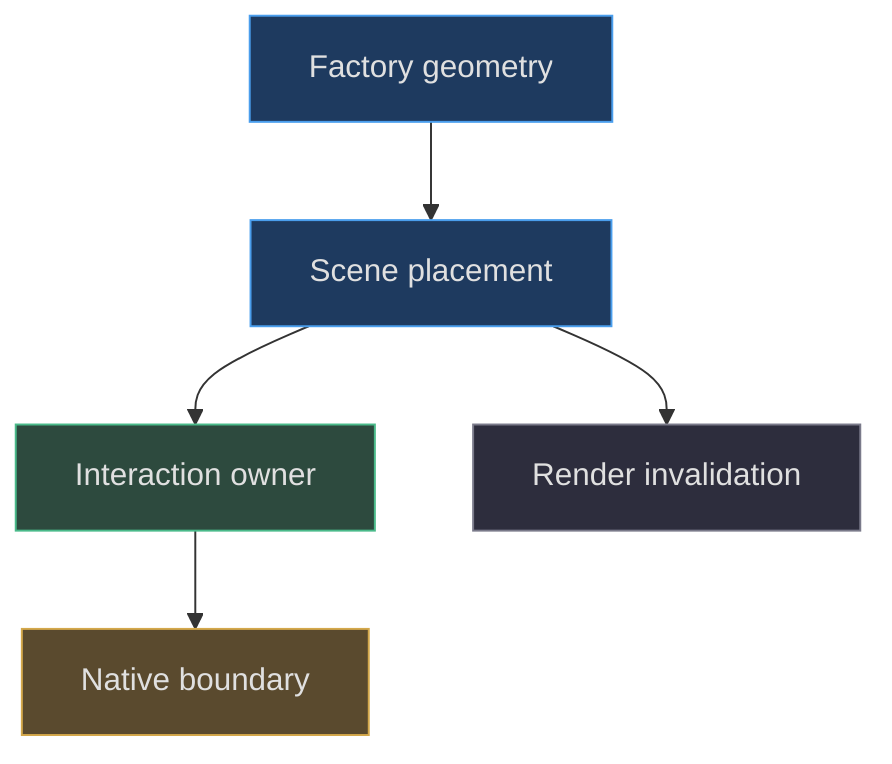
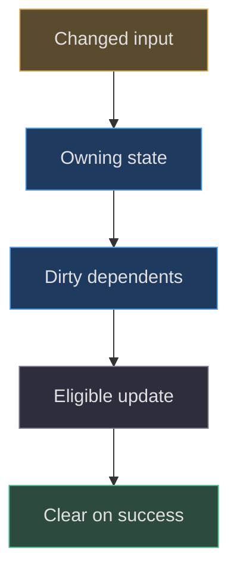

# Design principles and failure boundaries

## Principles must explain a concrete choice

A useful modeling principle predicts what to do when a condition
changes. “Keep it modular” is too weak unless it identifies
ownership, dependencies and failure behavior. This application
provides stronger examples: a model factory owns procedural
parts; scene integration owns world placement; native controllers
own emulator input; clearance stages movement before committing;
and publication tools copy an explicit allowlist. These are
different boundaries with different reasons to exist
([src/lighting.js:9–16](https://github.com/Zanark/BowserBoy/blob/1e4ef518d6943ab1af39cef3b4d558f209a17891/src/lighting.js#L9-L16),
[src/scene.js:796–890](https://github.com/Zanark/BowserBoy/blob/1e4ef518d6943ab1af39cef3b4d558f209a17891/src/scene.js#L796-L890),
[scripts/site-files.mjs:4–25](https://github.com/Zanark/BowserBoy/blob/1e4ef518d6943ab1af39cef3b4d558f209a17891/scripts/site-files.mjs#L4-L25)).

Do not infer an elaborate design-pattern framework from
ordinary functions. The code is direct JavaScript with Three.js
objects and explicit state. Its reuse value lies in contracts,
not in invented class hierarchies. A correct reconstruction
can explain where a dimension is authored, who converts its
space and who must invalidate a cached result when it changes.



Figure MD35.1. Reusable responsibility boundaries follow actual space, input and rendering ownership, not a decorative architecture taxonomy.

## Preserve invariants rather than apparent screenshots

The tabletop's upper face at world Y zero is an invariant.
The lamp's body converts metric-local child lengths exactly
once. Active LCD pixels use a basic non-tone-mapped material.
Locked console translation preserves its orientation.
Each statement is stronger than “the screenshot looks
similar,” because it explains what must survive a new
camera, device size or light state.

Invariants should also say what is deliberately approximate.
The tabletop bounce is a finite authored rectangle, not
computed global illumination. Screen spill averages a
24-by-16 image, not per-pixel indirect lighting.
`DeskMotion` is an upright bounded integrator, not a
general rigid-body solver. The reflection cube omits both
consoles. These limitations are useful design choices when
their costs and consequences remain visible
([src/lighting.js:103–110](https://github.com/Zanark/BowserBoy/blob/1e4ef518d6943ab1af39cef3b4d558f209a17891/src/lighting.js#L103-L110),
[src/lighting.js:126–188](https://github.com/Zanark/BowserBoy/blob/1e4ef518d6943ab1af39cef3b4d558f209a17891/src/lighting.js#L126-L188),
[src/pear-motion.js:91–157](https://github.com/Zanark/BowserBoy/blob/1e4ef518d6943ab1af39cef3b4d558f209a17891/src/pear-motion.js#L91-L157)).

The current official
[physical-material reference](https://threejs.org/docs/pages/MeshPhysicalMaterial.html)
describes capabilities such as clearcoat and transmission.
That does not obligate every modeled surface to use every
capability. More physically elaborate materials increase
cost and demand better illumination data. The correct
question is which additional behavior solves a demonstrated
problem, not which property makes a material sound advanced.

## Make illegal transitions explicit

Clearance is transactional. The scene computes staged
positions under fixed priorities, tries the two permitted
console orders, and only then commits roots. If no complete
layout exists, it reports an error and withholds the next
paint rather than knowingly displaying an overlapping
repair. This is a failure boundary: an impossible scene
is not silently reclassified as acceptable.

Reset is similarly conditional. A companion may have
occupied a saved console home, or another object may
occupy a companion home. The application refuses that
reset with an explicit reason rather than moving the
fixed tripod or teleporting an unrelated object
([src/scene.js:698–712](https://github.com/Zanark/BowserBoy/blob/1e4ef518d6943ab1af39cef3b4d558f209a17891/src/scene.js#L698-L712),
[src/scene.js:768–794](https://github.com/Zanark/BowserBoy/blob/1e4ef518d6943ab1af39cef3b4d558f209a17891/src/scene.js#L768-L794)).

An interaction failure should preserve unrelated state.
The context-loss message says the game and saves were
retained and offers recovery tools. Screen-light sampling
failure clears the failed source and quarantines it
instead of retrying the same readback every animation
callback. Neither strategy declares success; it narrows
the failed subsystem while retaining a usable path forward
([src/scene.js:383–391](https://github.com/Zanark/BowserBoy/blob/1e4ef518d6943ab1af39cef3b4d558f209a17891/src/scene.js#L383-L391),
[src/scene.js:1343–1364](https://github.com/Zanark/BowserBoy/blob/1e4ef518d6943ab1af39cef3b4d558f209a17891/src/scene.js#L1343-L1364)).

## Boundaries for identity and assets

Website identity is not interchangeable with hardware
decoration. Architecture documentation distinguishes the
site chrome, purple GBA identity and DS styling. Replacing
every surface with the website logo would flatten those
roles and make the modeled objects less legible
([docs/ARCHITECTURE.md:11–31](https://github.com/Zanark/BowserBoy/blob/1e4ef518d6943ab1af39cef3b4d558f209a17891/docs/ARCHITECTURE.md#L11-L31)).

`src/brand.js` decodes four approved images and exposes
cached assets only after successful decoding. Site file
mapping explicitly names vendor modules and eligible
top-level source/assets files; it is not a recursive
copy of the repository. This matters when adding a
procedural model with reference material: a private
reference directory does not become public merely because
the project has an assets directory
([src/brand.js:6–15](https://github.com/Zanark/BowserBoy/blob/1e4ef518d6943ab1af39cef3b4d558f209a17891/src/brand.js#L6-L15)).

The build script clears distribution, copies that mapping,
generates the two original demo artifacts and writes
the Pages marker. It is a publishing preparation action,
not a harmless manuscript validator. This writing task
does not run it
([scripts/build.mjs:7–16](https://github.com/Zanark/BowserBoy/blob/1e4ef518d6943ab1af39cef3b4d558f209a17891/scripts/build.mjs#L7-L16)).
Keep permission to document separate from permission to
build, synchronize, commit or deploy.

## Invalidating caches at the owner boundary

A cache is correct only when all changes to its inputs
are represented. `drawLcdCrt` keys by canvas plus dimensions
and row count. The scene's clearance signature includes
relevant poses, hinge and cartridge state. Reflections
have their own dirty flag because direct lighting can
paint before environment capture. These caches have
different lifetimes and must not be collapsed into one
global “needs update” boolean.

When adding an extension, list its inputs beside the
cache. A shade radius affects geometry, lamp bounds,
possible emitter seams and reflections. A brightness
change affects lighting and exposure but not necessarily
leg geometry. A texture replacement affects resource
disposal as well as appearance. This dependency exercise
is more valuable than adding updates everywhere until
the visible bug disappears
([src/lcd-crt.js:1–27](https://github.com/Zanark/BowserBoy/blob/1e4ef518d6943ab1af39cef3b4d558f209a17891/src/lcd-crt.js#L1-L27)).



Figure MD35.2. Clear dirty state only after the dependent update succeeds; a failed refresh must remain distinguishable from a valid cache.

### Prefer narrow adapters over cross-system shortcuts

The scene asks the DS controller to copy screens and
project controls through explicit methods. It does not
reach into native gameplay and reinterpret emulator
state as room lighting state. Likewise, a screen picture
becomes illumination through a sampler rather than by
changing every shell material to emissive. These narrow
adapters allow one subsystem to fail or run at a different
cadence without silently redefining another.

The same principle applies to new models. A proposed
desk clock might return a root, a display source and
an interaction callback. Its scene adapter would own
placement, light sampling and invalidation. It should
not directly mutate the active console's camera target
or private native session. This is a hypothetical
extension example, not an assertion that a clock exists
in the current room.

Prefer explicit state transitions to “helpful” global
repair. If a lamp switch needs fresh reflections, mark
that dependency. Do not rebuild all model factories.
If a new movement cannot fit, report it. Do not move
the fixed environment. If a display source is invalid,
surface that failure and retain unrelated native state.
Such narrow responses make causal debugging possible
because one user's action has a bounded set of effects.

Finally design rollback at the same abstraction level
as the change. A material experiment restores material
properties; a staged layout restores staged arrays
before trying another order; a capture restores renderer
tone mapping and object visibility in `finally`. Mixing
those levels produces partial recovery: for example,
restoring only the camera after a failed capture leaves
both consoles invisible. The concrete restoration in
`updateDsReflections` is a better teaching model than
a generic instruction to “handle errors gracefully.”

Use names as diagnostic interfaces, not as magical
selectors for broad behavior. The factory gives legs,
shade and emitters useful names, while interaction
uses explicit metadata or returned references.
An extension should preserve both roles: names make
ray-probe failures understandable, and references keep
application logic independent of display wording.
If a test deliberately depends on a name to establish
which shell surface was sampled, a rename changes
that evidence contract and deserves a coordinated
test update. Do not silently drop the surface check
because a friendlier label was introduced. Naming
is a lightweight but real part of observability.

## MD35-W01 Design a reversible lamp-material experiment

Propose changing shade roughness from `.95` to `.8`.
First identify the owner: shade and both rims share the
same material. One assignment changes all three.
Record the old value, perform the proposed assignment,
dirty the scene and reflection cache, and compare the
same camera and light state. Do not separately mutate
each rim with a cloned material unless a different
finish is the explicit goal.

Expected effects are surface-response differences, not
new emitted power: retain emissive intensity 60,
diffuser intensity 80 and all four light coefficients.
If the room becomes broadly brighter, inspect accidental
light or exposure changes before attributing the result
to roughness.

The following pseudocode is a proposed transaction for
an isolated harness, not a new application API. It
assumes a lamp factory result and a scene invalidator.

```text
remember shade.material.roughness
try:
  set shared roughness to 0.8
  invalidate main view and reflected environment
  capture matching diagnostic observations
finally:
  restore remembered roughness
  invalidate the same dependents
```

A reversible harness protects the baseline and makes
the changed condition explicit. The comparison still
requires human review; no roughness value alone proves
that the cloth reads more convincingly.

## MD35-R01 Retry when the experiment changes geometry

Now change the shade diameter instead. The previous
material-only invalidation list is insufficient.
Rebuild the cylinder and rims, dispose replaced owned
geometry, recompute lamp bounds and test nearby
placement. Inspect the transmitted rectangle's position
relative to fabric. Then request reflection refresh.

This retry illustrates why a generic “visual tweak”
work item is poorly specified. State precisely which
inputs change, which invariants remain fixed and which
old tests cease to cover the new domain. Do not
weaken the fixed-lamp assertion because a larger lamp
makes a layout inconvenient. The test checks a
product behavior, not an arbitrary obstacle to editing
([tests/browser/desk-clearance.spec.mjs:59–72](https://github.com/Zanark/BowserBoy/blob/1e4ef518d6943ab1af39cef3b4d558f209a17891/tests/browser/desk-clearance.spec.mjs#L59-L72)).

## MD35-Q01 Exercise: can automation approve the redesign?

An agent reports valid geometry, no detected overlaps,
passing color thresholds and a green deployment.
It concludes that the redesigned desk has owner
approval. Explain which inference fails and how to
word a truthful handoff.

## MD35-A01 Explained answer

Each observation covers a separate technical layer.
Geometry tests do not establish aesthetic preference;
color thresholds cover chosen probes; deployment
shows a revision became available. None supplies
the owner's visual acceptance. Report exactly those
observations and mark aesthetic approval pending.

The verification document makes this distinction
explicit and treats previously parked scenarios as
coverage debt, not silently passing cases
([docs/VERIFICATION.md:1–8](https://github.com/Zanark/BowserBoy/blob/1e4ef518d6943ab1af39cef3b4d558f209a17891/docs/VERIFICATION.md#L1-L8)).
Likewise, the GIF-first root README introduces the
project while standalone books carry deep detail;
new documentation should extend that navigation
instead of replacing the public identity with a wall
of engineering receipts
([README.md:1–30](https://github.com/Zanark/BowserBoy/blob/1e4ef518d6943ab1af39cef3b4d558f209a17891/README.md#L1-L30)).
