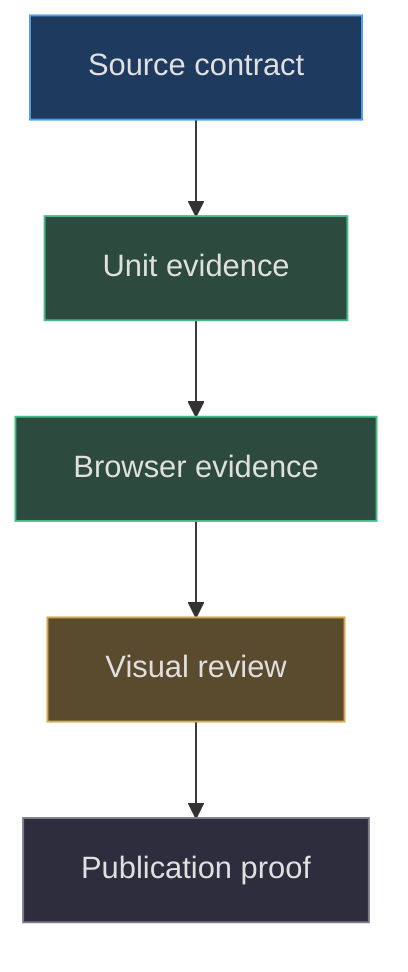
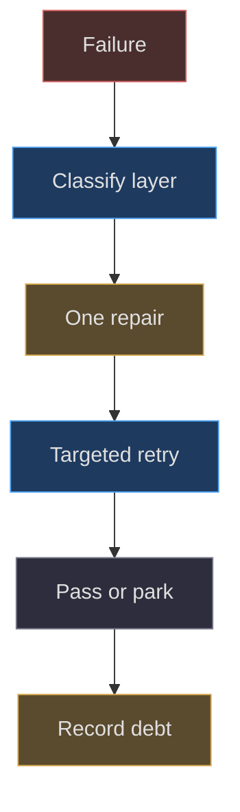

# Validation and bounded recovery

## Evidence is a ladder, not one green checkbox

A procedural model can have valid geometry and still fail
when touched, lit, moved or published. Validation should
therefore identify the layer being observed. Source
inspection establishes construction intent; unit tests
establish mathematical contracts; browser tests establish
integrated behavior under particular fixtures; screenshots
support visual review; deployment records identify a
published artifact. Human aesthetic acceptance remains
separate. The public verification record explicitly
warns against collapsing those layers
([docs/VERIFICATION.md:1–8](https://github.com/Zanark/BowserBoy/blob/1e4ef518d6943ab1af39cef3b4d558f209a17891/docs/VERIFICATION.md#L1-L8)).

This chapter gives reproducible validation instructions,
not a claim that tests ran while this handbook was
written. The pinned assertions are evidence of what
the project checks and where gaps remain. A recipe
without an execution receipt is a planned experiment,
not a result.



Figure MD36.1. Later evidence adds information rather than replacing earlier contracts; publication still does not imply owner approval.

## Validate construction before appearance

Begin with counts, dimensions, transforms and ownership.
For the tripod, verify three shared-geometry legs, an
open drum, two rims, support cylinder, diffuser and
the four actual light objects. Confirm that body
scale is `1/.017` and root placement is not scaled
twice. Those checks detect a malformed reconstruction
before a pleasing light setup can conceal it
([src/lighting.js:9–110](https://github.com/Zanark/BowserBoy/blob/1e4ef518d6943ab1af39cef3b4d558f209a17891/src/lighting.js#L9-L110)).

Next validate bounds under the intended orientation.
The desk solver's tests cover multi-blocker nearest
placement, independent returned vectors, vertical
separation, asymmetric extents, numeric gaps and
one-ULP boundary stability. They do not prove free
rotational collision behavior
([tests/unit/desk-clearance.test.mjs:1–123](https://github.com/Zanark/BowserBoy/blob/1e4ef518d6943ab1af39cef3b4d558f209a17891/tests/unit/desk-clearance.test.mjs#L1-L123)).
For a DS endpoint, use hypothetical geometry bounds;
for a proposed full rotation, add explicit swept
coverage rather than rebranding endpoint tests.

Motion validation checks trajectories and state
transitions separately. The unit test with sparse
three-second updates requires falling and rising
presentation states to survive until acknowledgment.
It also verifies that resetting clears pending
presentation and inertia
([tests/unit/pear-motion.test.mjs:75–154](https://github.com/Zanark/BowserBoy/blob/1e4ef518d6943ab1af39cef3b4d558f209a17891/tests/unit/pear-motion.test.mjs#L75-L154)).
A final resting position alone cannot reveal an
entire skipped bounce.

## Browser fixtures must establish their own conditions

The upright DS lighting fixture is unusually instructive.
It uses both desktop and narrow-phone dimensions,
turns off Pear and axolotl, establishes a straight
root, installs genuine status LCD materials and
ray-checks shell probes before sampling pixels.
This avoids accidentally measuring a background,
reflection or occluding lid instead of paint
([tests/browser/ds.spec.mjs:1412–1486](https://github.com/Zanark/BowserBoy/blob/1e4ef518d6943ab1af39cef3b4d558f209a17891/tests/browser/ds.spec.mjs#L1412-L1486)).

The fixture's tripod-only blue threshold above 75
and all-off maximum below three express a bounded
product expectation. They are not universal color
calibration. If another renderer produces different
pixels, inspect probe ownership, fixture state,
exposure convergence and actual geometry first.
Do not lower the threshold until the intended
condition disappears.

Room-paint fixtures must honor GPU readiness.
`installRoomPaintFixture` retires the real fence,
waits bounded recovery, rejects timestamps before
`nextPaint` and requires `renderedLastFrame`.
It does not equate any callback with a picture
([tests/browser/pixel-lab.mjs:8–41](https://github.com/Zanark/BowserBoy/blob/1e4ef518d6943ab1af39cef3b4d558f209a17891/tests/browser/pixel-lab.mjs#L8-L41)).
Use it to distinguish state mutation from actual
render submission. A later GPU fence gives stronger
completion evidence, though not proof of display
scanout or human observation.

## One bounded repair, then explicit parking

The project has documented repeated headless
application failures rather than pretending every
scenario is green. Its policy permits one bounded
repair, then parks a repeating scenario while
retaining its assertions, deadlines and resolution
contract. Coverage debt remains linked to an
actual issue. Parking is neither a code fix nor
permission to call the scenario passed
([docs/VERIFICATION.md:93–107](https://github.com/Zanark/BowserBoy/blob/1e4ef518d6943ab1af39cef3b4d558f209a17891/docs/VERIFICATION.md#L93-L107)).

A bounded repair changes one evidenced cause:
for example, disabling both companions when a
fixture claims LCD-only lighting, or starting a
rest experiment from current `performance.now()`
after real GPU waiting. Removing native framebuffer
assertions, reducing density, inventing synthetic
future time or extending every deadline is not
equivalent. Those actions can change the product
contract merely to satisfy the harness.

If failure repeats, preserve its original assertion
body, report the exact exclusion and open or update
the corresponding issue and Project status through
the authorized owner. Do not retry indefinitely
until environmental luck produces a receipt.
The ledger records this distinction and rejects
receipt-only deployment loops
([TODO/04_DEVELOPMENT_LEDGER.todo:1–106](https://github.com/Zanark/BowserBoy/blob/1e4ef518d6943ab1af39cef3b4d558f209a17891/TODO/04_DEVELOPMENT_LEDGER.todo#L1-L106)).



Figure MD36.2. Bounded recovery preserves assertions and records unresolved coverage instead of manufacturing a green result.

## The actual workstream record

Numbered TODO workstreams carry eight core fields:
Status, Milestone, Dependencies, Purpose, Tasks,
Acceptance criteria, Completion evidence and
Completion log. `TODO/116_DS_UPRIGHT_LIGHTING.todo`
shows this structure and links actual GitHub issue
115. A workstream number is therefore not an
issue-number formula
([TODO/116_DS_UPRIGHT_LIGHTING.todo:1–38](https://github.com/Zanark/BowserBoy/blob/1e4ef518d6943ab1af39cef3b4d558f209a17891/TODO/116_DS_UPRIGHT_LIGHTING.todo#L1-L38)).

Tracking documentation describes local TODO text as
the managed source, preview-first synchronization,
refusal to overwrite divergent remote changes,
persisted backlinks and final readback of issue
body, state, Project membership and status.
Index and perpetual ledger are not ordinary numbered
workstreams to mirror blindly. This is a real
workflow, not authorization for every documentation
agent to synchronize or publish
([docs/GITHUB-TRACKING.md:1–63](https://github.com/Zanark/BowserBoy/blob/1e4ef518d6943ab1af39cef3b4d558f209a17891/docs/GITHUB-TRACKING.md#L1-L63)).

Write completion evidence in past tense only for
actions that actually occurred. Planned checks
belong in Tasks or Acceptance criteria. A chapter
describing a test cannot reuse a historical success
as its own execution receipt.

### Keep the experiment's stopping rule explicit

Before a browser run, state the expected terminal
outcomes: pass with retained assertions, fail with
diagnostic evidence, or explicit exclusion after the
bounded repair policy. Also state which exact command,
revision and shard inventory will be monitored. Without
that stopping rule, an agent can accidentally substitute
an endless series of partial runs for one complete
verification attempt.

A useful failure packet contains the scenario name,
fixture setup, actual assertion text, relevant console
or application error, timing/fence state and any
captured diagnostic image. It also distinguishes a
harness timeout from a product assertion failure.
Both matter, but they suggest different next actions.
A timeout before startup ownership is established
does not prove an LCD shader defect. A native source
assertion after valid startup should not be dismissed
as cosmetic rendering noise.

Preserve negative controls. The upright-light fixture's
all-off state protects against adding global ambient
as a shortcut. Its LCD equality protects against
rescuing shell brightness by changing picture output.
Its ray probes protect against sampling the wrong
surface. Removing any one can allow a different
wrong implementation to satisfy the remaining checks.
This is why a good regression contains several
orthogonal observations rather than one elaborate
screenshot threshold.

For documentation validation, use a different scope.
Check chapter names, required markers, balanced
fences, Mermaid parsing, source-path existence,
verified line bounds and prose depth. Those checks
can establish manuscript integrity without building
the application or exercising native gameplay.
Report them as documentation checks only. A
successful Markdown validator must not be added
to the runtime test-pass total, just as a
runtime deployment must not be presented as
an aesthetic review. This separation keeps
future handoffs honest even when several agents
produce different evidence at the same time.

Also record what a diagnostic image cannot establish.
A still image can show a shell silhouette and
local brightness, but not a press/release sequence
or a deferred native update. A short animation can
show motion, but may omit the exact moment that
a held source should cancel. A GPU fence can
establish command completion, but not who reviewed
the picture. Choose evidence to match each claim
and preserve the missing dimensions explicitly.
This avoids requesting ever more screenshots for
a state-ownership defect that needs event traces,
or replacing visual review with a numeric bound
that covers only one small region.

## MD36-W01 Reconstruct a truthful result summary

The public record identifies historical exact-source
run `387537b602f44a5bc85d10ee0196d0ccb099e968`.
Its declared browser inventory is 119: 98 passed,
21 explicitly skipped, zero failed and zero unrun.
The arithmetic `98+21=119` reconciles declared
coverage, but “119 passed” would be false.
The record also identifies all nineteen shards
and build/deploy evidence. Those receipts belong
to that source revision and run
([docs/VERIFICATION.md:9–37](https://github.com/Zanark/BowserBoy/blob/1e4ef518d6943ab1af39cef3b4d558f209a17891/docs/VERIFICATION.md#L9-L37)).

This runnable Node recipe checks only reconciliation.
Expected output keeps passed and excluded separate.

```js
const result = {
  declared: 119, passed: 98, skipped: 21,
  failed: 0, unrun: 0
};
const accounted = result.passed + result.skipped
  + result.failed + result.unrun;
console.assert(accounted === result.declared);
console.log(`${result.passed} passed; ` +
  `${result.skipped} excluded; ${result.unrun} unrun`);
```

The same record says 48 public runtime files
matched, while a stricter 49-entry checker still
exited one because the Pages marker returned 404.
Report both facts. Do not convert an explained
checker failure into a forty-ninth successful
response, and do not imply this chapter repeated
the published-byte checks.

## MD36-R01 Retry when the fixture, not the model, is wrong

Suppose the first upright LCD test used powered-off
glass and observed changed pixels after switching
lights. The changed condition is reflective material,
not corrupted active LCD output. The bounded repair
is to install status LCDs, verify their basic
non-tone-mapped material and retain the original
RGB equality requirement.

Rerun the affected desktop and phone scenarios
under the exact same geometric and lighting
assertions. If application failures repeat,
park them explicitly and preserve coverage debt.
Do not replace an active-LCD assertion with a
weaker “image exists” assertion. The historical
lighting TODO records this correction and its
limited reason; it does not justify generalized
fixture weakening.

## MD36-Q01 Exercise: identify the unsupported conclusion

A report says “Pages deployed successfully, so
the shader, native input and owner-approved
appearance are verified.” Which additional
receipts would make each narrower claim defensible?

## MD36-A01 Explained answer

Deployment proves availability of a particular
artifact only after revision identity is checked.
Shader behavior needs material/state observations
and appropriate pixel or visual evidence.
Native input needs a real transition or native
framebuffer response, not merely button animation.
Owner approval needs the owner's explicit review.

For each claim, record revision, command or
fixture, environment, exact outcome and remaining
exclusions. Monitor the exact run to a terminal
state and reconcile all shards rather than
substituting a later unrelated green run.
This separation turns a report into reusable
engineering evidence rather than persuasive
but untraceable optimism.
