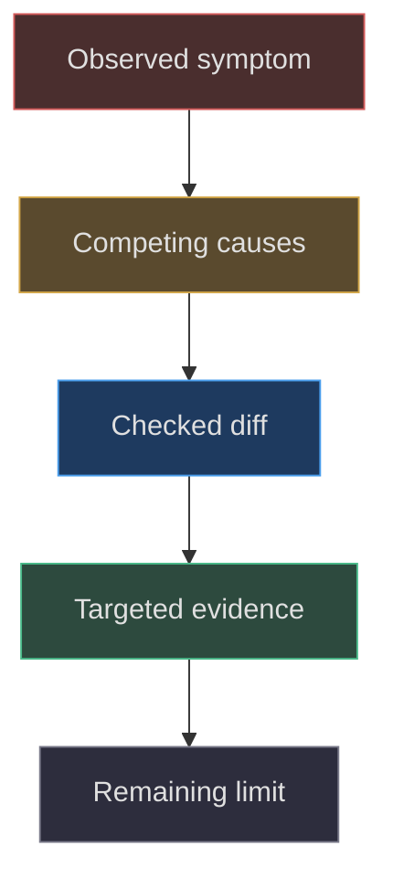
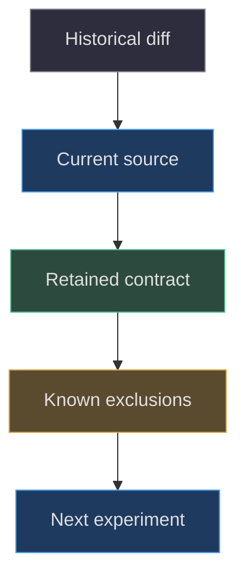

# The causal modeling history

## History teaches causality, not just chronology

A useful modeling history explains why the present
implementation has its shape. Listing commits is
insufficient: each change should connect a symptom,
a tested mechanism, a bounded repair and an
evidence limit. This chapter distinguishes checked
diffs from documented historical observations.
It does not recreate private conversation, claim
perfect memory or treat an old screenshot as
proof that today's source was tested.

The current manuscript's baseline is
`1e4ef518d6943ab1af39cef3b4d558f209a17891`.
When an earlier diff has a different constant,
teach the earlier value only as history. The
current runtime's exposure, GPU thresholds and
placements come from the pinned source, not a
commit message
([src/scene.js:14–25](https://github.com/Zanark/BowserBoy/blob/1e4ef518d6943ab1af39cef3b4d558f209a17891/src/scene.js#L14-L25),
[src/scene.js:1182–1236](https://github.com/Zanark/BowserBoy/blob/1e4ef518d6943ab1af39cef3b4d558f209a17891/src/scene.js#L1182-L1236)).



Figure MD37.1. Causal history preserves rejected explanations and evidence limits instead of converting every commit into an unqualified success story.

## The upright DS: a spatial repair, not brighter paint

Commit
[`9be851e96098e0dfd4beedffd911185cf33a11a6`](https://github.com/Zanark/BowserBoy/commit/9be851e96098e0dfd4beedffd911185cf33a11a6)
changes the DS play position from `(5,5.1,8)`
to `(-2,5.1,-8)`. The checked application diff
does not alter shell materials, light intensities
or exposure. That is the causal point: a straight
camera-facing shell had been behind the wrong
side of the existing lamp, so the repair moved
the shell into the authored illumination.

The workstream records old blue-channel values
around nine or ten, and final documented shell
blue ranges 108–113 on the lid and 117–157
on the deck. These are historical observations
reported in the TODO, not values newly measured
for this handbook. It also records an intermediate
candidate `(-2,5.1,-2)` that improved lighting
but had a rotation-clearance gap of `-1.047`.
Brightness alone therefore could not select
the final placement
([TODO/116_DS_UPRIGHT_LIGHTING.todo:1–56](https://github.com/Zanark/BowserBoy/blob/1e4ef518d6943ab1af39cef3b4d558f209a17891/TODO/116_DS_UPRIGHT_LIGHTING.todo#L1-L56)).

The final regression is geometrically specific:
eight probe rays must hit named deck/lid shell
surfaces inside the frame; all lamps off must
be nearly black; tripod and room conditions
must produce the expected blue shell. Status
LCD RGB must not change. Those controls rule
out a fake repair that simply increases
global ambient or recolors the paint
([tests/browser/ds.spec.mjs:1412–1486](https://github.com/Zanark/BowserBoy/blob/1e4ef518d6943ab1af39cef3b4d558f209a17891/tests/browser/ds.spec.mjs#L1412-L1486)).

## GPU fences changed the meaning of readiness

Commit
[`34484498de6be19a48c5191c4d717035bf84a320`](https://github.com/Zanark/BowserBoy/commit/34484498de6be19a48c5191c4d717035bf84a320)
introduced real room-paint fences and separated
DS LCD copying from room-paint-only controller
work. This addressed two coupled problems:
JavaScript could outpace graphics completion,
and budgeting the room could accidentally
freeze native LCD copying.

The earlier diff used a 50-millisecond slow-frame
threshold. The pinned implementation uses
100 milliseconds. Do not copy the historical
threshold into a current recipe simply because
the commit explains the mechanism well.
The key lasting design is zero-timeout polling,
explicit flush, bounded recovery and independent
native picture updates.

Later commit
[`836fc093bc4e72b06898e983cdf524c8fe772047`](https://github.com/Zanark/BowserBoy/commit/836fc093bc4e72b06898e983cdf524c8fe772047)
retained severe-load recovery while avoiding
an added wait for moderate completed frames.
Its checked tests distinguish the exact
100-millisecond boundary from 101 milliseconds.
This is not a claim that all devices now reach
a particular frame rate. It is an algorithmic
policy improvement under stated observations.

Another subtle repair concerns the test clock.
After a real GPU wait, starting a rest sample
from stale `lastRender` can place synthetic
time before actual work creation. The current
test resets the baseline and starts at real
`performance.now()`
([tests/browser/scene.spec.mjs:338–363](https://github.com/Zanark/BowserBoy/blob/1e4ef518d6943ab1af39cef3b4d558f209a17891/tests/browser/scene.spec.mjs#L338-L363)).
History therefore teaches a testing lesson as
well as a renderer lesson: clocks are part
of a fixture's causal model.

## Why fixed steps needed presentation state

Commit
[`120d9bd5a3e785d24a9bdc5e96d6e9b332613510`](https://github.com/Zanark/BowserBoy/commit/120d9bd5a3e785d24a9bdc5e96d6e9b332613510)
added fall/bounce/rise presentation behavior.
Ordinary fixed stepping can compute a correct
final rest position after a long gap while
never showing the fall. The repair preserves
meaningful intermediate poses until the room
acknowledges them, while bounding integration
to 600 substeps.

This is deliberately not a replacement for
accurate rigid-body physics. Motion remains
upright, support and side contact are simplified,
and queued elapsed time serves the visible
interaction. The unit tests prove the intended
sparse-update sequence and eventual behavior,
not angular momentum or arbitrary contact
manifolds
([src/pear-motion.js:91–157](https://github.com/Zanark/BowserBoy/blob/1e4ef518d6943ab1af39cef3b4d558f209a17891/src/pear-motion.js#L91-L157),
[tests/unit/pear-motion.test.mjs:75–154](https://github.com/Zanark/BowserBoy/blob/1e4ef518d6943ab1af39cef3b4d558f209a17891/tests/unit/pear-motion.test.mjs#L75-L154)).

## Tiny numeric errors, large visible layout changes

Commit
[`6b5d2c552e6b3206bfb3ae36d845896773147a1c`](https://github.com/Zanark/BowserBoy/commit/6b5d2c552e6b3206bfb3ae36d845896773147a1c)
adds a magnitude-scaled eight-epsilon tolerance
to forbidden-rectangle interior checks. A legal
edge can move a few ULPs when world bounds
are translated to local bounds and reconstructed.
Without tolerance, the candidate can be
misclassified as inside and jump to a different
side of the desk.

The repair does not replace the `.25` physical
clearance gap with a broad collision fudge.
The separate squared-distance tie tolerance
remains, and the tests retain rejection of
an actual `.01` overlap. Historical context
explains why both numerical and product-scale
tests are necessary
([src/desk-clearance.js:18–31](https://github.com/Zanark/BowserBoy/blob/1e4ef518d6943ab1af39cef3b4d558f209a17891/src/desk-clearance.js#L18-L31),
[tests/unit/desk-clearance.test.mjs:90–123](https://github.com/Zanark/BowserBoy/blob/1e4ef518d6943ab1af39cef3b4d558f209a17891/tests/unit/desk-clearance.test.mjs#L90-L123)).

## Built-in CRT became explicit reusable drawing

Commit
[`06e9c8240b6f3a8c5e2c91a408db0be61ccdfef2`](https://github.com/Zanark/BowserBoy/commit/06e9c8240b6f3a8c5e2c91a408db0be61ccdfef2)
introduced the cached built-in CRT treatment.
The present helper caches mask and vignette
by canvas dimensions and row count, then
restores drawing state. This history supports
a bounded claim about generated status images,
not a claim that all native CRT presets use
this canvas implementation
([src/lcd-crt.js:1–39](https://github.com/Zanark/BowserBoy/blob/1e4ef518d6943ab1af39cef3b4d558f209a17891/src/lcd-crt.js#L1-L39),
[src/preferences.js:1–13](https://github.com/Zanark/BowserBoy/blob/1e4ef518d6943ab1af39cef3b4d558f209a17891/src/preferences.js#L1-L13)).



Figure MD37.2. A historical mechanism becomes a current teaching claim only after comparison with the pinned implementation and its exclusions.

### Read a history entry in both directions

Forward reading asks what changed after a symptom.
Backward reading asks which present invariant would
break if the change were removed. Removing the
ULP tolerance can destabilize a legal edge.
Removing presentation acknowledgment can hide a
fall under sparse painting. Putting DS copies
behind the room gate can stale native pictures.
These counterfactuals make the history useful
for future regression design.

Counterfactual reasoning is not a new experiment.
Unless the removal was actually tested, label it
as an explanation derived from source and tests.
The distinction is especially important when
historical entries include numerical observations:
those values depend on their fixture and
environment, and cannot be reproduced merely
by repeating them in prose.

Look for unchanged files as well as edited
ones. The upright repair's lack of material
or light edits rules out several claimed
mechanisms. Conversely, a commit that touches
renderer, tests and verification prose does
not automatically prove all three are correct.
Read its actual changes and compare to the
final baseline, where later edits may alter
thresholds, exclusions or fixture preparation.

The development ledger is a causal index,
not the complete evidence itself. Its newest
entries distinguish exact-source deployment,
book artifacts outside the runtime allowlist
and preservation of nine unrelated dirty
historical images
([TODO/04_DEVELOPMENT_LEDGER.todo:1–36](https://github.com/Zanark/BowserBoy/blob/1e4ef518d6943ab1af39cef3b4d558f209a17891/TODO/04_DEVELOPMENT_LEDGER.todo#L1-L36)).
Those distinctions explain why documentation
work must not casually rebuild or commit
the whole worktree. A model change, a
book change and a published runtime receipt
can coexist while having different owners.
Record which one a history claim concerns,
and avoid promoting a navigation or receipt
update into an application-behavior change.

For each historical measurement, preserve its subject
as carefully as its number. The lighting TODO's
final ranges refer to lid and deck samples,
not two universal device classes. Its rendered
desktop inspection is explicitly not owner
approval. Its focused browser run is not an
all-suite result. These qualifiers may look
small beside the headline repair, but losing
them changes the claim. A causal history
should make later engineering decisions safer,
not accumulate impressive numbers stripped of
their conditions. When a receipt lacks a
needed condition, mark the gap rather than
manufacturing a more convenient interpretation.

## MD37-W01 Build a causal receipt for the DS repair

Write four rows: symptom, changed source, controlled
variables and evidence limit. Symptom is an
upright blue shell reading too dark under the
tripod. Changed source is the play-position
constant. Controlled variables include material,
light intensity, exposure, straight root and
both disabled companions. Evidence includes
eight verified shell rays and separate LCD
invariance; the limit is that documented
historical samples are not a new execution.

Then compute the displacement: new minus old
is `(-7,0,-16)`, whose horizontal length is
`sqrt(49+256)`, about 17.464 world units.
That large relocation explains why framing and
rotational clearance also needed attention.
It does not explain brightness by distance
alone: surface orientation relative to the
lamp and cone also matters.

This runnable Node recipe checks displacement
only. Expected output is the stated vector
and length, not a predicted pixel value.

```js
const oldPose = [5, 5.1, 8];
const newPose = [-2, 5.1, -8];
const delta = newPose.map((v, i) => v - oldPose[i]);
const length = Math.hypot(delta[0], delta[2]);
console.assert(delta[1] === 0);
console.log({ delta, length });
```

## MD37-R01 Retry when a historical test becomes unreliable

Change the condition from a successful local
fixture to repeated headless application
failure. Commit
[`19f499643c9d02a0be219713ae0059d9fd531309`](https://github.com/Zanark/BowserBoy/commit/19f499643c9d02a0be219713ae0059d9fd531309)
records loader-aware restoration and explicit
parking. The public account retains the failed
broad SwiftShader attempt—52 passed, 55 failed,
two unrun—and says that broad change was
reverted. It does not prove SwiftShader was
the sole cause
([docs/VERIFICATION.md:79–107](https://github.com/Zanark/BowserBoy/blob/1e4ef518d6943ab1af39cef3b4d558f209a17891/docs/VERIFICATION.md#L79-L107)).

Apply one bounded evidenced repair, then park
repeating scenarios with assertions intact and
coverage debt visible. History is most useful
when it preserves this uncomfortable outcome
rather than smoothing it into “CI fixed.”

## MD37-Q01 Exercise: which constant should a reconstruction use?

An agent reads the fence-introduction commit,
copies its 50-millisecond threshold and claims
it reproduced the pinned application exactly.
What should its correction include beyond
changing one number?

## MD37-A01 Explained answer

Use the pinned 100-millisecond threshold and
its strict boundary, recovery caps and lighting
exception. Explain that 50 belongs to an earlier
iteration. Reconcile tests at exactly 100 and
101, inspect the real-time fixture baseline,
and report whether the retained browser scenario
is excluded in CI. Correcting a constant alone
does not establish the whole scheduling contract.

Keep the ledger's causal account and exact-source
receipts separate from this documentation's
validation. Old successful runs remain valuable
history, but they cannot be silently promoted
into tests of newly written chapters or a
future implementation.
