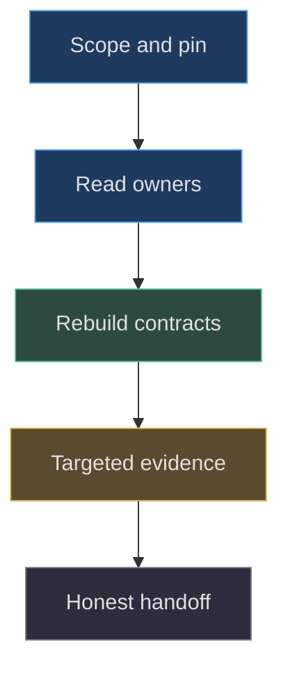
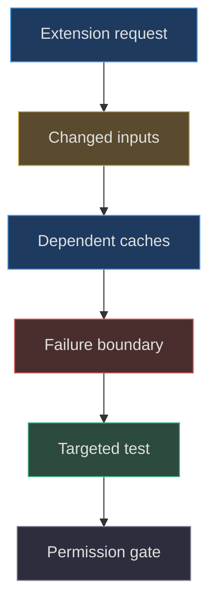

# Agent reconstruction and extension

## Reconstruct behavior, not an imagined memory

A useful agent handoff contains enough explicit contracts
for another engineer to continue without pretending to
remember an earlier conversation. It names the baseline,
files, space conventions, ownership, experiments and
unresolved gaps. It does not claim a perfect mental
replica or universal accuracy. This chapter provides
such a contract for the integrated room, renderer and
interaction layer; detailed console and companion
anatomy remains the responsibility of their dedicated
factory chapters.

The canonical evidence baseline is
`1e4ef518d6943ab1af39cef3b4d558f209a17891`
in `Zanark/BowserBoy`. Runtime dependency evidence is
the explicit Three.js 0.186.1 declaration
([package.json:7–9](https://github.com/Zanark/BowserBoy/blob/1e4ef518d6943ab1af39cef3b4d558f209a17891/package.json#L7-L9)).
A later repository checkout or current online
manual can differ. Always distinguish “observed at
the baseline” from “recommended for a new extension.”



Figure MD38.1. A reconstruction is a chain of explicit receipts, not an appeal to hidden conversation memory.

## The reusable assignment

The following instructions are intended to be copied
as an assignment, with writable paths and execution
permissions filled in by the requesting owner.
They do not grant publication, tracking synchronization
or application-edit permission by themselves.

### Establish scope and read before editing

Record the requested output, exact baseline and
allowed write paths. Inspect the worktree without
resetting unrelated changes. Preserve historical
images, existing books and concurrent work. Do
not inspect private ROMs, conversations, credentials
or unrelated personal context. Report missing
public evidence rather than searching private
stores to fill a documentation gap.

Read complete `src/lighting.js`, `src/scene.js`
and `src/lcd-crt.js`. Read relevant controller,
preferences, motion, clearance and asset sections
before describing their behavior. Trace actual
callers and state transitions where source evidence
permits; do not invent a code graph for a repository
without one. Read tests as specifications and
mark any skipped coverage. Public architecture
is a useful orientation, not a substitute for
the implementation
([docs/ARCHITECTURE.md:43–146](https://github.com/Zanark/BowserBoy/blob/1e4ef518d6943ab1af39cef3b4d558f209a17891/docs/ARCHITECTURE.md#L43-L146)).

### Rebuild the world in dependency order

First establish Y zero as tabletop support.
Construct the tabletop, rear wall and lower
floor with the source dimensions and separate
top/edge material ownership. Add the tripod
body at `(-13.5,0,2)` with child scale `1/.017`.
Draw one extruded leg and share it three
times around Y; add support, open drum, rims
and diffuser. Preserve double-sided fabric
and the explicit non-casting overrides.

Add the spotlight, two local area emitters
and world-owned tabletop bounce. Do not invent
a tall central pole, mechanical switch or
extra room props. The actual switch model
is surface metadata plus scene/UI dispatch
([src/lighting.js:9–110](https://github.com/Zanark/BowserBoy/blob/1e4ef518d6943ab1af39cef3b4d558f209a17891/src/lighting.js#L9-L110)).
Attach existing console and companion factories
through their returned roots and named references;
do not reconstruct their detailed anatomy in
the integration module.

### Preserve image and light ownership

Use sRGB output and the authored tone mapping.
Keep active displays basic and non-tone-mapped,
but preserve the actual distinction between DS
nearest-filter native canvases and GBA linear-
filter canvases. Keep powered-off glass reflective.
Do not treat `drawLcdCrt` as a native emulator
shader implementation
([src/scene.js:1106–1160](https://github.com/Zanark/BowserBoy/blob/1e4ef518d6943ab1af39cef3b4d558f209a17891/src/scene.js#L1106-L1160),
[src/ds-controller.js:415–435](https://github.com/Zanark/BowserBoy/blob/1e4ef518d6943ab1af39cef3b4d558f209a17891/src/ds-controller.js#L415-L435)).

Sample screen emission in linear space using
the 24-by-16 average, bounded sampling cadence
and elapsed-time smoothing. Include both
companions in exposure decisions and obstacle
inventory. Never call a fixture LCD-only unless
tripod, room, Pear and axolotl conditions are
explicitly controlled.

### Preserve interaction and scheduling

Convert pointer coordinates through the canvas
CSS rectangle. Respect dispatch priority,
pointer capture, grab offsets, cancellation
and release. For lower DS touch, raycast the
whole model and accept only a nearest lower-
LCD hit. Update camera/model matrices and DOM
control projection before waiting for a GPU
paint
([src/ds-controller.js:490–514](https://github.com/Zanark/BowserBoy/blob/1e4ef518d6943ab1af39cef3b4d558f209a17891/src/ds-controller.js#L490-L514),
[src/scene.js:484–500](https://github.com/Zanark/BowserBoy/blob/1e4ef518d6943ab1af39cef3b4d558f209a17891/src/scene.js#L484-L500)).

Separate callback updates, native screen copies,
room submission and fence completion. Retain
resolution, threshold boundaries and bounded
recovery; start new real-time experiments from
current `performance.now()`, not stale render
timestamps. Keep required fall/bounce/rise poses
until presentation acknowledgment. Do not label
this as full rigid-body physics.

## Research and evidence instructions

Consult three to five official references
for concepts that extend beyond source.
For this part the checked references are
Three.js color management, physical materials,
shadows and cleanup, plus MDN WebGL best
practices. Record URL, consultation date,
supported claim and scope. Current documentation
is guidance, not pinned-runtime proof.
Never send local code to public search.

Maintain four evidence labels: actual
implementation, documented historical observation,
researched recommendation and proposed extension.
For history, inspect scoped diffs and say
which mechanism changed. An old test receipt
does not validate a new source revision.
For a new experiment, record assumptions,
changed condition, fixed variables, expected
outcome and the observation that would
falsify the explanation.

The scene's cleanup is a useful baseline,
not a universal resource tracker. If adding
texture slots or shared resources, define
their owner and disposal path explicitly
([src/scene.js:1430–1450](https://github.com/Zanark/BowserBoy/blob/1e4ef518d6943ab1af39cef3b4d558f209a17891/src/scene.js#L1430-L1450)).
The checked current
[cleanup guide](https://threejs.org/manual/pages/cleanup.html)
supports unique-resource tracking, while
[MDN best practices](https://developer.mozilla.org/en-US/docs/Web/API/WebGL_API/WebGL_best_practices)
supports avoiding unnecessary blocking and
releasing GPU resources eagerly.



Figure MD38.2. Extension work ends at its authorized boundary; successful technical checks do not automatically authorize synchronization or publication.

### Deliver a self-contained reconstruction packet

The final packet should let another agent find
every necessary public source without guessing.
Include a model inventory mapping components
to source symbols, chapters and relevant tests.
Record absent components explicitly: there
is no modeled mechanical lamp switch or
separate tall pole to hunt for. Include
research receipts with supported concepts
and historical receipts with checked changes.
List what remains unverified, especially
render execution, parked browser coverage
and owner acceptance.

For a proposed extension, add a dependency
table with changed input, owner, invalidated
cache and retained invariant. A wider shade
changes geometry and bounds; its material
brightness need not change. A new light
changes exposure-state logic and reflections;
its decorative mesh need not be an obstacle
unless the model actually occupies space.
Such a table prevents a successor from
mistaking all visible properties for one
undifferentiated “appearance” setting.

Include runnable arithmetic or clearly labeled
pseudocode with assumptions and expected
outcomes, not fragments that reference
imaginary application APIs. State whether
a recipe was executed. When commands are
authorized, retain exit status and exact
run identity. When they are prohibited,
stop at manuscript validation and say so.
A complete handoff is not one that claims
everything is done; it is one that makes
the next permitted action and remaining
evidence gap unambiguous.

## MD38-W01 Specify a larger shade extension completely

Suppose the owner requests a ten-percent wider
shade while preserving height and leg footprint.
Compute radius `.09*1.1=.099` and diameter
`.198/.017=11.6471` world units. The original
diameter was 10.5882, so the increase is
1.0588 world units across the drum.
Keep center Y `.225`, height `.15` and
rim Y values `.15` and `.30`.

The rim's original radius `.0895` is `.0005`
inside the drum radius. Preserving that radial
inset gives new radius `.0985`, not `.0895`.
Retain the tube radius unless a thicker seam
is separately requested. Check the transmitted
rectangle at X `.11` against the wider fabric:
the source's anti-seam offset deserves renewed
inspection, not automatic rescaling.

This runnable Node recipe calculates proposed
dimensions only. It does not modify any model
or claim the enlarged shade is accepted.

```js
const metersPerUnit = .017;
const radius = .09 * 1.1;
const rim = radius - .0005;
const diameter = 2 * radius / metersPerUnit;
console.assert(Math.abs(rim - .0985) < 1e-12);
console.log({ radius, rim, diameter });
```

The implementation plan must include new
geometry creation, old owned geometry disposal,
lamp-bound recomputation, clearance with all
companions, main-view invalidation and
reflection refresh. Acceptance should include
fixed leg footprint, unchanged light switches,
no invented pole, no seam and unchanged
active LCD colors. Human review decides
whether the wider shade is preferable.

Keep calculated values unrounded in code and round
only their displayed explanation. The diameter
increase is exactly `.018/.017` world units
under these assumptions. Independently rounding
old and new diameters before subtraction can
produce a different last printed digit. This
small example mirrors the clearance algorithm's
larger lesson: numerical presentation is not
authoritative simulation state.

## MD38-R01 Retry when the new bounds block the desk

Change the condition: the widened shade's
world bounds leave no legal table layout
under current priorities. First verify
that the bounds include actual geometry
and were not enlarged twice by metric
conversion. If the bound is correct,
do not move the fixed tripod silently.

The resolver must stage both equal-ranked
console orders with stable tie behavior,
then report failure if neither works
([src/scene.js:849–890](https://github.com/Zanark/BowserBoy/blob/1e4ef518d6943ab1af39cef3b4d558f209a17891/src/scene.js#L849-L890)).
Offer an explicitly proposed alternative,
such as a smaller diameter or a separately
authorized world placement change. Preserve
saved poses and rollback semantics. If
the application regression repeats after
one bounded repair, retain the assertions
and park coverage debt rather than
shrinking gaps until it passes.

## MD38-Q01 Exercise: write the final handoff

The agent has written the extension and
run only unit tests. Browser startup failed
twice, images have not been reviewed,
and publication was not authorized.
What should the final message contain,
and what must it not imply?

## MD38-A01 Explained answer

Report exact changed files, baseline,
computed dimensions, commands actually
executed, unit outcomes and browser
failure receipts. State the bounded
repair attempted, retained assertions,
parked scenario and issue/Project update
needed from the authorized owner.
Mark visual and aesthetic review pending.
Say explicitly that no deployment occurred.

Use the real eight-field numbered
workstream and causal ledger practice
when authorized. Preview synchronization,
read the actual issue backlink rather
than guessing its number, and verify
remote state after any approved apply
([docs/GITHUB-TRACKING.md:1–63](https://github.com/Zanark/BowserBoy/blob/1e4ef518d6943ab1af39cef3b4d558f209a17891/docs/GITHUB-TRACKING.md#L1-L63)).
That process still grants no implicit
publishing permission.

Finally preserve the public presentation:
the root README remains GIF-first, and
standalone books provide detailed teaching
([README.md:1–30](https://github.com/Zanark/BowserBoy/blob/1e4ef518d6943ab1af39cef3b4d558f209a17891/README.md#L1-L30)).
Do not replace an inviting entry point
with exhaustive validation logs. A
truthful handoff makes the next action
clear without claiming tests, approval,
memory continuity or publication that
did not occur.
