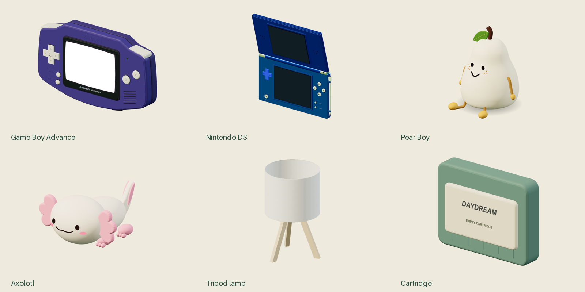

# How to use this reconstruction manual

This book explains how BowserBOY's first-party three-dimensional objects are constructed, assembled, animated and verified. Its central subject is not the emulator instruction set. It is the deceptively large amount of geometry and engineering required to make a small handheld console, a second articulated console, two expressive companions and a believable desk behave as one coherent interactive world.

The purpose is transfer. A future agent should be able to inspect the implementation, identify the mechanism behind a visible detail, reconstruct that mechanism in a small experiment, and extend it without relying on this conversation. The book therefore keeps exact source references, parameter meanings, worked calculations, changed-condition retries and explained exercises beside the construction discussion. It does not claim to copy a model's hidden reasoning, transfer every previous memory or guarantee that a different agent will make identical artistic judgments.

## What belongs to this edition

The implementation cutoff is `1e4ef518d6943ab1af39cef3b4d558f209a17891` in the public `Zanark/BowserBoy` repository. A cutoff makes the teaching inspectable: a later improvement must not silently become evidence for an earlier explanation. The manuscript, diagnostic atlas and publishing tools were created after that implementation revision. Their exact input hashes belong to the edition manifests, rather than being misrepresented as files already present at the cutoff.

There are four parts. The first establishes libraries, references, coordinates, reusable geometry, the Game Boy Advance shell and its small physical details. The second follows the Nintendo DS from lower deck to articulated lid, dual display, stylus, controls and cartridge loading. The third constructs Pear Boy and the axolotl, including curved face projection, expressions, soft-looking surfaces, movement and clearance. The fourth explains the supporting desk, room, tripod lamp, rendering, input ownership, performance, algorithms, design principles, regression evidence and historical changes.

The desk and wall are not incidental background. A convincing tabletop controls apparent contact, scale, shadow direction and whether a moved object seems to float. A lamp is not only a mesh: the visible shade, world-space emitter, exposure and shadow policy have to agree. A face is not only a set of eyes: its features have to remain outside the actual body surface as it follows the pointer. Those connections are part of modeling, not unrelated implementation detail.

This is a third, independent book. The existing GBA engineering book and the separate NDS development-journey book remain useful references and are not overwritten. This handbook deliberately includes both console families and their common systems because the subject is the complete modeling workflow. It does not import the GBA chapters into the NDS-only book.

## Read the evidence labels literally

Four classes of statements occur throughout the chapters.

**Implemented behavior** describes source at the pinned revision. The strongest references identify the file, the relevant symbol or section, and actual line ranges. A source reference can establish what a constructor creates or what an update function calculates. It cannot by itself prove what a particular browser visibly displayed.

**Historical evidence** describes a change supported by a commit, tracked workstream or existing regression record. A development history reconstructed from those records is not a verbatim transcript of an author's thoughts. A later test name is not proof that the test existed when an earlier shape was first modeled.

**Researched guidance** comes from an identified external reference, such as Three.js or a browser-platform reference. Documentation consulted later can explain a general mechanism or suggest a better experiment. It does not retroactively prove the project's original intent, and a current documentation page need not describe every detail of the installed library version.

**Proposed extensions** are recommendations. A proposed optimization, alternate modeling tool or broader test matrix is not already implemented because it appears in a textbook. Carry that distinction into future changes and into their completion reports.

Hash equality is also a narrow claim. It can establish the identity of a file, an illustration or an artifact. It does not establish semantic correctness, aesthetic approval, reproducibility on an untested machine or the rights to redistribute a third-party work. The native PDF and browser checks make specific assertions about content, dimensions, links and layout; they are not an all-purpose certificate.

## Follow a model through five layers

For each object, begin with its silhouette. If a reader cannot recognize the console or companion from an uncluttered three-quarter view, tiny labels will not rescue the design. Reconstruct the main masses first, establish an origin and local axes, then add recesses, controls and markings.

Next, inspect the surface construction. A pale silicone body, painted shell, rubber pad, LCD and glass overlay should not be treated as interchangeable material presets. Ask which geometry owns the visible contour, which material receives light, which surface is unlit by design and which layer exists only to provide a reflection.

Then identify the transform owner. A DS lid rotates around a hinge-related local origin; a whole console moves through another group; a companion's gaze can move its facial features without dragging its entire body. An attractive pose in one hierarchy is not evidence that the hierarchy remains correct when a parent rotates.

The fourth layer is interaction. A button can be visually present but geometrically occluded. A face can report a visible flag yet be buried beneath another surface. A lamp can remain in the correct pose while its effective light position fails to follow. Inspect the world-space result and the foremost rendered surface, not only a convenient state field.

Finally, examine lifecycle and regression evidence. A model factory allocates buffers, materials and textures. A render loop decides when motion is sampled and when shadows or reflections are refreshed. A change to a limb can enlarge a collision envelope even if its resting pose looks unchanged. Modeling precision therefore includes resource ownership, animation timing and clearance.

## The atlas is a controlled experiment

The illustrations in `assets/atlas` are fresh renders of the actual procedural factory geometry. There are front, back and three-quarter orthographic views of the GBA, DS, Pear Boy, axolotl, tripod lamp and cartridge. The original factory code was not edited to make the images.

The capture environment intentionally differs from the application. It uses a neutral studio background, separate studio lights, ACES tone mapping at exposure one and an orthographic camera fitted to each complete model. Factory light objects are hidden and material emission is disabled so that base surfaces remain inspectable. The DS's returned lid group is rotated fifteen degrees around local X for a readable diagnostic open pose. The application sets its own poses, lighting and exposure.

Those conditions matter. A pale companion in the atlas is not a demonstration of its powered lamp appearance. The captured GBA's white display is its factory material, not proof of game execution. A visible model edge is useful construction evidence; it does not demonstrate a shadow produced by the table lamp in the real room. Captions and the capture manifest retain these limits.

The generator loads the shared brand images before constructing the GBA. Its canvas textures use decoded image data immediately; simply importing a constructor is insufficient. The loopback server serves only approved module and image resources, and the browser blocks external requests. No ROM, firmware, native emulator startup or private recording is needed to reproduce these illustrations.

The source identity check distinguishes Windows line endings from substantive edits. It compares pinned and working source after explicit CRLF-to-LF normalization, while recording the raw capture-input hashes separately. Do not report those two identities as byte equality. The manifest also records actual served resource hashes, browser version, model bounds and mesh counts.

Figure O.1. The original six-model cover plate is composed from actual three-quarter captures. It compares shapes, not physical scale between objects or application-room lighting.

## Use the learning structure

Every chapter has a stable `MDxx` identity. A `W` section is a worked example: follow the concrete setup and explain why the result follows. An `R` section changes a condition and requires a new decision rather than copying the previous answer. A `Q` section presents an exercise; its paired `A` section explains the reasoning and the failure modes, not just a final number.

When adapting a technique, write down the invariant before changing the code. For a face, an invariant might concern surface clearance and visibility across all expressions. For a console, it might concern the relation between the bezel opening, active screen and glass. For a movable companion, it includes the complete component envelope and a collision-free settled pose.

Use the exercises to find a misunderstanding before making a broad patch. If the proposed change cannot be explained in local coordinates, isolate a small model and draw the parent-child relationship. If a lighting adjustment cannot distinguish material emission from external illumination, test those contributions separately. A short controlled experiment is more useful than repeatedly tuning several unrelated constants.

## Reconstruct before you generalize

The shortest route through the book for a new agent is foundations, the model family being changed, algorithms, design principles and reconstruction. Read the neighboring interaction and lifecycle chapters before changing a shape that is animated or draggable. The book's source inventory and standalone handoff help locate those boundaries, but neither substitutes for reading the relevant implementation.

Reproduce the existing behavior first. Establish the baseline silhouette, dimensions, material roles, transform hierarchy and a few representative views. Save the exact source revision and capture conditions. Only then change one construction layer and evaluate the result. Otherwise a new lighting setup can disguise a bad normal, a different camera can hide an intersection and a broad refactor can make the cause of an improvement impossible to identify.

Do not install an alternative authoring tool merely because it appears in a researched recommendation. The established application constructs its models procedurally with Three.js and browser canvas textures. An external mesh editor can be a reasonable future choice, but it introduces a different source-of-truth, export, scale, normal, texture and licensing contract. It is a design decision, not a missing step that this book quietly assumes.

For reproducible commands, start in the repository root. The publishing and atlas recipes use the existing Node dependencies, Python image/PDF tools and an installed supported Chromium browser. Restore a missing dependency only when the chosen validation reports it missing, or when changing its manifest. The documented local qualification does not claim a fresh-machine setup or cross-platform test run.

## Know when the work is actually done

A successful modeling change has several different outcomes. The intended geometry exists. The intended effect is visible from the relevant views. Interaction still selects the correct surface. Motion and clearance remain valid. Relevant regressions pass or an explicitly recorded limitation remains. Documentation explains the change without exporting private inputs.

A successful book has its own separate outcomes. The assembly contains the intended chapters and illustrations; real chapter prose is not replaced by code dumps; the printed PDF contains at least two hundred pages and at least two hundred unique chapter-content pages; links and learning markers survive native export; and the standalone reader opens without scripts or network dependencies. Cover, contents, part openers, chapter openers and appendices do not satisfy the content-page minimum.

Mechanical results, bounded visual inspection, user acceptance and publication are distinct. Read the exact edition's review note. Do not turn a generated contact sheet into a claim that every figure was inspected at full size, a deployment badge into a gameplay test, or a previous edition's review into approval of new bytes.

The transferable method is a sequence of evidence-backed decisions, not a list of magical parameter values. Preserve that sequence when improving the project, and the next agent will inherit a usable engineering manual instead of another long document that still requires the original conversation.
