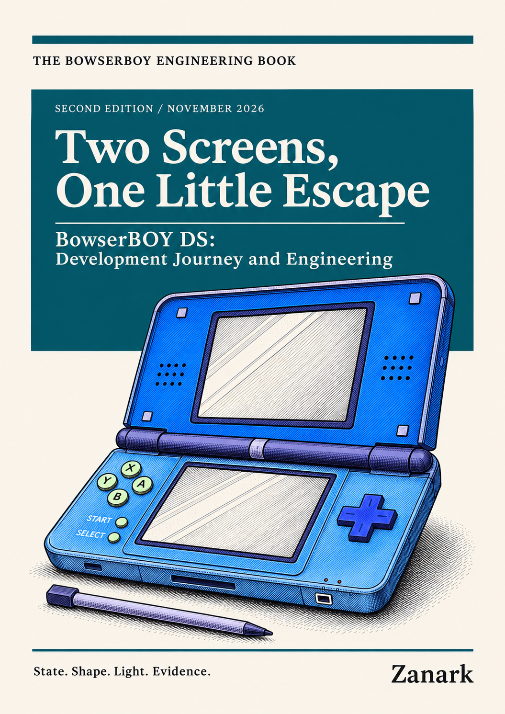

# Two Screens, One Little Escape

## BowserBOY DS: development journey and engineering

*Figure ND-C. Owner-supplied cover, used unchanged in the PDF and offline reader.
This November 8 cover revision preserves the first NDS edition's interior.*

An independent Nintendo DS book. The existing GBA engineering book and its
published PDF are preserved unchanged. Shared infrastructure appears here
only where it explains the DS experience.

**Read:** [85-page PDF](published/Two-Screens-One-Little-Escape.pdf) |
[download the offline HTML reader](published/Reading-Edition.html) |
[edition files and checksums](published/README.md).
Download the HTML before opening it; GitHub's file viewer is not an HTML host.

**Implementation cutoff:** `61845372142b41992916f3732ea102cc0f4c8edf`,
November 7, 2026. Historical observations remain historical; source inspection
is not new compatibility testing, physical-device qualification or human approval.

## Reading routes

| Part | Chapters |
|---|---|
| I - Becoming a console | [01 - A second console](chapters/01-a-second-console/README.md), [02 - The development journey](chapters/02-development-journey/README.md) |
| II - Making it run | [03 - Static host, native core](chapters/03-runtime-boundary/README.md), [04 - Cartridge and power](chapters/04-cartridge-and-power/README.md), [05 - Two live screens](chapters/05-two-live-screens/README.md), [06 - Touch and controls](chapters/06-touch-and-controls/README.md), [07 - Saves and recovery](chapters/07-saves-and-recovery/README.md) |
| III - Making it feel physical | [08 - The DS on the desk](chapters/08-physical-ds/README.md), [09 - Algorithms and data structures](chapters/09-algorithms/README.md), [10 - Design principles](chapters/10-design-principles/README.md) |
| IV - Evidence and maintenance | [11 - Tests and releases](chapters/11-tests-and-releases/README.md), [12 - Visual documentation](chapters/12-visual-documentation/README.md), [13 - Maintainer field guide](chapters/13-maintainer-field-guide/README.md) |

Read Parts I and IV for the journey; Parts II and III explain mechanisms.
Every chapter includes a diagram, a worked example and an explained exercise.
This is a focused engineering book, not a DS CPU tutorial or exhaustive source atlas.

The [source register](SOURCES.md) identifies implementation and historical
evidence. The [production and review record](REVIEW.md) describes the actual
rendered edition, reproduction commands and remaining review limits.
