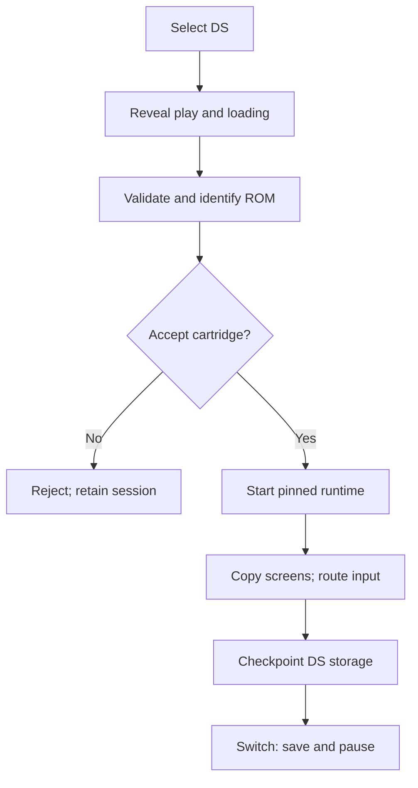

# 01 - A second console

## What makes a second console more than another model?

The motivating question is not whether a DS-shaped object can sit on the
desk. It is whether selecting it establishes a coherent cartridge, display,
input and persistence boundary without disturbing the original console.
The outcome of this chapter is a vocabulary for that boundary: what the
implementation supports, what its first prototype established, and what
neither a successful demo nor a product label can establish.

This account stops at implementation
`61845372142b41992916f3732ea102cc0f4c8edf`. It describes recorded evidence;
authoring this chapter did not execute new emulator tests.

## The prototype answered a deliberately smaller question

Workstream 79 requested playable Nintendo DS emulation beside the retained
console, while keeping static hosting and separate runtime lifecycles.
Its original technical result used pinned EmulatorJS 4.2.3/DeSmuME to boot
the project's original Twin Lab homebrew without supplied BIOS or firmware.
Real native frames reached both modeled LCDs; buttons and lower-screen
stylus input reached the core. That was substantially more than a decorative
screen animation. It was still a local prototype result, not a commercial
compatibility matrix, physical-phone qualification or publication. [S1]

The distinction matters because the model and the runtime advanced at
different rates. The first silhouette, disconnected hinge and loose
pen-like stylus were rejected while verified emulator and save behavior
were preserved. Remodeling the shell did not require throwing away the
native integration. Conversely, native output did not make the first model
visually acceptable. The historical record explicitly separates those
outcomes rather than retroactively making the initial attempt successful
in every dimension. [S1]

That separation is an engineering asset. A failure in geometry should lead
to geometry evidence; a failure in native input should lead to native
evidence. Treating every visible problem as a core defect, or every passing
core check as approval of the object, would erase the useful boundary.

## Supported now does not mean universally compatible

Workstream 114 later changed the current product status: BowserBOY DS is
a supported console, not a feature currently labeled “local prototype.”
The change reconciled UI labels, runtime errors and documentation, and
its public-copy verification was recorded through the monitored release.
It did not add emulator functionality or certify additional games. Historical
captions, filenames and work logs deliberately retained their provenance. [S2]

Thus both statements can be true: the first delivery was a local prototype;
the current product presents DS as supported. The old workstream's open
device/aesthetic qualifications are not evidence that current UI should
still call it a prototype. Equally, removing that label cannot turn a
desktop viewport check into a physical-device performance result.

The current acceptance boundary is concrete. Authorized, uncompressed
`.nds` files must have an original-DS header, valid ARM program ranges and
a size between 512 bytes and 512 MiB. DSi-enhanced and DSi-only inputs are
rejected. The runtime options select stacked screens, no gap, 256×192
internal LCD resolution and one core, with external BIOS and BIOS-menu
boot disabled. These are configuration and validation facts, not a promise
that every structurally valid cartridge boots. [S3, S4]

Direct boot trades a simpler static-hosted launch for a compatibility
boundary. Twin Lab demonstrates one BIOS-free path. It does not show that
every game's startup assumptions are satisfied. The guide says this
explicitly and distinguishes supplied user cartridges from automated
fixtures. A maintainer should preserve that wording even after a particular
user-supplied opening has appeared in public media. [S4]

## Follow ownership through the selection boundary

Figure ND01-01. The console boundary follows cartridge identity and lifecycle, not merely the selected model's color.

The diagram combines the immediate-loading contract with the established
lifecycle contract. DS play appears before full-file reading and hashing,
so a slow identification step no longer leaves the cartridge sidebar as
the only apparent response. The lower LCD supplies loading feedback;
reduced motion keeps that graphic static. None of this accelerates the
runtime download. It makes pending work legible and preserves cancellation
and rejection behavior. [S5]

Persistence is equally part of the console identity. The DS has its own
database and checksummed `.bbds-save` backups. Switching checkpoints and
pauses the inactive runtime; simultaneous emulation was not required by
the original acceptance contract. Power-on cold boot and same-ROM reload
recovery are intentionally different operations. Without that distinction,
“resume” could accidentally become a promise that a checkpoint survives
replacement by a newer live-session save. Workstream 79 records an actual
correction to that mistaken testing expectation. [S1]

## ND01-W01 - Read a successful boot without overclaiming

Suppose the original Twin Lab demo boots and a mark appears on the lower
physical LCD after touch input. A useful receipt identifies the fixture,
runtime version, native output and displayed output. It supports the claim
that this input-to-display path worked in that environment.

Now consider the next inference: “Any accepted `.nds` file will work.”
The inference fails because header validation establishes structure, not
the behavior of all programs accepted by that structure. The implementation
hashes the full file to identify it only after header checks; it does not
execute a compatibility proof. [S3]

Similarly, a 390-pixel desktop-browser layout result supports responsive
framing, not physical-phone latency or thermal behavior. A later successful
Pages gate establishes the retained hosted scenarios at its exact revision.
It cannot retroactively qualify every prototype scenario, particularly the
21 cases still explicitly parked at this book's cutoff. [S1, S6]

## ND01-R01 - Retry the boundary, not the whole product

Workstream 115 provides a practical retry model. A rejected replacement
must report its error without losing an existing DS session; a cancelled
native startup must stop loading and leave a usable retry route. The
recorded focused cases exercised held upload reading, native handoff,
invalid replacement retention, reduced motion and cancellation. [S5]

The lesson is not “try again until green.” First classify where progress
stopped: file identification, core startup, display handoff or session
replacement. Preserve the last valid ownership state while retrying the
failed operation. A loading animation is useful precisely because it does
not pretend those states are already successful.

## ND01-Q01 - Exercise: which statement belongs in a release note?

A local demo passes, a hosted gate passes its retained cases, and the UI
now says BowserBOY DS. Choose between these summaries:

1. “DS is supported; direct-boot and parked-coverage limits remain.”
2. “DS compatibility and physical-phone performance are fully verified.”

Explain which additional evidence the second statement would require.

## ND01-A01 - Explained answer

The first statement respects separate product, compatibility and evidence
boundaries. The second would require title-specific compatibility evidence
and actual device qualification; neither follows from a label or a desktop
viewport. It would also have to account honestly for parked scenarios.
At cutoff the release has 119 declared cases, 98 PASS and 21 SKIP, not
119 demonstrated behaviors. Chapter 11 explains how those numbers and
public deployment receipts fit together.

## Source references

- **S1:** [Prototype contract, local evidence and actual corrections, TODO 79, lines 11–86 and 111–126](https://github.com/Zanark/BowserBoy/blob/61845372142b41992916f3732ea102cc0f4c8edf/TODO/79_NINTENDO_DS_EMULATION.todo#L11-L86); [correction log](https://github.com/Zanark/BowserBoy/blob/61845372142b41992916f3732ea102cc0f4c8edf/TODO/79_NINTENDO_DS_EMULATION.todo#L111-L126).
- **S2:** [Current supported-console status and historical-copy boundary, TODO 114, lines 15–34](https://github.com/Zanark/BowserBoy/blob/61845372142b41992916f3732ea102cc0f4c8edf/TODO/114_DS_CONSOLE_STATUS.todo#L15-L34).
- **S3:** [Runtime options, structural validation and ROM digest, lines 4–45](https://github.com/Zanark/BowserBoy/blob/61845372142b41992916f3732ea102cc0f4c8edf/src/ds-cartridge.js#L4-L45).
- **S4:** [Current player-facing compatibility and direct-boot limits, lines 177–193](https://github.com/Zanark/BowserBoy/blob/61845372142b41992916f3732ea102cc0f4c8edf/docs/GUIDE.md#L177-L193).
- **S5:** [Immediate loading, replacement retention and focused evidence, TODO 115, lines 16–46](https://github.com/Zanark/BowserBoy/blob/61845372142b41992916f3732ea102cc0f4c8edf/TODO/115_DS_IMMEDIATE_LOADING.todo#L16-L46).
- **S6:** [Explicit restoration contract and final skip partition, TODO 105, lines 30–36 and 101–108](https://github.com/Zanark/BowserBoy/blob/61845372142b41992916f3732ea102cc0f4c8edf/TODO/105_PARKED_BROWSER_CASES.todo#L30-L36); [21-case partition](https://github.com/Zanark/BowserBoy/blob/61845372142b41992916f3732ea102cc0f4c8edf/TODO/105_PARKED_BROWSER_CASES.todo#L101-L108).
