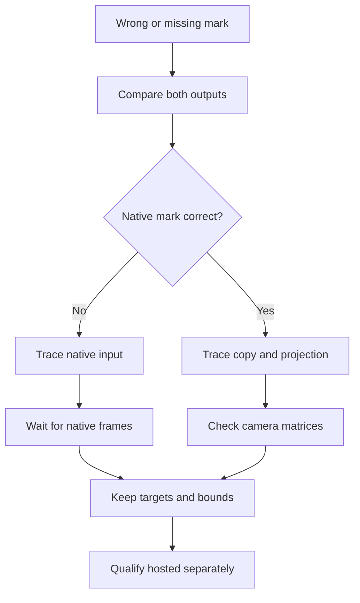

# 02 - The development journey

## Which failed hypothesis should change the design?

A DS on a physical-looking desk has several clocks and coordinate systems:
pointer events, native input polling, framebuffer copying, scene rendering
and GPU completion. The motivating question is how to determine which one
failed without compensating in the wrong layer. This chapter's outcome is
a causal reading of the journey, not a catalog of commits.

The account is pinned to
`61845372142b41992916f3732ea102cc0f4c8edf`. Historical measurements below are
receipts from the public record, not newly executed benchmarks.

## From a second object to an articulated console

Workstream 79 established dual-screen output, native input and separate
persistence, then reopened the model after rejection of its geometry,
hinge and loose stylus. Its correction log also records pickup intersection,
frozen inspection paints, scaled framebuffer splitting and lower-LCD
direct-color behavior. These were different failures with different
owners; a single “DS implemented” milestone would hide their causes. [S1]

Subsequent numbered workstreams refined the object into an interaction
system. Independent console movement made placement a constraint rather
than a fixed coordinate. Articulated inspection and locked gameplay
orientation meant the same touchscreen had to remain accurate through
body rotation, hinge motion, zoom and resizing. A picked-up pen then had
to remain visually useful without blocking its own input ray. These
dependencies explain why touch correctness could not be reduced to a
single screenshot in the initial flat pose. [S2, S3]

Not every numbered idea became a feature. The boxed-cartridge library
remained explicitly deferred and required title-specific redistribution
permission. A physical cartridge prop therefore must not be narrated as
a downloadable game catalog. The book selects these causal boundaries
rather than exporting every intermediate tracking entry. [S4]

## A pointer offset was not permission to move every touch

Workstream 88 began with a click near the lower-right LCD appearing
substantially higher in Twin Lab. The tempting repair would have shifted
host coordinates. Instead, the recorded investigation traced the native
bridge and original homebrew, corrected the demo's Y conversion and
restricted brush bounds, and retained physical UV mapping. Native corner
tests separately exposed synthetic autofocus/blur behavior and inclusive
viewport endpoint issues. [S5]

That distinction protects every other cartridge from a compensation for
one fixture's bug. Physical antialiasing introduced another false signal:
a corner between drawing-buffer pixels could not reasonably be required
to contain one completely yellow pixel. The corrected probe used a small
sampling footprint while retaining exact native brush assertions. This
was fixture accuracy, not permission to accept arbitrary drawing offsets.

Quick taps then falsified a different assumption. Eight ordinary clicks
lost marks even though coordinates were correct; down/up arrived only
0–0.3 ms apart. Earlier held-contact precision tests had not exercised
that path. Two browser animation frames still lost touches. The pinned
native frame counter demonstrated why: browser paint boundaries are not
native input-poll boundaries. The repair retained contact edges across
actual native frame changes, coalesced pending moves and discarded
queued contacts on cancellation. [S5]

Figure ND02-01. A correct coordinate, a registered native contact and a timely displayed mark are three different observations.

## Correct pixels can still arrive too late

The touch story did not end when native marks became correct. The public
record contains software-rendered runs where native and copied pixels
were right only after the unchanged 1500 ms quick-tap deadline. It also
records a cached-controller experiment that failed and was rejected.
A pass on hardware did not invalidate that software result. [S6]

Resize exposed another layer: camera positions changed while inverse and
world matrices waited for an eligible room paint. A deferred-paint phone
regression mapped `(32,80)` to `(65,56)` before correction. Synchronizing
camera and active-model matrices at the change fixed projection without
waiting for GPU rendering. A later held-pen regression showed that
projected controls also needed synchronization after resize. [S6]

There was no evidence for a universal “GPU problem” that excused every
failure. The record distinguishes delayed evaluation, native contact
loss, stale projection and copying gated by room paints. An unqualified
tiled/snapshot overlay experiment was removed because it still failed
and exposed transition state before its full frame completed. Minimal
full-frame fences and independent native-half copying were retained.
The engineering trade-off was to decouple necessary work without
publishing an incompletely rendered state. [S6]

## ND02-W01 - Light the shell by moving the shell

Workstream 116 is a compact example of testing a physical explanation.
The upright pose at `(5,5.1,8)` placed the front shell ahead of the lamp's
emitting region. Lamp-only blue samples were only 9 on the lid and 10
on the deck. Enlarging tabletop bounce alone was ineffective.

Moving toward the light was promising but not sufficient: the first
target `(-2,5.1,-2)` failed full-rotation clearance with a recorded gap
of `-1.047`. The bounded correction moved the shared target to
`(-2,5.1,-8)`. Final physical-shell samples reached blue 108–113 on
the lid and 117–157 on the deck; all eight sampled rays hit shell and
went black with every lamp off. No material, light or exposure edit was
needed. [S7]

This result answers the original readability complaint without inventing
a camera light or brightening native LCDs. Earlier paint work had already
shown why hex-only trials were insufficient: rendered shell color depended
on reflection and illumination, and measurements had to exclude green
LCD pixels. Readability was a spatial problem here, not another request
to repaint the console. [S8]

## ND02-R01 - Retry a fixture without rewriting the observation

The new lighting fixture initially treated powered-off reflective glass
as an unlit LCD. Its bounded repair used actual static status LCDs;
native screen/input behavior remained separately qualified. Similarly,
workstream 115 found full-file digest and storage lookup occurring before
sidebar closure. Moving visible play/loading feedback earlier addressed
perceived inactivity without claiming faster emulation. [S7, S9]

A useful retry changes the falsified assumption and preserves the
question's original strength. It does not enlarge every deadline, lower
renderer sharpness or reclassify a late result as timely. Later CI
parking therefore remains unresolved evidence debt even where focused
local checks succeeded.

## ND02-Q01 - Exercise: repair a misleading quick-tap test

A test holds contact until a yellow native mark appears, then reports that
ordinary taps work. Real short clicks still fail. What should the next
regression measure, and why is adding a fixed host-screen offset wrong?

## ND02-A01 - Explained answer

Generate genuine short down/up contacts, inspect native and copied pixels
separately, and relate edge retention to actual native frame changes.
Keep cancellation and the original latency bound. A fixed coordinate
offset cannot repair lost contact edges; it would corrupt correct UV
mapping while leaving the timing failure intact.

The journey's durable result is this discipline, not an assertion that
every scenario now passes. Workstream 114 establishes current supported
console status without rewriting prototype history. Workstream 105
still preserves 21 skipped hosted cases, 18 CI-only and three also local.
The next chapter on releases explains why both facts belong in the same
engineering account. [S10]

## Source references

- **S1:** [Prototype corrections and remodel rejection, TODO 79, lines 111–126](https://github.com/Zanark/BowserBoy/blob/61845372142b41992916f3732ea102cc0f4c8edf/TODO/79_NINTENDO_DS_EMULATION.todo#L111-L126).
- **S2:** [Movement purpose, TODO 85, lines 1–6](https://github.com/Zanark/BowserBoy/blob/61845372142b41992916f3732ea102cc0f4c8edf/TODO/85_MOVABLE_CONSOLES.todo#L1-L6); [articulation purpose, TODO 87, lines 1–6](https://github.com/Zanark/BowserBoy/blob/61845372142b41992916f3732ea102cc0f4c8edf/TODO/87_DS_HINGE_GAMEPLAY_POSE.todo#L1-L6).
- **S3:** [Held-pen constraints, native evidence and Escape correction, TODO 89, lines 18–43](https://github.com/Zanark/BowserBoy/blob/61845372142b41992916f3732ea102cc0f4c8edf/TODO/89_PICKABLE_DS_STYLUS.todo#L18-L43).
- **S4:** [Deferred library and redistribution boundary, TODO 80, lines 1–6](https://github.com/Zanark/BowserBoy/blob/61845372142b41992916f3732ea102cc0f4c8edf/TODO/80_BOXED_CARTRIDGE_LIBRARY.todo#L1-L6).
- **S5:** [Actual contact failure, native-frame repair and demo-coordinate correction, TODO 88, lines 174–225](https://github.com/Zanark/BowserBoy/blob/61845372142b41992916f3732ea102cc0f4c8edf/TODO/88_DS_PRECISE_TOUCHSCREEN.todo#L174-L225).
- **S6:** [Rejected cached-controller trial, lines 55–69](https://github.com/Zanark/BowserBoy/blob/61845372142b41992916f3732ea102cc0f4c8edf/TODO/88_DS_PRECISE_TOUCHSCREEN.todo#L55-L69); [projection and incomplete-frame experiments, lines 106–158](https://github.com/Zanark/BowserBoy/blob/61845372142b41992916f3732ea102cc0f4c8edf/TODO/88_DS_PRECISE_TOUCHSCREEN.todo#L106-L158).
- **S7:** [Measured geometry, failed target and fixture correction, TODO 116, lines 25–56](https://github.com/Zanark/BowserBoy/blob/61845372142b41992916f3732ea102cc0f4c8edf/TODO/116_DS_UPRIGHT_LIGHTING.todo#L25-L56).
- **S8:** [Rejected color/reflection trials and shell-only measurement, TODO 86, lines 17–43](https://github.com/Zanark/BowserBoy/blob/61845372142b41992916f3732ea102cc0f4c8edf/TODO/86_DS_BLUE_CYAN_BASE.todo#L17-L43).
- **S9:** [Immediate-loading diagnosis and verification, TODO 115, lines 25–46](https://github.com/Zanark/BowserBoy/blob/61845372142b41992916f3732ea102cc0f4c8edf/TODO/115_DS_IMMEDIATE_LOADING.todo#L25-L46).
- **S10:** [Supported status without new compatibility, TODO 114, lines 15–34](https://github.com/Zanark/BowserBoy/blob/61845372142b41992916f3732ea102cc0f4c8edf/TODO/114_DS_CONSOLE_STATUS.todo#L15-L34); [final skip partition, TODO 105, lines 101–108](https://github.com/Zanark/BowserBoy/blob/61845372142b41992916f3732ea102cc0f4c8edf/TODO/105_PARKED_BROWSER_CASES.todo#L101-L108).
