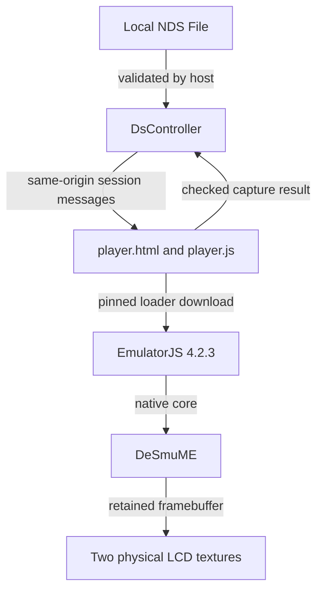

# 03 - Static host, native core

**Question:** how does a static website become a DS without a game server?
**Outcome:** trace a cartridge from a local browser file to a native emulator,
and distinguish an application boundary from a security sandbox.

## The host does not emulate the processors

BowserBOY DS combines a browser application, a Three.js physical presentation
and a pinned EmulatorJS 4.2.3 adapter using DeSmuME. It is not a new ARM9 or
ARM7 emulator. The website supplies the appliance around that existing core:
cartridge selection, power, checked storage, input routing, scene geometry,
status and recoverable errors.

Static hosting serves HTML, JavaScript and assets. The browser executes the
application and emulator locally. The selected cartridge becomes a browser
`File`, not an upload to a game-processing server. That distinction does not
make first launch offline: `src/player.js` fetches the pinned runtime loader
and its dependencies from the EmulatorJS CDN. CDN access is a real dependency.
There is no service-worker-backed, guaranteed offline installation contract.

Figure ND03-01. Execution ownership. The CDN supplies runtime code; it is not
the owner of local checkpoints or a remote gameplay service.

## Three boundaries, three different promises

`DsController` owns the physical DS session. It knows the selected cartridge,
checkpoint store, iframe, visible controls, screen materials and current
power/pause state. It does not spread upstream `EJS_emulator` internals
through the scene.

`player.js` is the version-sensitive adapter. It translates host commands into
the pinned runtime's APIs, configures native options, retains the WebGL drawing
buffer and translates native results back into messages. An upstream change
therefore has a bounded inspection surface, although a version pin alone does
not prove continued CDN availability.

The same-origin iframe separates document layout and runtime lifecycle from
the desk. It is deliberately readable by the host, which obtains the native
canvas through `contentDocument`. This is not a hostile-code security boundary.
Same-origin code and downloaded runtime dependencies remain trusted code.
Calling it a sandbox would overstate what the implementation provides.

## Session identity is not optional decoration

The host creates a new UUID at launch. A host message handler accepts an event
only when its source is the current iframe window, its origin matches the
page and its session matches the current session UUID. The adapter likewise
requires the parent window, matching origin and valid session. Initialization
also checks that the ROM is a `Blob` and the game identity is a 64-digit
lowercase hexadecimal digest.

These checks solve a practical asynchronous problem: an old runtime must not
finish a command against a replacement cartridge. They do not authenticate
arbitrary same-origin scripts or provide a capability boundary against all
compromised page code.

Requests have separate UUIDs. `pending`, a `Map`, associates each command
with its resolve/reject callbacks and ten-second timer. A result settles only
its matching entry. `clear()` rejects pending work and removes the iframe;
it does not leave callers waiting for results from a destroyed runtime.

## ND03-W01 - A capture round trip

The Save action calls `command('capture')`. The controller registers the
pending request before posting the message. The adapter validates the session,
calls `getState()` and `getSaveFile()`, validates the resulting DS capture and
sends a `bba:result` with the request ID.

The controller clears the timer and resolves the matching promise. Only then
does the host attempt the IndexedDB transaction. Native capture and durable
storage are separate steps: a successful capture is not a successful save.
The save chapter follows that distinction through failure.

## Failure is a message, not a blank screen

Loader download failure, invalid native video dimensions and runtime errors
are surfaced as explicit failure messages. Launch has a 90-second deadline
and a visible Cancel action. Post-start failure clears the runtime, powers
the controller down and opens the cartridge tools with an error.

The adapter disables its own databases/local storage and hides unmanaged
save/import controls. This avoids two competing persistence owners. It is
not a blanket claim that every possible upstream feature is audited.

## ND03-R01 - Replace the session before a result returns

Suppose request A belongs to a removed iframe, and cartridge B is now active.
Even a well-formed delayed response from A cannot pass the current-window
and session checks. The old promise is already rejected by `clear()`. A
request ID without source/session checking would not provide that protection.

## ND03-Q01 - Why not call DeSmuME directly from the scene?

## ND03-A01 - Contain the unstable interface

Direct calls would make rendering and physical interaction depend on
version-specific emulator internals and its document lifetime. The adapter
centralizes that coupling; messages give operations explicit completion and
error paths. This improves maintainability, not automatic compatibility with
future EmulatorJS versions.

## Source trail

[DsController: launch, command, message and clear](https://github.com/Zanark/BowserBoy/blob/61845372142b41992916f3732ea102cc0f4c8edf/src/ds-controller.js#L290-L470).
[Adapter: initialize and message dispatch](https://github.com/Zanark/BowserBoy/blob/61845372142b41992916f3732ea102cc0f4c8edf/src/player.js#L198-L394).
Read the source register for the pinned edition boundary.
