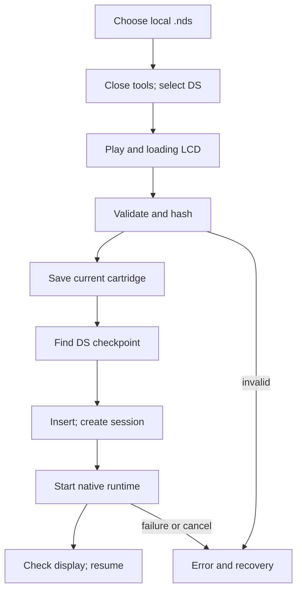

# 04 - Cartridge, loading and power

**Question:** what should happen immediately after selecting a large ROM?
**Outcome:** distinguish scene handoff, validation, insertion, native launch,
checkpoint resume, pause and power cycling.

## Give the player the console before doing expensive work

The important loading improvement is ordering, not a fictional speedup.
`load(file)` closes the DS tools, selects DS, requests playing view and paints
`READING LOCAL ROM` before awaiting cartridge identification. Large-file
reading, hashing and native startup still take time, but the player is no
longer stranded in the selection sidebar without visible progress.

This is asynchronous work on the page, not a claim that the ROM hashing
was moved to a worker. Reading bytes and computing a digest can consume memory
and browser resources. The observable contract is early handoff and a loading
display while awaited work proceeds; it is not instant emulation.

Figure ND04-01. The handoff happens before ROM identification. The loading
animation communicates a phase, not measured percentage completion.

## Validation has a declared compatibility boundary

`identifyDsRom` accepts an uncompressed `.nds` filename, requires at least
512 bytes and caps the file at 512 MiB. It reads a 512-byte header and rejects
nonzero unit-code byte `0x12`, so DSi-enhanced and DSi-only files are outside
this implementation's accepted input scope.

For each ARM program descriptor at `0x20` and `0x30`, it checks ROM offset,
entry address, load address and length. Program bytes must lie in the file;
the load range must lie within the accepted memory ranges; the normalized
entry must fall inside that program. These checks catch malformed/truncated
files before loading a large native runtime.

They are not a full DS cartridge authenticity or compatibility verifier.
A valid descriptor does not prove that a particular game's timing,
peripherals or save behavior work in the browser. The full file digest
identifies checkpoint ownership; the display title comes from the filename,
with underscores replaced and the extension removed.

## Two loading visuals solve different problems

The physical cartridge moves from `y = 3.1` toward its seated `y = .44`.
The insertion clock accumulates actual painted elapsed time over 1800 ms,
using smoothstep `t*t*(3-2*t)` rather than treating a frame count as time.
These are local model coordinates, not browser-screen coordinates or a
claim about a standard retail shell. Chapter 08 distinguishes the actual
modeled slots from the media caption's description of insertion.

The lower LCD separately draws a small original card animation and three
progress dots. Its twelve-frame sequence changes on 160 ms buckets. It
continues through reading and native startup, then yields to the real
framebuffer. It is drawn into a canvas texture rather than fetched as an
external GIF, so it remains integrated with the physical display.

With reduced motion, the cartridge is immediately seated and the loading
display stays on frame zero. Status still communicates that work is happening.
Reduced motion must remove unnecessary motion, not remove the information.

## ND04-W01 - Selecting a cartridge with an existing checkpoint

The controller first identifies the file. If another cartridge is running,
it saves that session before replacing it. The selected ROM's digest looks
up a DS checkpoint. After clearing the previous runtime, the controller
stores the new `File`, identity and any battery bytes in memory, begins
insertion and launches with the matching checkpoint.

On game start, the adapter loads battery data and native state, then waits
for rendered frames before acknowledging readiness. The host checks both
native dimensions and the actual retained canvas before replacing loading
materials with live outputs. A loaded iframe by itself is not a running DS.

## Power is not pause, and resume is not a fresh boot

Pause retains the running runtime and asks it to stop advancing. Switching
away from a running, unpaused DS uses `suspend()`: release inputs, save when
storage is available, pause and remember that this was an automatic
suspension. Returning resumes that retained runtime only if it was suspended.
An intentionally paused DS should not become unpaused merely because the
player switches consoles.

Power off saves first when running, then clears the runtime, marks power off
and installs dark physical screen materials. The selected cartridge stays
in memory. Power on launches a new runtime with battery data, not the old
native checkpoint. The adapter writes the battery bytes and restarts the
core, preserving the distinction between an in-game save and a resumed
machine snapshot.

Initial cartridge selection may resume a checkpoint; deliberate power
cycling boots from the in-game save. Neither operation persists the ROM
itself across a page reload.

## ND04-R01 - Storage fails while powering off

`togglePower()` awaits `save()` before clearing a running runtime. If durable
storage is unavailable, the save throws with instructions to export. The
operation wrapper displays the error and opens tools instead of reporting
a successful safe shutdown. The same choice protects against replacing a
running cartridge after a failed save.

The application cannot guarantee recovery after browser termination,
storage eviction or a user ignoring an export warning. The next chapter on
saves explains the portable escape route.

## ND04-Q01 - Does a seated cartridge prove that startup succeeded?

## ND04-A01 - Animation and execution are separate clocks

No. Insertion can finish while the runtime download is still pending. Native
success requires a started message and a valid retained display. Conversely,
reduced-motion insertion can be instantaneous without altering startup.
Treating a visual transition as proof of execution would hide real failures.

## Source trail

[Cartridge identification and DS options](https://github.com/Zanark/BowserBoy/blob/61845372142b41992916f3732ea102cc0f4c8edf/src/ds-cartridge.js#L1-L46).
[Controller loading, launch, power, suspension and painting](https://github.com/Zanark/BowserBoy/blob/61845372142b41992916f3732ea102cc0f4c8edf/src/ds-controller.js).
[Adapter restoration and initialization](https://github.com/Zanark/BowserBoy/blob/61845372142b41992916f3732ea102cc0f4c8edf/src/player.js#L177-L305).
