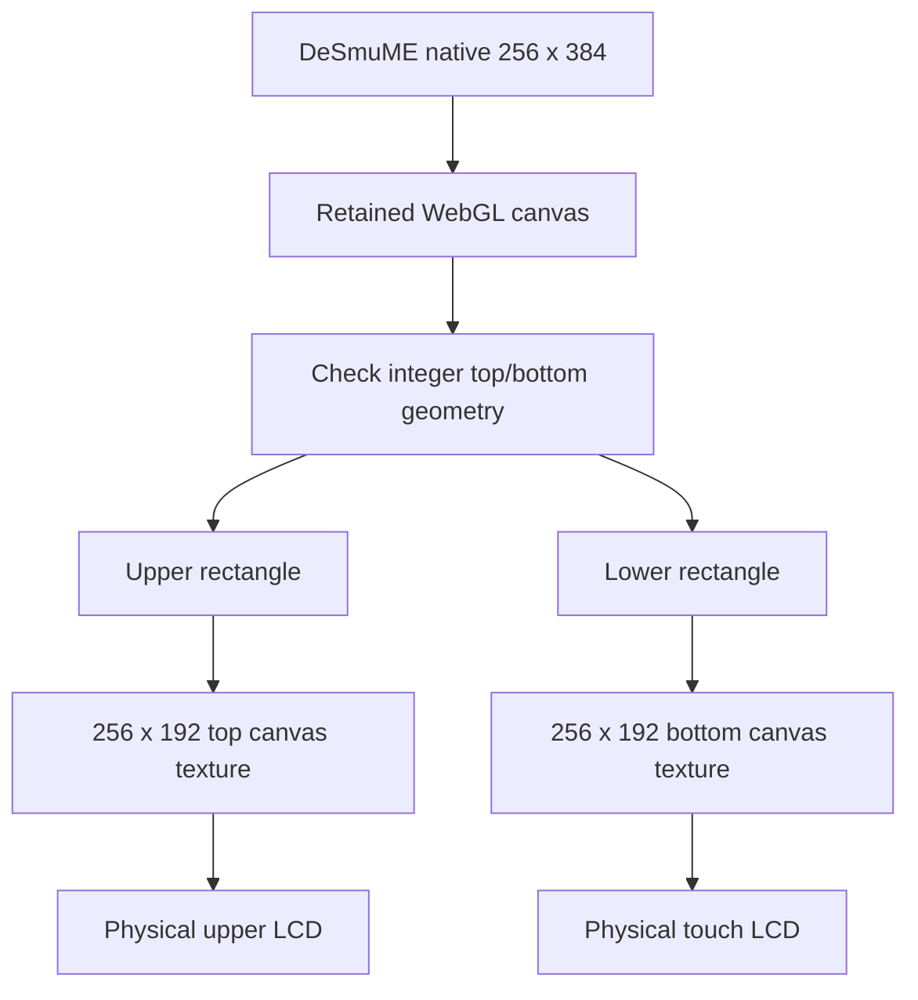

# 05 - One framebuffer, two live screens

**Question:** how do two physical LCDs show one emulator without two cores?
**Outcome:** trace the video contract, integer scaling, texture sampling,
loading replacement and the distinction between screen brightness and light.

## Make the native layout explicit

The native DS picture is two 256 by 192 screens. The adapter configures
DeSmuME for top/bottom layout, zero gap and native internal resolution.
After startup it checks the core's reported video dimensions: exactly
256 by 384. This prevents a swapped, horizontal or gapped layout from
silently producing plausible but incorrect crops.

The actual presentation canvas may be integer-scaled. `dsScreenRegions`
accepts widths from 256 through 2048, divisible by 256, with height exactly
1.5 times width. It returns equal upper/lower rectangles. These two checks
operate at different layers: native dimensions describe the core; canvas
dimensions describe its presentation surface.

Figure ND05-01. Two views of one running native framebuffer. No second
emulator and no independent screen clocks are created.

## Retention is an initialization requirement

WebGL does not generally promise that a drawing buffer remains readable
after presentation. During runtime setup, the adapter wraps only that core
canvas's WebGL `getContext` call to request `preserveDrawingBuffer: true`.
On `bba:started`, the host verifies that the actual context reports that
attribute. A missing retained buffer fails visibly rather than becoming
intermittent black LCDs.

This is a performance trade-off: retention and copying can cost memory and
GPU bandwidth. It is not a globally applied WebGL override, and changing
the attribute after a context has been created is not equivalent to asking
for it when the context is first constructed.

## ND05-W01 - An integer-scaled canvas

Suppose the canvas is 512 by 768. Validation accepts it: width is twice 256,
height is 1.5 times width. The upper rectangle is `(0,0,512,384)` and the lower
is `(0,384,512,384)`. Each is drawn into a separate 256 by 192 output canvas.

`imageSmoothingEnabled = false` avoids an extra 2D interpolation pass.
The Three.js maps use nearest minification and magnification filters with
no mipmaps. `paintScreens()` marks the maps dirty after copying. These choices
preserve crisp source pixels; they do not increase native detail or make a
256-pixel-wide source equivalent to higher-resolution emulation.

## The screen is not a lamp-lit plastic surface

Live LCD materials are `MeshBasicMaterial` with `toneMapped: false`, rather
than ordinary shell materials whose visibility depends on the desk lamp.
The game remains visible when room lamps are off. Shell highlights,
surrounding light spill and framebuffer content remain separate concerns.

Before native video exists, status and loading pictures use host-generated
canvas textures. `drawLcdCrt` provides their built-in presentation treatment.
The controller's DS preferences disable the native shader by default.
When the native framebuffer arrives, it replaces the temporary display
materials; the implementation does not stack the pre-cartridge treatment
on top of the live native picture.

No CRT presentation is proof of timing accuracy. Likewise, a changing pool
of light on the desk is not proof that the emulated game accepted input.
Pixel evidence, light evidence and input evidence need different checks.

## What goes wrong when the contract drifts?

A horizontal canvas can still contain colorful output, but splitting it
vertically would duplicate or scramble its screens. A gap changes the
touch-to-picture correspondence. A noninteger scale changes the assumptions
behind crisp downsampling. `dsScreenRegions` rejects these shapes explicitly.

During screen copying, an unexpected error is reported to the player,
the source is detached and tools are opened for recovery. The application
does not manufacture a static fallback and call it a live frame.

## ND05-R01 - Introduce a 20-pixel gap

A 256 by 404 canvas fails the required geometry. Removing that check would
require redesigning both crops and lower-screen coordinate dispatch, not
merely tolerating a different height. The safe small change is to retain
the pinned zero-gap runtime configuration, not guess the content boundary.

## ND05-Q01 - Can two different screen colors establish full DS compatibility?

## ND05-A01 - It establishes a narrower fact

Different, advancing screen output can establish a functioning split in a
particular fixture or game. It does not establish save behavior, native
touch positions, every title's timing or performance on phones. Verification
must name the input, environment and contract it actually observes.

## Source trail

[DS options and dsScreenRegions](https://github.com/Zanark/BowserBoy/blob/61845372142b41992916f3732ea102cc0f4c8edf/src/ds-cartridge.js#L12-L54).
[Framebuffer retention and native checks](https://github.com/Zanark/BowserBoy/blob/61845372142b41992916f3732ea102cc0f4c8edf/src/player.js#L243-L303).
[Controller message and paintScreens](https://github.com/Zanark/BowserBoy/blob/61845372142b41992916f3732ea102cc0f4c8edf/src/ds-controller.js).
