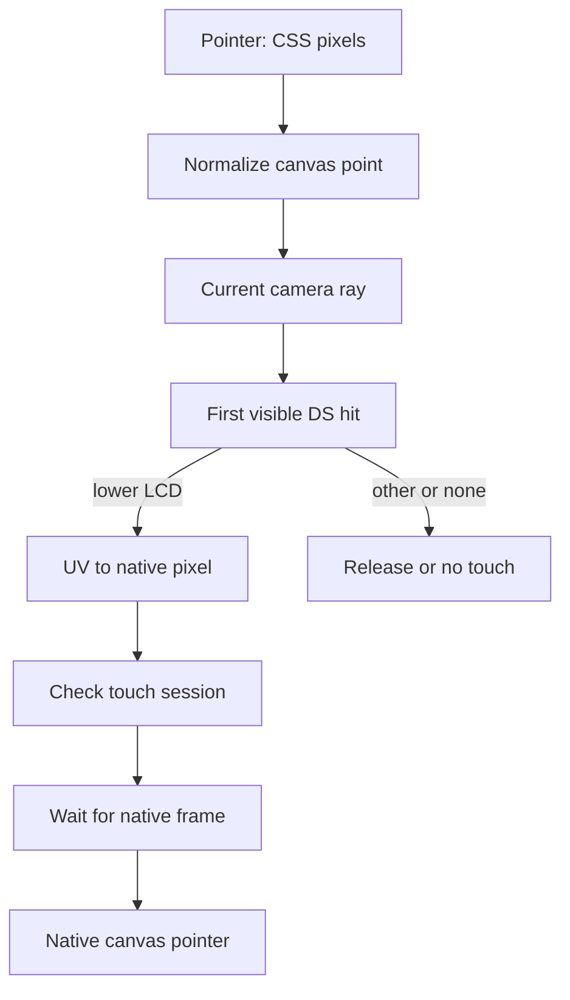

# 06 - Touch, controls and the stylus

**Question:** why is a DS tap more than a click on a rectangle?
**Outcome:** trace a screen coordinate through a 3D ray, UV coordinates,
native contact edges and source-owned button state.

## Find the visible surface, not an approximate box

The physical DS can rotate, change hinge angle and zoom. An axis-aligned DOM
rectangle around its lower display cannot express that perspective or the
lid's occlusion. `touchAt(event)` converts the pointer position relative to
the renderer canvas into normalized device coordinates. A ray from the
actual camera intersects the DS model.

The controller takes the first relevant hit and accepts it only if the
object is the lower screen. A hit on the shell or covering lid is not a
valid touch. When the held stylus is visible, its own marked geometry is
excluded from this search. The pen must not block the LCD it is indicating.



Figure ND06-01. Every transformation has a defined coordinate system.
Touch depends on actual visible geometry, not merely a projected bounding box.

## UV conversion has a deliberate edge rule

`dsTouchFromUv` rejects missing, nonfinite or out-of-range coordinates.
For accepted UV values, it computes:

```text
x = min(255, floor(u * 256))
y = min(191, floor((1 - v) * 192))
```

The vertical flip connects mesh UV orientation to native top-left screen
coordinates. The minimum prevents the inclusive UV endpoints from generating
out-of-range pixel 256 or 192. Device-pixel ratio does not enter this formula:
the DOM event and bounding rectangle use CSS pixels; the ray resolves the
physical surface; the UV then resolves native pixels.

The adapter checks integer coordinates again. It maps the native point to
the combined canvas using pixel centers, adding 192 to address the lower
half. Its dispatch formula accounts for inclusive browser-driver viewport
endpoints instead of landing on an offscreen edge.

## A fast press and release must survive native polling

Browser tasks and emulator frames are different clocks. Posting down and up
in adjacent message tasks can complete before the native core next polls
input, producing no observed contact.

`DsTouchQueue` retains contact transitions. After dispatching a sample it
awaits `dsInputFrame`, which waits until the core's frame number changes
while the queue generation remains current. Consecutive movement samples
can coalesce to the latest move; press and release boundaries are retained.
The goal is not to replay every mouse move. It is to preserve the semantic
edges of contact while keeping movement current.

Cancellation increments a generation, discards pending samples and sends a
release when the last dispatched state was pressed. An older asynchronous
flush cannot continue injecting a stroke after pause, restore, blur or
console switching. This is a cancellation protocol, not a timeout-based
guess that the core probably saw a click.

## ND06-W01 - A quick tap followed by a drag

Consider samples `down(20,30)`, `up(20,30)`, `down(80,90)`,
`move(90,95)`, `move(100,100)`, `up(100,100)`. The two moves can collapse to
the latest coordinate, but the first tap's down/up and second contact's
down/up remain distinct. The core receives an opportunity to advance between
dispatched contact states.

If a modal opens during the stroke, `inputAllowed()` becomes false and
input release/cancellation prevents a stuck stylus. A pointer leaving the
valid lower-screen surface releases contact rather than drawing through
the surrounding plastic.

## A physical pen is a separate presentation

The held pen is a clone of the docked model. Its raycast function is disabled
and it is added to the scene independently, leaving the original docked
geometry in the model's bounds. The held visual points toward the camera
with its tip placed on the ray intersection or a camera-facing plane.

The implementation lifts the tip along the pointer ray, not along the LCD
normal. Moving along the ray preserves the projected cursor location; moving
along the normal could visibly slide the pen tip away from the contact point.
Returning the stylus, Escape, right-click, lost availability and blur have
explicit cleanup. Visual pickup is not required for direct lower-screen touch.

## Buttons have multiple legitimate owners

The adapter holds a `Map` from action to a `Set` of source IDs. Keyboard and
pointer can hold the same action simultaneously. Native press state changes
only when the set crosses empty/nonempty. Releasing one owner cannot cancel
another owner's held direction.

DS keys are arrows for directions, Z/X for A/B, A/S for Y/X, Q/W for L/R,
Enter for Start and left Shift for Select. The DS-specific mapping is declared in
`DS_CONTROLS`; it should not be inferred from another console's controls.
DOM button targets are projected from actual control anchors, hidden when
back-facing or covered and disabled outside playing input availability.

## ND06-R01 - Blur before the queued release

On blur, release host inputs, return the stylus and cancel native queued
contact. Merely clearing the JavaScript array would be insufficient if
the native core already saw down. Cancellation must dispatch a release
for that last delivered state as well.

## ND06-Q01 - Why not coalesce the entire touch queue?

## ND06-A01 - Latest position and contact history are different data

Replacing all pending samples with the newest one could turn a complete
quick tap into an unpressed final coordinate. Coalescing adjacent moves
removes redundant positions without erasing down/up edges. That distinction
is the central input invariant, and the original Twin Lab fixture tests it
through native observations rather than a decorative painted marker alone.

## Source trail

[UV conversion and DS controls](https://github.com/Zanark/BowserBoy/blob/61845372142b41992916f3732ea102cc0f4c8edf/src/ds-cartridge.js#L1-L63).
[Controller touchAt, releaseInputs and stylus presentation](https://github.com/Zanark/BowserBoy/blob/61845372142b41992916f3732ea102cc0f4c8edf/src/ds-controller.js).
[DsTouchQueue](https://github.com/Zanark/BowserBoy/blob/61845372142b41992916f3732ea102cc0f4c8edf/src/ds-touch.js).
[Native dispatchTouch and dsInputFrame](https://github.com/Zanark/BowserBoy/blob/61845372142b41992916f3732ea102cc0f4c8edf/src/player.js).
