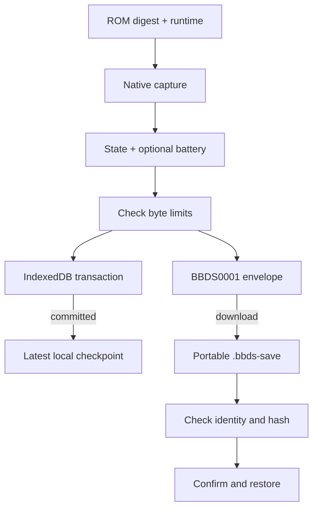

# 07 - Saves, identity and recovery

**Question:** which kind of progress survives which kind of interruption?
**Outcome:** distinguish battery data, native checkpoints, browser storage
and portable backups, including the failures each does not solve.

## Four objects, not one vague save

An in-game save is the cartridge's battery-backed data, exposed as `sram`
by the adapter. A checkpoint also contains the native core's machine state,
so it can resume a running situation rather than boot normally. IndexedDB
is the browser's origin-local storage location for the latest checkpoint.
A `.bbds-save` file is the exported portable envelope containing checkpoint
and optional battery data.

These are different layers. A downloaded backup is not automatic cloud sync.
An IndexedDB transaction is not an immutable external copy. Loading battery
bytes is not equivalent to loading the native state. The ROM is not stored
inside either checkpoint or portable backup.



Figure ND07-01. Identity and validation precede persistence or restoration.
The two storage routes have independent durability and user responsibilities.

## Identity includes the complete cartridge

The host computes the full ROM digest. `DsSaveStore` keys records by
`DS_RUNTIME + ':' + digest`, where the runtime marker is
`emulatorjs-4.2.3-desmume`. Stored records repeat both runtime and ROM
identity, and reads reject incompatible values.

Two files with the same title but different bytes must not share a
checkpoint automatically. A title is a label, not a safe identity. Likewise,
a future runtime upgrade must not quietly reinterpret old native states.
The current marker provides a compatibility boundary; migration requires an
explicit future design rather than a renamed string.

The database is `bowserboy-ds`, version 1, with a `checkpoints` object store.
It is a separate DS store, not a second view of another console's records.
Blocked/open failure is surfaced after a bounded wait. A late successful
open after timeout closes its connection instead of reviving an abandoned
operation. Version changes close the old connection.

## Completion belongs to the transaction

`put` validates capture shape and size, then writes state, battery data,
identity and timestamp in one readwrite transaction. The wrapper resolves
on `tx.oncomplete`, not merely request success. A transaction can still
abort after a request returns successfully.

Native state must be a nonempty `Uint8Array` of at most 64 MiB. Battery
data is either `null` or a `Uint8Array` no larger than 16 MiB. `null` means
no battery file; an empty byte array is a distinct valid byte sequence.
Preserving that distinction matters when reconstructing an export.

Autosave runs every 30 seconds only while running, unpaused, not busy and
storage is available. It is not a promise that every last moment survives
a crash. The host warns before leaving a running session, but browser
termination and eviction cannot be made safe by a warning alone.

## ND07-W01 - Reading a portable backup

The first eight bytes are ASCII magic `BBDS0001`; the next four contain a
little-endian metadata length. UTF-8 JSON follows, then state bytes and
optional battery bytes. Metadata carries runtime, ROM identity, payload
lengths and hashes. The battery length uses `-1` for `null`.

The decoder bounds total file size before reading, checks magic, caps JSON
at 4096 bytes and checks that metadata fits. It parses JSON, checks exact
runtime/ROM identity, validates integer lengths and requires the complete
envelope length to match. It then slices the payloads, applies DS capture
limits and verifies hashes before returning anything eligible for restore.

```text
total bytes = 12 + metadata bytes + state bytes + max(0, battery bytes)
```

This equality rejects both truncation and trailing unexpected payload.
Hashes detect accidental corruption relative to the envelope; they are not
a cryptographic signature proving who authored the file.

## Restore deliberately crosses two boundaries

Import first decodes and validates the backup against the selected ROM.
The player confirms replacing the current session/checkpoint. Where storage
is available, the host persists the imported capture before requesting
native restore. The adapter loads battery data, calls native `loadState`
and waits for rendered frames before acknowledging restoration. If the
runtime had been paused, it restores that pause afterward.

This is not a distributed transaction between IndexedDB and a native core.
An IndexedDB commit followed by a native restore error can leave the imported
checkpoint persisted while the live runtime did not complete restoration.
The implementation surfaces the error; the book should not invent atomic
rollback across those components.

## Failed persistence must not look successful

If persistence throws, `storageAvailable` becomes false and the player is
told to export before leaving. Saving updates the in-memory battery copy
from the native capture, but that does not make the browser record durable.
Power-off and cartridge replacement wait for save, so a failed save prevents
those normal operations from silently destroying the running session.

Export directly captures the running core and requests a download. It can
therefore be useful even when browser storage is unavailable. The application
reports a download request, not proof that the operating system saved the
file or that a user later tested it on another machine.

## ND07-R01 - Rename a ROM and import its backup

If only the filename changes, identical bytes retain the same digest, so
identity remains valid. Change one byte and the digest changes; the previous
backup must be rejected even when the filename remains identical. This
is why a user-visible name is not the storage key.

## ND07-Q01 - Is a checksum a guarantee that a backup will always restore?

## ND07-A01 - Integrity is narrower than compatibility

No. The decoder proves the selected envelope's structural and checksum
conditions under the pinned format/runtime identity. It does not prove all
future runtime versions, every title's native state behavior, permanent
storage or absence of failures during restoration. Exported copies and
careful version boundaries reduce risk without removing it.

## Source trail

[DS capture validation and backup encoding/decoding](https://github.com/Zanark/BowserBoy/blob/61845372142b41992916f3732ea102cc0f4c8edf/src/ds-cartridge.js#L64-L115).
[DsSaveStore transactions and identity](https://github.com/Zanark/BowserBoy/blob/61845372142b41992916f3732ea102cc0f4c8edf/src/ds-store.js).
[Controller save, persist and import/export actions](https://github.com/Zanark/BowserBoy/blob/61845372142b41992916f3732ea102cc0f4c8edf/src/ds-controller.js).
[Adapter capture, battery loading and restore](https://github.com/Zanark/BowserBoy/blob/61845372142b41992916f3732ea102cc0f4c8edf/src/player.js#L154-L200).
