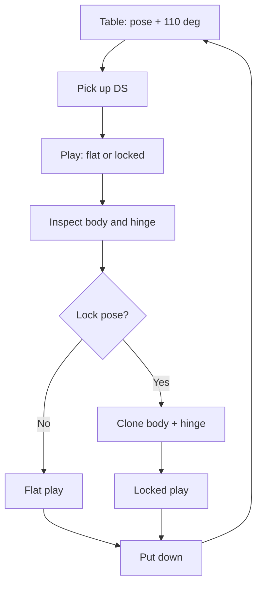
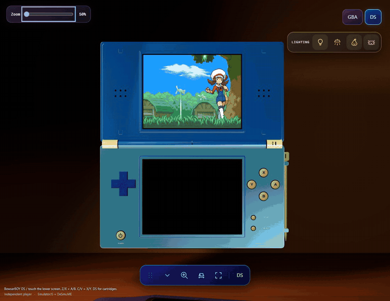
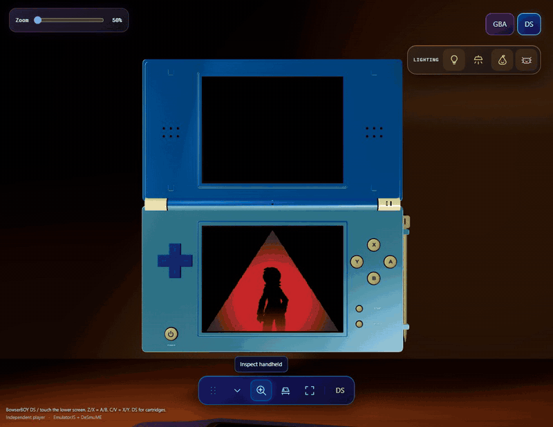

# 08 — The DS on the desk

The DS becomes convincing when its parts obey the same spatial story. A lid
must carry its own screen when it folds. A saved playing angle must not erase
the owner's tabletop arrangement. A lamp must illuminate the shell from its
actual position, not merely make a screenshot brighter. This chapter explains
those contracts at source cutoff
`61845372142b41992916f3732ea102cc0f4c8edf`. Source inspection here is not a new
browser run, physical-device qualification or human visual approval.

## One body, two transform spaces

`createDsHandheld()` builds original procedural geometry, not a photograph
wrapped around a box. The root owns the lower shell, controls, battery cover,
card and stylus. The upper shell and upper LCD belong to a separate `lid`
group. Rotating that group changes the upper half without moving the lower
touchscreen. The segmented barrel and collars make the joint legible, but
the articulation is a bounded transform, not simulated hinge torque.

The two screen planes measure 4.5 by 3.375 model units: the same 4:3 aspect
as each 256-by-192 LCD. Surrounds, recesses and controls are separate geometry.
That separation matters in Inspect: a screen-sized colored rectangle cannot
stand in for a bezel, and a projected button target must follow its real
anchor rather than a remembered screen coordinate. See the
[model construction, screens and hinge](https://github.com/Zanark/BowserBoy/blob/61845372142b41992916f3732ea102cc0f4c8edf/src/ds-handheld.js#L7-L138).

Rear details are equally structural. Two centered square holes are cut into
the extruded outer lid, with inset floors behind them. The supplied DS
emblem occupies a lower-body underside plane beside the right battery cover;
it therefore does not swing with the lid. Four pale-green square pads, screw
recesses and top-edge shoulder housings distinguish the underside from the
control deck. Enlarging the emblem preserves its aspect ratio rather than
stretching artwork across the battery seam.

There is an important naming boundary around the **bottom-facing slot**.
The model's front expansion slot sits along the lower edge of the upright
base and rotates its slot face through 90 degrees. It is not the separately
named rear DS game-card slot near the hinge. Nor does a README caption saying
“slides in from below” establish the card's local-space trajectory:
`DsController.load()` starts the card at local Y 3.1 and `render()` seats it
at Y .44. These are distinct modeled features, not interchangeable evidence
of a hardware connector. The
[front/underside/card geometry](https://github.com/Zanark/BowserBoy/blob/61845372142b41992916f3732ea102cc0f4c8edf/src/ds-handheld.js#L193-L243)
and controller's
[insertion setup](https://github.com/Zanark/BowserBoy/blob/61845372142b41992916f3732ea102cc0f4c8edf/src/ds-controller.js#L345-L363)
and [card animation](https://github.com/Zanark/BowserBoy/blob/61845372142b41992916f3732ea102cc0f4c8edf/src/ds-controller.js#L624-L632)
are the authoritative descriptions.

## Pose is a contract, not one rotation

Figure ND08-01. Table placement, Inspect articulation and the session-only gameplay lock are separate state; returning to the table restores its resting hinge.

`setDsHinge()` accepts only finite values and only edits an unlocked DS in
Inspect outside a transition. The opening is clamped to 30–180 degrees;
the stored lid rotation is `180 - opening`. Thus 180 degrees means zero
lid rotation, while the table's 70-degree rotation represents a 110-degree
opening. Confusing opening angle with stored rotation reverses an otherwise
plausible slider.

`setDsPoseLocked()` clones the root quaternion and stores the lid rotation.
It also clears active drag/pinch state, preventing an old gesture from
continuing across the lock boundary. `setView()` chooses the saved desk
rotation for table mode, the current rotation for Inspect, or the locked
rotation/default identity for play. A lock survives view changes within the
session; reloading is not pose persistence.

The camera uses the actual articulated bounds, not a flat-console rectangle.
`dsPoseBounds()` evaluates body and lid geometry under their respective
candidate transforms. `updateCameraTargets()` lifts the resulting envelope
above the desk and fits its width, height and depth, reserving additional
space for the phone Inspect panel. Immediate matrix updates keep projected
controls consistent before another eligible GPU paint. These mechanisms
are visible in
[pose editing and bounds](https://github.com/Zanark/BowserBoy/blob/61845372142b41992916f3732ea102cc0f4c8edf/src/scene.js#L452-L517),
[camera fitting](https://github.com/Zanark/BowserBoy/blob/61845372142b41992916f3732ea102cc0f4c8edf/src/scene.js#L924-L948)
and [view transitions](https://github.com/Zanark/BowserBoy/blob/61845372142b41992916f3732ea102cc0f4c8edf/src/scene.js#L1009-L1039).
Fitting is not visibility: an extreme backward pose can fit perfectly while
the lid hides a screen or control.

Figure ND08-02. Existing DS Inspect GIF. The book renderer embeds only its first-frame PNG still, not the hinge motion; the repository GIF retains the sequence. LCDs replay a recorded native opening, not responses to these scene actions.

## Clearance follows the interaction

The desk is not organized by hiding inconvenient objects. In focus mode,
the active DS is an immovable obstacle for placement purposes: its playing
angle must not yield to a decorative prop. The inactive console is placed
next, followed by Pear and the axolotl, then loose desk objects. In table
mode, companion positions receive priority before props and consoles.
Returning from focus restores remembered companion XZ coordinates, then
reconciles lower-priority objects.

`resolveDeskClearance()` first accumulates candidate placements. If any
placement fails, it reports blocked space without applying that partial
list. On the table it retries the two console orders, because greedily
placing the narrower object can trap the wider one. A signature avoids
repeating unchanged work. This is deterministic bounded rearrangement,
not a globally optimal packing solver.

`nearestDeskPosition()` reduces vertically overlapping obstacle boxes to
forbidden XZ rectangles expanded by the moving object's bounds and a
.25-unit gap. Candidates lie at the desired coordinate or rectangle edges,
clamped to the workspace. It chooses the nearest valid squared-distance
candidate; a small floating-point tolerance keeps a legal edge legal.
Conservative axis-aligned boxes can reject visually empty corners around a
rotated DS, trading packing density for predictable separation. Read
[mode priorities and atomic application](https://github.com/Zanark/BowserBoy/blob/61845372142b41992916f3732ea102cc0f4c8edf/src/scene.js#L796-L891)
with the [placement solver](https://github.com/Zanark/BowserBoy/blob/61845372142b41992916f3732ea102cc0f4c8edf/src/desk-clearance.js#L3-L35).

## Light must move through real space

The metallic lid uses blue `#0077FF`; the lower shell uses lighter
`#40A0FF`, with grain, roughness and clearcoat. Those values do not promise
the same perceived blue under every warm source. Brightening a material
to compensate for backlighting would change other views too.

Workstream 116 records the causal correction: the old upright target
`(5, 5.1, 8)` stood ahead of the lamp's emitting region. A first candidate
`(-2, 5.1, -2)` improved illumination but failed a rotation-clearance check.
The final shared target is `(-2, 5.1, -8)`. Moving the object rather than
adding a camera light preserved the existing paint, exposure and dark-room
behavior. These measurements are historical task evidence, not measurements
repeated for this chapter.

Pear and the axolotl are light-bearing scene objects, not glowing stickers.
The axolotl's point light is a child of its movable root, so its light pool
follows translation. Scene setters change emitted material intensity and
light intensity together; off means removing illumination, not merely
darkening a button. `DeskMotion` supplies held/released motion, gravity and
damped impacts. Pear adds expressive recovery; the smaller companion reuses
the motion without pretending to share every facial animation. See
[companion brightness](https://github.com/Zanark/BowserBoy/blob/61845372142b41992916f3732ea102cc0f4c8edf/src/scene.js#L560-L603),
[axolotl light attachment](https://github.com/Zanark/BowserBoy/blob/61845372142b41992916f3732ea102cc0f4c8edf/src/axolotl-lamp.js#L86-L89)
and [drop integration](https://github.com/Zanark/BowserBoy/blob/61845372142b41992916f3732ea102cc0f4c8edf/src/pear-motion.js#L59-L145).

Figure ND08-03. Existing DS lighting GIF, represented by a first-frame PNG still in the rendered book. The still cannot demonstrate switch transitions or establish lighting-independent paint fidelity.

## ND08-W01 — Work a pose change through the system

Starting in unlocked play, enter Inspect and set the opening to 120 degrees.
The lid rotation becomes 60 degrees. Rotate the body, lock, then return to
play: the quaternion and hinge should be retained while camera fitting uses
the new envelope. Put down: the desk orientation and 110-degree opening
return. Pick up again: the session lock supplies the playing pose.

This is a reasoned walkthrough, not a claimed execution. Its diagnostic
value is separating three failures: wrong hinge conversion, overwritten
desk placement, and camera framing based on stale bounds.

### ND08-R01 — Retry with a changed condition

Now put a companion where the DS envelope needs clearance and repeat the
transition. The focused DS should keep its pose while lower-priority
placements yield. If no placement exists, spread objects out or reset a
clear home; do not shrink the DS, disable depth testing or silently discard
the lock. Then retry with every lamp off. Darkness is expected, not evidence
that the corrected material reverted.

### ND08-Q01 — Why not always move the DS to resolve a collision?

### ND08-A01

Because focus mode promises a stable chosen pose and usable projected
controls. Moving that priority object would make a decorative collision
change the user's playing composition. Table mode has different ownership
and may legitimately relocate consoles. Neither policy guarantees that
every crowded arrangement has a solution.

## Historical evidence and limits

Public workstreams
[85](https://github.com/Zanark/BowserBoy/blob/61845372142b41992916f3732ea102cc0f4c8edf/TODO/85_MOVABLE_CONSOLES.todo),
[87](https://github.com/Zanark/BowserBoy/blob/61845372142b41992916f3732ea102cc0f4c8edf/TODO/87_DS_HINGE_GAMEPLAY_POSE.todo),
[93](https://github.com/Zanark/BowserBoy/blob/61845372142b41992916f3732ea102cc0f4c8edf/TODO/93_MODE_BASED_MODEL_CLEARANCE.todo)
and [116](https://github.com/Zanark/BowserBoy/blob/61845372142b41992916f3732ea102cc0f4c8edf/TODO/116_DS_UPRIGHT_LIGHTING.todo)
preserve the placement/pose failures and correction.
[95](https://github.com/Zanark/BowserBoy/blob/61845372142b41992916f3732ea102cc0f4c8edf/TODO/95_DS_REAR_MARKINGS.todo),
[100](https://github.com/Zanark/BowserBoy/blob/61845372142b41992916f3732ea102cc0f4c8edf/TODO/100_LARGER_DS_REAR_EMBLEM.todo)
and [103](https://github.com/Zanark/BowserBoy/blob/61845372142b41992916f3732ea102cc0f4c8edf/TODO/103_PALE_GREEN_DS_FINISH_AND_REAR_PADS.todo)
explain rear refinements;
[110](https://github.com/Zanark/BowserBoy/blob/61845372142b41992916f3732ea102cc0f4c8edf/TODO/110_SMALL_AXOLOTL_LAMP.todo)
and [111](https://github.com/Zanark/BowserBoy/blob/61845372142b41992916f3732ea102cc0f4c8edf/TODO/111_MOVABLE_AXOLOTL.todo)
explain the second movable lamp. Checked implementation tasks and local
captures do not erase unchecked hosted qualification or owner-review items.
Public delivery proves delivery; a human must still judge the physical
composition. No new capture, artwork or approval is supplied here.
