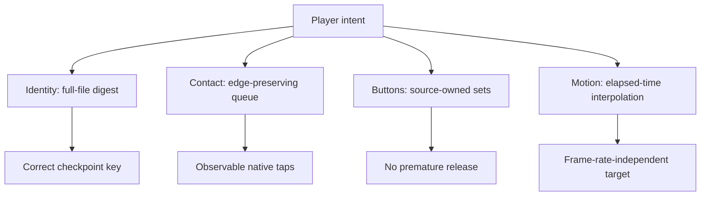

# 09 - Algorithms and data structures

**Question:** which small algorithms make this appliance coherent?
**Outcome:** reason about time, coordinates, ownership and memory without
mistaking a familiar data structure for an automatic performance guarantee.

## Complexity starts with a declared unit

Let `R` be ROM bytes, `S` native-state bytes, `B` battery bytes, `q` pending
touch samples, `h` physical button actions and `p` active command requests.
Costs below describe application-side work, not the native emulator's CPU
accuracy or instruction throughput. Hashing and copying do not become free
because their APIs are asynchronous.

Figure ND09-01. Four different invariants. Each algorithm protects a specific
meaning, not a generic promise that the entire emulator becomes fast.

## Full-file identity: pay once per selection

Cartridge identification reads and hashes the entire `R`-byte ROM after
checking the header. Work is linear in file size. An `ArrayBuffer` for the
file means application memory proportional to `R`; native loading and
structured cloning may add further live copies or allocations. The book
does not claim zero-copy loading or bound total memory by the ROM alone.

That cost buys exact byte identity rather than a heuristic such as title
plus file size. The early scene handoff hides neither the cost nor errors:
it gives the player a meaningful display while awaited work proceeds.

## A queue preserves edges, not every pointer coordinate

`DsTouchQueue.samples` is an array. A new move can replace a pending move
at the tail. Contact starts and ends append separately. A generation counter
invalidates in-flight work during cancellation. Dispatch is serialized by
`flushing`, and each delivered sample awaits native frame advancement.

Tail replacement is constant-size work; array `shift()` conventionally moves
remaining indexed entries and can cost O(q). The important practical limit
is that high-frequency adjacent moves coalesce. A long sequence of
alternating taps is not given a strict fixed queue bound by this code.
Calling it a constant-memory queue would be inaccurate.

A future ring buffer could improve dequeue behavior if measured workloads
justify it. Such a change would still need to preserve contact edges,
cancellation generations and error propagation. Data-structure substitution
alone does not prove the semantic invariant.

## ND09-W01 - Why a boolean cannot represent a button

Keyboard Right goes down, then a pointer presses Right. There are now two
source IDs in the action's set. The native button was already down, so no
second native edge is needed. Keyboard release leaves one source; native
Right stays down. Pointer release empties the set and sends native up.

The adapter's `Map<action, Set<source>>` models exactly that ownership.
Under conventional hash-table behavior, lookup/add/delete are expected
constant time; worst-case engine guarantees should not be inferred from that
notation. Releasing everything visits the actual stored sources.

One boolean would fail when the first owner released. A reference count
would handle balanced edges but would be harder to make idempotent under
duplicate source events. Source sets make ownership explicit.

## Maps also correlate commands

`pending` maps each request UUID to callbacks and a timer. Results locate
their own request rather than relying on message arrival order. Timeout
removes the entry before rejecting. Session teardown clears timers, rejects
every remaining promise and empties the map.

The map uses O(p) entries, not unlimited history. The controller's busy guard
serializes ordinary operations, but the data structure itself is not a
formal hard cap on all possible outstanding requests.

## Coordinates: affine conversion followed by geometry

The pointer is normalized within the canvas to `[-1,1]` in X and Y.
Raycasting resolves the first visible surface under the current camera.
An accepted lower-screen UV becomes a native integer pixel with vertical
flip and inclusive-edge clamping. The adapter then maps that pixel's center
into the lower half of its combined canvas.

The scalar conversions are O(1). Ray traversal depends on scene geometry
and Three.js behavior; the book does not claim that intersecting the model
is constant time. More importantly, replacing that geometry query with
a rectangle changes semantics, not just cost.

## Elapsed-time motion and damped response

Insertion accumulates elapsed paint timestamps and uses smoothstep
`e(t) = t²(3 - 2t)` for `t` clamped to `[0,1]`. At `t=.5`, `e=.5`; its
endpoint slopes are zero, making the approach gentler than a constant
velocity jump. A missed paint produces a larger next elapsed step rather
than assuming a fixed number of frames.

D-pad pitch/yaw use signed opposing directions. Diagonal magnitude is
normalized by `max(1,hypot(x,y))`, so holding two perpendicular directions
does not multiply total tilt by square root of two. Exponential damping
uses the measured delta and separate press/release response rates; tiny
residual differences snap to target to stop unnecessary repainting.

## Backup validation has linear payload costs

Portable decoding checks size and metadata first, then copies and hashes
payloads. Work and memory are proportional to `S+B`, within the declared
limits. A checksum is O(payload), not a constant-time header check. The
bounded JSON header avoids trusting an arbitrary metadata length before
basic envelope validation.

## ND09-R01 - Increase display refresh without changing motion speed

At twice the browser paint frequency, a frame-count-based insertion finishes
twice as fast. Elapsed-time accumulation retains the 1800 ms target, subject
to when the browser actually paints. It cannot guarantee that suspended tabs
render motion smoothly; it guarantees the target is expressed in time,
not an assumed frame rate.

## ND09-Q01 - Which optimization is safe without additional evidence?

## ND09-A01 - None merely because it sounds cheaper

Replacing SHA-based identity with a title, touch edges with a latest-only
sample or geometry with a bounding box changes correctness contracts.
Measure costs first, preserve the invariant in focused tests and name any
new compatibility boundary. Simpler code is valuable only when it preserves
the meaning the current algorithm protects.

## Source trail

[Cartridge identity, coordinates and backup algorithms](https://github.com/Zanark/BowserBoy/blob/61845372142b41992916f3732ea102cc0f4c8edf/src/ds-cartridge.js).
[Edge queue](https://github.com/Zanark/BowserBoy/blob/61845372142b41992916f3732ea102cc0f4c8edf/src/ds-touch.js).
[Source-owned inputs](https://github.com/Zanark/BowserBoy/blob/61845372142b41992916f3732ea102cc0f4c8edf/src/player.js#L36-L57).
[Controller command and motion algorithms](https://github.com/Zanark/BowserBoy/blob/61845372142b41992916f3732ea102cc0f4c8edf/src/ds-controller.js).
