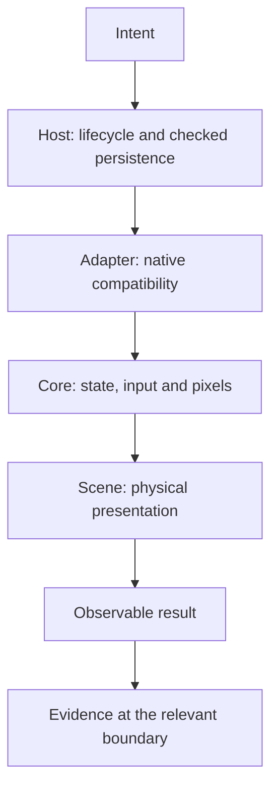

# 10 - Design principles and failure boundaries

**Question:** which principles actually explain this implementation?
**Outcome:** recognize useful boundaries and their limits without inventing
a perfect architecture or attaching pattern names to every function.

## Own the truth at one layer

The host owns checked storage and player-visible lifecycle. The adapter
owns version-sensitive native calls. The physical model owns geometry
and anchors. The native core owns emulated state and output.

This separation prevents two persistence engines from independently choosing
which checkpoint to resume. It also keeps a scene transformation from
becoming a cartridge reboot. The implementation is not perfectly decoupled:
the controller directly reads the same-origin canvas, and projection
requires knowledge of scene objects. Those are deliberate integration
boundaries, not evidence that every dependency has disappeared.

Figure ND10-01. Ownership follows the operation, then verification follows its
observable consequence. A source change alone does not close the final arrow.

## Fail early where the assumptions become knowable

Header ranges can be checked before native startup. Session identity can be
checked when a message arrives. Video layout can be checked only after the
core exposes dimensions. Storage durability can be acknowledged only when
its transaction completes.

Moving a check earlier is useful only when the necessary information exists.
For example, an `.nds` extension cannot establish that the ARM program bytes
fit in the file; a valid header cannot establish native video readiness.
The design uses a chain of narrower checks rather than one mythical
“validated ROM” boolean.

## ND10-W01 - A corrupted checkpoint must not become a fresh start

Suppose a matching IndexedDB record contains invalid state bytes. A
success-shaped fallback would silently ignore the record and start a new
game. That would make the app appear operational while concealing lost
progress.

The store instead validates identity and capture shape and throws on an
invalid record. The operation wrapper reports the error and opens tools.
The portable decoder likewise rejects a bad checksum before restoration.
The visible result can be less convenient, but it does not pretend the
requested recovery happened.

## Preserve invariants through every entry point

Keyboard, pointer and runtime-focused input share source-owned button
semantics. Pause, configure, restore and hidden visibility cancel native
touch. Power off, replacing a cartridge and switching consoles must release
inputs before changing the runtime's availability.

A feature that works through one button but leaves a second entry point
with stale state is incomplete. This is why a stylus demonstration needs
cancel/blur cases and why visual model rotation must be tested alongside
touch coordinates, not as an unrelated aesthetic action.

## Cancellation is a first-class state transition

The touch queue's generation distinguishes current work from stale
asynchronous work. Launch cancellation rejects a pending launch callback.
Session clear rejects outstanding commands. These mechanisms do not
silently convert abandonment into success.

They also have different scopes. Cancelling native startup is not the same
as aborting an already awaited full-file read. Invalidating queued touch is
not the same as terminating the native runtime. Good documentation states
which operation is cancellable instead of generalizing one Cancel button
to the entire application.

## Separate simulation, presentation and observation

A physical button can move without native input being accepted. An LCD can
display replay footage without a running core reacting. A lamp can change
the shell while the self-lit LCD remains readable. A passing fixture is
not every commercial game's compatibility.

The book's source-backed diagrams explain implementation. The visual
showcase demonstrates scene presentation with recorded opening replay.
The original Twin Lab tests observe native contracts. Release receipts
qualify a specific revision in a specific environment. None substitutes
for all the others.

## ND10-R01 - Upgrade the runtime

Treat an upgrade as a compatibility change, not a URL edit. Recheck
game-manager APIs, framebuffer retention, dimension/layout settings,
native touch polling and save-state behavior. A changed native state format
may require a new runtime identity and explicit recovery guidance.

Reusing old hashes or old checkpoint metadata would not establish new
compatibility. Preserve the old book and release evidence as dated records,
then qualify the changed implementation independently.

## ND10-Q01 - Does isolation mean that switching consoles cannot fail?

## ND10-A01 - A boundary reduces coupling, not all failure

Separate sessions and stores prevent accidental shared-state ownership.
Switching can still fail while saving, pausing, starting or accessing the
CDN. The controller must report those failures and retain useful state
where possible. Independence is an architectural property; successful
switching is an observed operation with its own prerequisites.

## Source trail

[Controller lifecycle, errors and cleanup](https://github.com/Zanark/BowserBoy/blob/61845372142b41992916f3732ea102cc0f4c8edf/src/ds-controller.js).
[Native adapter boundary](https://github.com/Zanark/BowserBoy/blob/61845372142b41992916f3732ea102cc0f4c8edf/src/player.js).
[Checkpoint identity and transaction ownership](https://github.com/Zanark/BowserBoy/blob/61845372142b41992916f3732ea102cc0f4c8edf/src/ds-store.js).
[Cancellation generation](https://github.com/Zanark/BowserBoy/blob/61845372142b41992916f3732ea102cc0f4c8edf/src/ds-touch.js).
