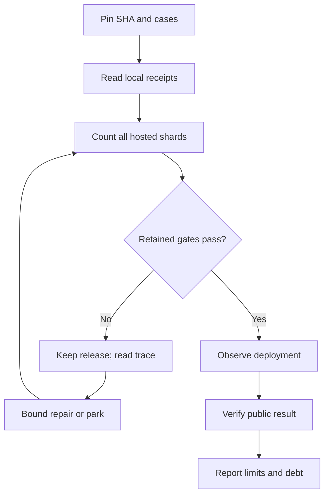

# 11 - Tests and releases

## What exactly became public?

A passing local DS check, a green hosted workflow and a byte-matched public
site answer different questions. This chapter's motivating question is how
to report a release without collapsing them into “verified.” Its outcome
is a reproducible interpretation of the cutoff receipts, including failures,
skips and the public verifier's remaining exception.

At exact cutoff `61845372142b41992916f3732ea102cc0f4c8edf`,
Pages **42390309869** succeeded with **119 declared / 98 PASS / 21 SKIP /
0 FAIL / 0 UNRUN**, across all 19 browser shards, build and deployment.
The preceding implementation recovery,
`387537b602f44a5bc85d10ee0196d0ccb099e968`, Pages **42389431053**, has the
same counts. The latter is recorded in pinned documentation; the final
documentation-only cutoff run is identified by its actual hosted logs. [S1, S2]

These are historical hosted results inspected for this manuscript.
No new application tests were run to author the chapter.

## Keep four evidence layers separate

**Local implementation evidence** includes units, syntax/build checks and
focused browser cases. For immediate DS loading, the public TODO records
held upload reading, native handoff, invalid replacement retention and
cancellation. Upright lighting adds real shell-ray samples and a bounded
clearance correction. Neither local record alone says that the exact source
was deployed. Their TODOs explicitly separate technical completion from
publication. [S3]

**Hosted qualification** establishes what ran in the workflow environment
at a specific SHA. Inventory, shard summaries and skipped declarations
matter as much as an overall green status. A scenario that never ran
after a shard exhausted its budget is not the same as a skipped case.
A case that passed on a previous source is not evidence that it passed
on the next one.

**Actual public evidence** checks the delivered site or repository media.
Successful upload/deployment jobs do not prove that the browser fetched
the intended bytes. Workstream 112 records independent runtime/entry/demo
comparisons and actual live-site cases after the monitored release. [S4]

**Acceptance and compatibility** remain separate again. Current supported
DS status came through workstream 114; it did not certify all games.
The direct-boot guide still limits its BIOS-free demonstration to Twin Lab
rather than every accepted original-DS ROM. Human aesthetic approval and
physical-phone qualification cannot be inferred from these technical
layers. [S5]

Figure ND11-01. Release evidence is a chain of independently bounded claims; a later link does not erase an earlier failure.

## The first recovery disproved the easy environment explanation

Workstream 104 began with nine hosted failures and deployment skipped.
Selecting explicit full-resolution ANGLE SwiftShader was a bounded
environment hypothesis, not a confirmed diagnosis. Its exact hosted
attempt produced 52 passes, 55 failures and two unrun cases: a regression,
not a repair. The launch selection was restored rather than presented
as a success. Loader-aware setup and a directly coupled DS fill correction
were then qualified without blanket-skipping the newly failing cases. [S6]

The next run reached 90 PASS / 7 FAIL / 10 SKIP / 2 UNRUN. Inspection of
all 19 shards found suite exhaustion affecting isolation and resize.
Those unrun scenarios were preserved and native cases redistributed.
The eventual 92 PASS / 17 SKIP / 0 FAIL / 0 UNRUN recovery executed both
formerly aborted cases successfully. This was a stronger result than
making the totals green by hiding unexecuted scenarios. [S6]

The debt subsequently grew through explicit bounded decisions. A companion
lamp obstructed a console-movement fixture; a complete reduced-motion/
WebGL scenario remained unqualified after its repair; GPU-fence and
tripod cases failed their allowed follow-up. At cutoff the partition is
**18 CI-only skips and three also skipped locally**, totaling 21. [S7]

Local focused passes do not restore those exact hosted cases. Workstream
105 requires original assertions, resolution and deadlines on the hosted
browser before removing a skip. Its inventory includes DS native boot,
quick taps, side-stylus, hinge, placement, reference lighting, shoulder
motion, several stylus poses and independent LCD spill. The honest
supported-console statement must coexist with these qualification gaps.

## ND11-W01 - Account for the fullscreen recovery

The untouched-opening media revision `c3b211e` had public GIF evidence
but did not deploy through Pages 42388336737: 119 declared, 97 PASS,
21 SKIP, one FAIL and zero UNRUN. Its fullscreen-return trace showed
the final changed LCD hash completing just after the original 120-second
deadline. That is not proof of a stuck LCD or a DS-core defect. [S1, S8]

One bounded **test-only** correction disabled unrelated Pear and axolotl
companion lamps through existing scene methods. The source change is
visible in the shared fullscreen fixture. It retained both exit paths,
viewport, renderer resolution, deadlines and original runtime/pixel/input
assertions. The exact local case passed in 30.8 seconds without retry;
the exact recovery then passed hosted and deployed. [S1, S9]

This shared release gate belongs here because it governed publication
of the DS-bearing site, not because it supplies new DS-specific fullscreen
compatibility evidence. Its isolation repair must not be described as a
shipping lighting optimization or a repair of all slow-rendering cases.
The count stayed at 21 skips: this failure was repaired without another
park, and the previous debt remained untouched.

## ND11-R01 - Retry once, then preserve the unresolved question

The recovery policy is bounded by the observed case, not an invitation
to retry unrelated failures indefinitely. Inspect the exact trace, identify
the fixture or product assumption being changed, and preserve the original
question. Workstream 112 illustrates the distinction: opening recovery
controls needed a real product correction after the dock became
default-collapsed, but a focused recovery-entry pass did not restore
the complete parked reduced-motion/WebGL case. [S4]

For the fullscreen follow-up, another failure would have meant explicit
parking under 105 rather than another repair loop. Hosted success made
that contingency unnecessary. Neither the successful repair nor the
subsequent receipt-only cutoff commit changes what the parked cases mean.

## Public bytes and public pictures prove different things

For the preceding `387537b` release, all **48 actual runtime/entry/demo
assets matched** committed inputs. The strict additional `.nojekyll`
check returned **404**, leaving the 49-check verifier at exit 1.
Report exactly that: 48 matches and one known marker exception, not
49 passes or a wholly green strict verifier. The pinned receipt describes
the marker as build-only; do not silently delete it from the result. [S1]

Media needs a parallel limitation. Workstream 117 records live native
interaction captures; workstream 120 deliberately replaces scene LCD
content with capture-only replay of untouched openings. Real scene
controls plus recorded LCD playback do not demonstrate live game-input
response. Byte-identical public GIFs establish delivery of those GIFs,
not universal compatibility, audio quality or physical-phone speed. [S8]

## ND11-Q01 - Exercise: rewrite an overconfident release summary

“119 tests passed, all 49 public checks passed, and the new footage proves
native DS input.” Correct each claim using the cutoff boundary.

## ND11-A01 - Explained answer

Write: “119 cases declared: 98 PASS, 21 SKIP, zero FAIL and zero UNRUN
in Pages 42390309869. The preceding recovery's public receipt records
48 asset matches and `.nojekyll` 404, so the strict verifier exits 1.
Recorded-opening scene media demonstrates scene choreography and delivered
footage, not live native input.”

The qualification about the preceding public receipt is intentional:
the cutoff workflow was inspected, but this authoring task did not perform
a fresh cutoff-SHA public byte comparison. Precision about that boundary
is more useful than manufacturing one last all-green sentence.

## Source references

- **S1:** [Previous recovery, exact counts and strict verifier exception, verification lines 14–37](https://github.com/Zanark/BowserBoy/blob/61845372142b41992916f3732ea102cc0f4c8edf/docs/VERIFICATION.md#L14-L37).
- **S2:** [Exact cutoff Pages 42390309869](https://github.com/Zanark/BowserBoy/actions/runs/42390309869): actual head SHA, successful build/19 shards/deploy and shard-log totals inspected during authoring. This post-commit run cannot be recorded inside its own pinned source tree.
- **S3:** [Local DS loading receipts, TODO 115, lines 25–37](https://github.com/Zanark/BowserBoy/blob/61845372142b41992916f3732ea102cc0f4c8edf/TODO/115_DS_IMMEDIATE_LOADING.todo#L25-L37); [lighting and clearance receipts, TODO 116, lines 25–46](https://github.com/Zanark/BowserBoy/blob/61845372142b41992916f3732ea102cc0f4c8edf/TODO/116_DS_UPRIGHT_LIGHTING.todo#L25-L46).
- **S4:** [Monitored/public evidence, TODO 112, lines 27–49](https://github.com/Zanark/BowserBoy/blob/61845372142b41992916f3732ea102cc0f4c8edf/TODO/112_MONITORED_UI_RELEASE.todo#L27-L49); [recovery-entry versus parked-case distinction, lines 76–98](https://github.com/Zanark/BowserBoy/blob/61845372142b41992916f3732ea102cc0f4c8edf/TODO/112_MONITORED_UI_RELEASE.todo#L76-L98).
- **S5:** [Current console status, TODO 114, lines 15–34](https://github.com/Zanark/BowserBoy/blob/61845372142b41992916f3732ea102cc0f4c8edf/TODO/114_DS_CONSOLE_STATUS.todo#L15-L34); [direct-boot limits, guide lines 177–193](https://github.com/Zanark/BowserBoy/blob/61845372142b41992916f3732ea102cc0f4c8edf/docs/GUIDE.md#L177-L193).
- **S6:** [Failed environment hypothesis, shard exhaustion and eventual recovery, TODO 104, lines 26–72](https://github.com/Zanark/BowserBoy/blob/61845372142b41992916f3732ea102cc0f4c8edf/TODO/104_BOUNDED_CI_RECOVERY.todo#L26-L72).
- **S7:** [Exact restoration contract and parked inventory, TODO 105, lines 8–36](https://github.com/Zanark/BowserBoy/blob/61845372142b41992916f3732ea102cc0f4c8edf/TODO/105_PARKED_BROWSER_CASES.todo#L8-L36); [growth to 21, lines 80–108](https://github.com/Zanark/BowserBoy/blob/61845372142b41992916f3732ea102cc0f4c8edf/TODO/105_PARKED_BROWSER_CASES.todo#L80-L108).
- **S8:** [Live capture qualification, TODO 117, lines 15–43](https://github.com/Zanark/BowserBoy/blob/61845372142b41992916f3732ea102cc0f4c8edf/TODO/117_FRESH_CONSOLE_AND_LIGHTING_MEDIA.todo#L15-L43); [replay boundary and release receipts, TODO 120, lines 17–65](https://github.com/Zanark/BowserBoy/blob/61845372142b41992916f3732ea102cc0f4c8edf/TODO/120_UNTOUCHED_INTRO_README_MEDIA.todo#L17-L65).
- **S9:** [Actual bounded lamp isolation, fullscreen fixture lines 915–931](https://github.com/Zanark/BowserBoy/blob/61845372142b41992916f3732ea102cc0f4c8edf/tests/browser/dock.spec.mjs#L915-L931); [causal ledger, lines 17–37](https://github.com/Zanark/BowserBoy/blob/61845372142b41992916f3732ea102cc0f4c8edf/TODO/04_DEVELOPMENT_LEDGER.todo#L17-L37).
