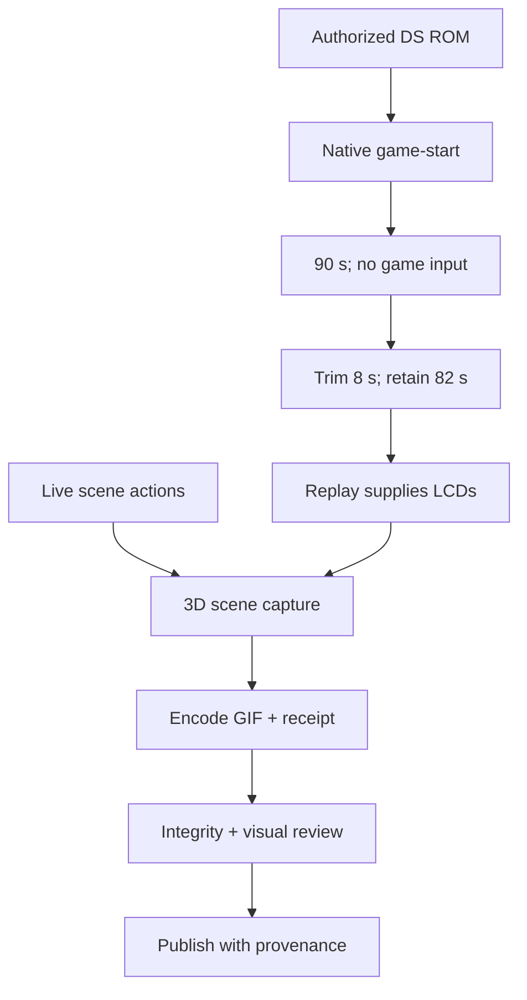
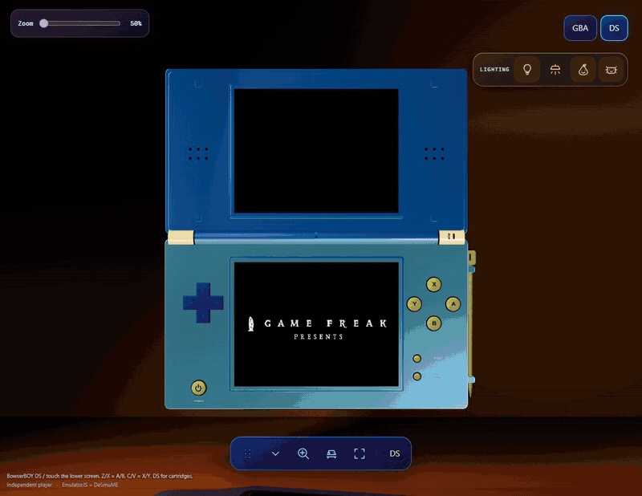
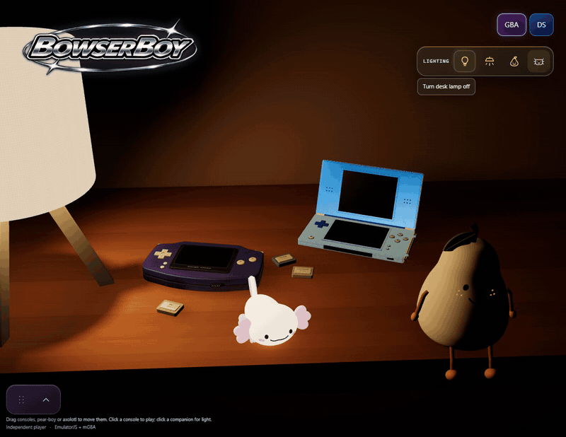

# 12 — Visual documentation without borrowed certainty

A DS showcase must make two screens, a hinged body and a small set of
physical interactions understandable before a reader studies the guide.
It must also say what was actually recorded. A beautifully timed button
press beside moving LCD pixels can suggest a causal relationship that the
capture does not contain. Good visual documentation controls that
interpretation as carefully as it controls framing.

This chapter uses the public repository at
`61845372142b41992916f3732ea102cc0f4c8edf`. It explains the existing workflow,
not a new capture session. Private cartridges, videos, timing receipts and
browser stores were not needed to write it and are not book inputs.

## The README is a front page, not the entire manual

The repository's GIF-first policy is explicit and local to this project.
The front page offers motion and short captions; setup, detailed controls,
limitations and release evidence live in linked documentation. This division
is especially useful for DS: a hinge sequence communicates articulation
quickly, while the 30–180-degree limit, session-only lock and occlusion
rules require prose that should not interrupt every animation.

The documentation chain therefore has different jobs. The README attracts
and orients. The guide tells a player how to act. `MEDIA.md` establishes
capture provenance and interpretation. Public TODOs retain causal failures,
acceptance criteria and qualification boundaries. This engineering book
explains why those choices exist. Copying all five layers into the front
page would make each layer harder to maintain.

The approved DS logo is artwork, not a native-game screenshot. Likewise,
an image of a rear emblem documents branding placement, not cartridge
compatibility. Workstreams 92 and 99 concern DS visual identity; 95, 100
and 103 concern physical markings. Keeping those claims separate prevents
an attractive identity treatment from becoming accidental runtime evidence.
The controlling policy and current edition are recorded in
[MEDIA.md, opening edition](https://github.com/Zanark/BowserBoy/blob/61845372142b41992916f3732ea102cc0f4c8edf/docs/MEDIA.md#L1-L86).

## Two timelines, one scene

Figure ND12-01. Native LCD acquisition and live scene manipulation meet only in the capture harness; their coexistence does not prove that the game responds to the depicted controls.

The current edition records the selected DS opening for 90 native seconds,
then excludes its first eight seconds. Native time begins at entry to
`EJS_onGameStart`, after core/cartridge loading, not at page navigation and
not at a later host-ready notification. The recorder intercepts the served
player source in an isolated browser context and captures the native
canvas. The DS row explicitly selects 90 seconds and an eight-second trim.
See [native acquisition hook](https://github.com/Zanark/BowserBoy/blob/61845372142b41992916f3732ea102cc0f4c8edf/scripts/capture-native-openings.mjs#L14-L50).

That recording then becomes a source for a second operation. `openingReplay()`
serves private opening videos through intercepted browser routes, creates
off-DOM video/canvas pairs, and exposes the DS canvas through an
instance-specific `source` accessor. Browser actions still operate real
scene controls; the screen image is supplied by the recording. Geometry,
materials and lighting are not replaced with a composited illustration.
The implementation boundary is explicit in the
[replay installation](https://github.com/Zanark/BowserBoy/blob/61845372142b41992916f3732ea102cc0f4c8edf/scripts/capture-opening-replay.mjs#L9-L78)
and [receipt declaration](https://github.com/Zanark/BowserBoy/blob/61845372142b41992916f3732ea102cc0f4c8edf/scripts/capture-opening-replay.mjs#L94-L106).

Consequently, a DS button GIF establishes physical button travel while an
untouched opening plays. A stylus GIF establishes pickup and scene tracing,
not native touchscreen response to that trace. A lighting GIF establishes
scene light changes with recorded LCD content. Those are useful, honest
demonstrations. Calling them live game-input demonstrations would be false,
even though the source pixels originally came from a running native core.
Capture-only replay must not become a shipping-player fallback.

Figure ND12-02. Existing DS opening GIF: the selected native opening's 8–90-second window, without game inputs. The book renderer embeds only a first-frame PNG still; sequence duration and pacing remain properties of the repository GIF, not this printed frame.

## Why an earlier honest capture can still be superseded

Workstream 117 produced fresh DS and shared-lighting recordings. Its capture
state was not fabricated, but the owner rejected the tutorial/menu screens
and requested untouched openings throughout the README. Workstream 120
therefore replaced every scene GIF, including desk and lamp sequences,
rather than fixing only the main DS introduction.

This distinction is a maintenance lesson: technical authenticity does not
guarantee that a capture satisfies the requested editorial state. Keep the
earlier edition labeled historical; do not silently reuse its native-input
description for replacement replay footage. `MEDIA.md` explicitly separates
the current opening edition from the superseded capture round.

Loading is another editorial hazard. Workstream 115 moves selection back
to the physical DS immediately and supplies animated loading feedback before
slow identification/startup finishes. A short loading clip is not a boot
benchmark. Cutting before readiness is acceptable if the caption says the
full boot takes longer; implying that a cartridge starts within the clip's
duration is not. The same discipline applies to workstream 116: an upright
lighting clip documents the real lamp-pool placement, not a new studio rig
or a promise that metallic blue is invariant under warm light.

## Reproducibility without publishing private inputs

Reproduction scripts belong in the repository; local source recordings,
ROMs and detailed receipts do not. Environment variables choose authorized
local sources, and the capture receipt records revision, viewport, clip
boundaries, errors and replay observations. This chapter references those
public mechanisms without opening private evidence or copying personal
paths. A future maintainer must supply their own lawful inputs and explicit
capture destination; reading these instructions does not authorize a new
capture or publication.

`capture-desk-showcase.mjs` measures clip starts and durations and records
LCD progress at their boundaries. Its DS Inspect sequence exercises body,
hinge and lock controls; lighting sequences operate actual scene switches.
The final receipt retains errors rather than treating an incomplete take as
an ordinary clip. See
[clip bookkeeping](https://github.com/Zanark/BowserBoy/blob/61845372142b41992916f3732ea102cc0f4c8edf/scripts/capture-desk-showcase.mjs#L16-L43),
[DS scene sequences](https://github.com/Zanark/BowserBoy/blob/61845372142b41992916f3732ea102cc0f4c8edf/scripts/capture-desk-showcase.mjs#L161-L203)
and [receipt output](https://github.com/Zanark/BowserBoy/blob/61845372142b41992916f3732ea102cc0f4c8edf/scripts/capture-desk-showcase.mjs#L291-L315).

Encoding is receipt-driven, not a manually guessed crop. `clips()` rejects
capture errors and missing durations, validates frame rate and palette size,
then uses FFmpeg scaling, palette generation and Bayer dithering. Ordinary
feature clips trim half a second from the tail. Complete showcases provide
`encodedDuration`, bypass that trim and calculate the final GIF delay in
centiseconds. The complete DS clip uses eight frames per second and 64
colors to retain all 82 seconds below the publication size limit. Reduced
palette and frame rate are delivery tradeoffs, not higher-quality evidence.
The [encoder](https://github.com/Zanark/BowserBoy/blob/61845372142b41992916f3732ea102cc0f4c8edf/scripts/render-readme.py#L157-L185)
and [complete-window recorder](https://github.com/Zanark/BowserBoy/blob/61845372142b41992916f3732ea102cc0f4c8edf/scripts/capture-opening-showcases.mjs#L24-L37)
explain that distinction.

Figure ND12-03. Existing shared-desk GIF, relevant to DS scene clearance and moving illumination. Only a first-frame PNG still is embedded by the book renderer; it cannot establish the drop trajectory or moving light pool. Visible LCD content is recorded replay.

## Four different kinds of evidence

**Local integrity** answers whether files decode, have expected dimensions,
durations and loop flags, and differ across temporal samples. A changing
sample does not show that every frame is correctly framed.

**Bounded visual review** answers whether inspected frames show the intended
state. The recorded workflow caught an axolotl panel hiding its lamp and
a settings sequence missing its drawer. Replacing those takes addressed
specific observed failures, not every possible visual defect.

**Hosted qualification** answers whether the exact source passed its delivery
gate. `MEDIA.md` records that the opening-media commit's Pages run failed an
unchanged fullscreen case and skipped deployment, followed by a bounded
fixture correction and successful later deployment. Public GIF byte checks
were a separate result. A reachable GitHub image did not retroactively turn
the failed Pages run green.

**Human approval** concerns whether the owner accepts the appearance and
editorial choices. Neither an empty browser error array nor a successful
deployment supplies that judgment. The historical successful run still
retained 21 existing skipped browser scenarios; this chapter creates no
new test result or compatibility claim. See the
[publication record](https://github.com/Zanark/BowserBoy/blob/61845372142b41992916f3732ea102cc0f4c8edf/docs/MEDIA.md#L113-L136).

## ND12-W01 — Write the caption from the evidence

Suppose the selected artifact is `ds-inspect.gif`. First identify the
demonstrated mechanism: body rotation, hinge change and pose locking.
Next identify the LCD source: the current edition's replayed native
opening. Finally identify the destination: animated repository page or
first-frame book still.

A defensible caption is: “DS body and hinge inspection with a session pose
lock; recorded opening on the LCDs.” In the book, append the first-frame
limitation. Do not write “the game responds while the player folds the DS.”
That sentence would require separate live native-input evidence.

### ND12-R01 — Retry after the condition changes

Now assume the GIF is valid but a controls panel covers the lamp during the
brightness change. Decoding it again cannot repair the composition. In an
authorized future capture, dismiss or reposition the panel through the real
UI, retake the affected sequence, then repeat temporal review and integrity
checks. Do not paint over the panel or substitute a brighter render.

If publication alone fails, preserve the distinction: verify the exact
source and delivery gate rather than recording replacement footage to fix
an unrelated hosted assertion. The present chapter performs neither retry;
it specifies the decision rule.

### ND12-Q01 — Does the book still prove that the light followed the lamp?

### ND12-A01

No. One frame can show a lamp and an illuminated region together. Motion
requires the original sequence or separate temporal evidence. The source
also explains that the light is attached to the movable root, but source
structure is not a substitute for human review of the animation.

## Source trail and edition boundary

The relevant public records are
[115: immediate loading](https://github.com/Zanark/BowserBoy/blob/61845372142b41992916f3732ea102cc0f4c8edf/TODO/115_DS_IMMEDIATE_LOADING.todo),
[116: upright lighting](https://github.com/Zanark/BowserBoy/blob/61845372142b41992916f3732ea102cc0f4c8edf/TODO/116_DS_UPRIGHT_LIGHTING.todo),
[117: earlier fresh media](https://github.com/Zanark/BowserBoy/blob/61845372142b41992916f3732ea102cc0f4c8edf/TODO/117_FRESH_CONSOLE_AND_LIGHTING_MEDIA.todo)
and [120: replacement opening edition](https://github.com/Zanark/BowserBoy/blob/61845372142b41992916f3732ea102cc0f4c8edf/TODO/120_UNTOUCHED_INTRO_README_MEDIA.todo).
They document intent and historical receipts, not newly reproduced results.
The four GIF links across these two chapters reuse current DS/shared scene
assets unchanged. No historical dirty PNG, new photograph, regenerated
artwork or new game capture is part of this manuscript.
