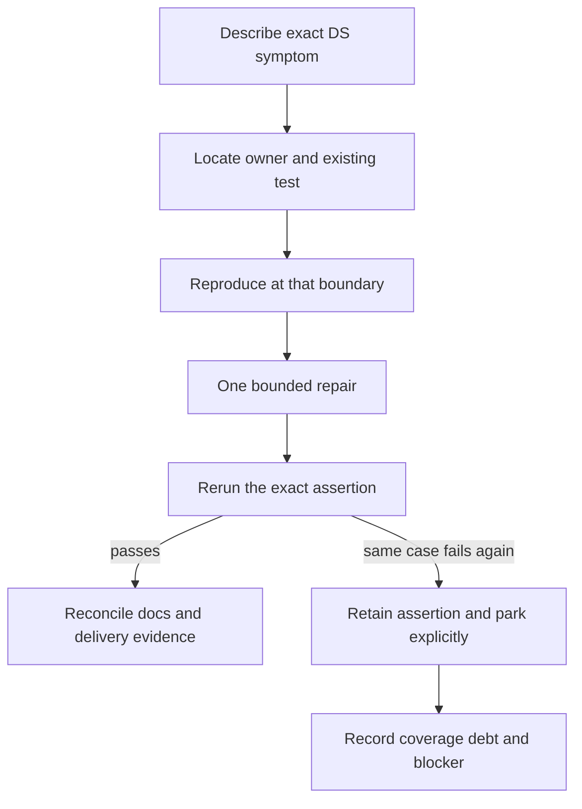

# 13 - The maintainer field guide

**Question:** where should a maintainer start when the DS is wrong?
**Outcome:** select a bounded investigation, preserve evidence and change
the component that owns the failure instead of hiding the symptom.

## Start with the visible contract

Record which cartridge or original fixture, which view, which input path
and which source revision produced the failure. State whether the result
was local, hosted CI or the actual deployed website. Do not start by
editing a timeout or downgrading resolution.



Figure ND13-01. The bounded recovery policy prevents an endless repair loop
and prevents green dashboards from silently erasing an unresolved assertion.

## A compact fault map

| Symptom | First owner to inspect | Evidence that matters |
|---|---|---|
| Upload remains in tools | `DsController.load` ordering | Playing view and advancing loading LCD before a held ROM read resolves |
| First startup fails | Adapter loader and launch callbacks | Visible CDN/error message, cancellation and retry |
| One screen duplicates the other | `dsScreenRegions`, `paintScreens` | Native dimensions and distinct actual upper/lower output |
| Quick tap disappears | `DsTouchQueue`, native frame polling | Native contact at the clicked pixel, not only a DOM event |
| Touch drifts after rotation | `touchAt`, camera/model transforms | Actual lower-LCD ray and native mark under the pointer |
| Direction releases too early | Adapter source sets | Mixed keyboard/pointer ownership and final release |
| Progress does not persist | `DsSaveStore`, `persist` | Completed transaction and matching runtime/ROM identity |
| Upright shell disappears | Scene lamp target and playing pose | Shell pixels under the actual lamp, with readable LCDs retained |
| A stylus stays held after leaving | Cleanup and availability guards | Release/cancel, hidden held clone and returned docked model |

These are starting points, not a promise that every symptom has one cause.
Inspect the actual source and existing assertions before changing ownership.

## Run the smallest relevant command

The application requires Node 22 or newer and its existing locked
dependencies. From the repository root:

```powershell
npm run build
npm run check
node --test tests\unit\ds-cartridge.test.mjs tests\unit\ds-controls.test.mjs tests\unit\ds-touch.test.mjs
```

Build creates the allowlisted static preview. Check performs the repository's
source checks. The selected unit files cover DS format/control/touch logic,
not native game compatibility. Restore dependencies only when missing or
after a dependency-manifest change.

The managed browser preview serves built `dist`; rebuild after source
changes. Use a unique existing test name instead of a Windows file path
interpreted as a regular expression. For example:

```powershell
npx playwright test --grep "DS upload leaves the sidebar"
```

This is a reproduction recipe, not a claim that this book-authoring task
reran application tests. Preserve the existing viewport, deadlines,
workers/retries and quality settings unless a separately justified change
requires them. A named skipped case is not newly passing because a grep
selects it.

## ND13-W01 - Change touch-edge rounding

First inspect `dsTouchFromUv` and its unit cases. Predict UV zero, UV one,
mid-screen and nonfinite/out-of-range behavior. Then inspect adapter
`dispatchTouch`: its combined-canvas pixel-center rule is a second
transformation, not a duplicate of the first.

Run focused unit cases, then the native pointer scenarios needed by the
change: quick tap, held pen, changed orientation, zoom and high-DPI touch.
Record any parked cases explicitly. A center-point screenshot alone cannot
qualify an edge-rounding change.

## Keep current guides current; keep editions historical

The player guide answers how to operate the current console. Architecture
describes current boundaries. Verification records identified observations.
The development ledger explains decisions and failed approaches. Numbered
workstreams describe a finite outcome, its evidence and actual remaining
work. This book explains the cutoff implementation in a coherent narrative.

When behavior changes, update the current guide and affected explanation,
then create a clearly identified new rendered edition when necessary.
Do not silently overwrite the original GBA book or re-label this edition's
historical source pin. Keep the root README short and visual, linking
readers to the detailed documentation.

## ND13-R01 - A documentation-only correction

If only a caption or prose claim changes, inspect its source and rerun
the documentation/book gates affected by the edit. Do not recapture every
GIF or run unrelated native suites merely to make the change look rigorous.
If the book builder changes, its own tests and actual rendered output are
relevant; parser success alone is not layout review.

## ND13-Q01 - When is the workstream complete?

## ND13-A01 - When the promised outcome has its own evidence

Implementation, targeted validation, documentation and owned continuity
must agree. Where publication is authorized, verify the exact remote
revision and artifact rather than assuming a push deployed it. Mirror
the actual workstream in its issue and Project item. Keep human acceptance,
remaining compatibility limits and parked tests explicit instead of using
one DONE label to imply all of them.

## Source trail

[Declared application commands](https://github.com/Zanark/BowserBoy/blob/61845372142b41992916f3732ea102cc0f4c8edf/package.json).
[DS browser assertions](https://github.com/Zanark/BowserBoy/blob/61845372142b41992916f3732ea102cc0f4c8edf/tests/browser/ds.spec.mjs).
[Touch queue unit evidence](https://github.com/Zanark/BowserBoy/blob/61845372142b41992916f3732ea102cc0f4c8edf/tests/unit/ds-touch.test.mjs).
[Bounded parked-case record](https://github.com/Zanark/BowserBoy/blob/61845372142b41992916f3732ea102cc0f4c8edf/TODO/105_PARKED_BROWSER_CASES.todo).
